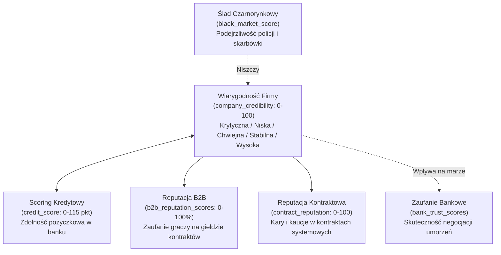
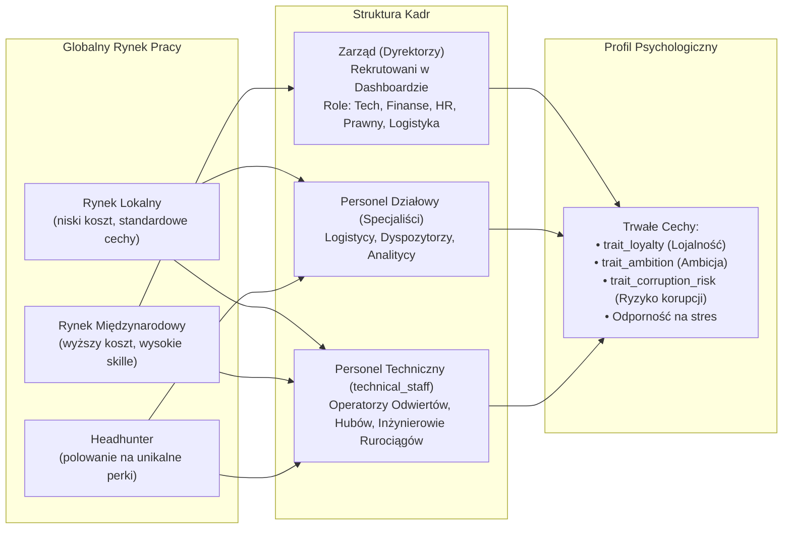
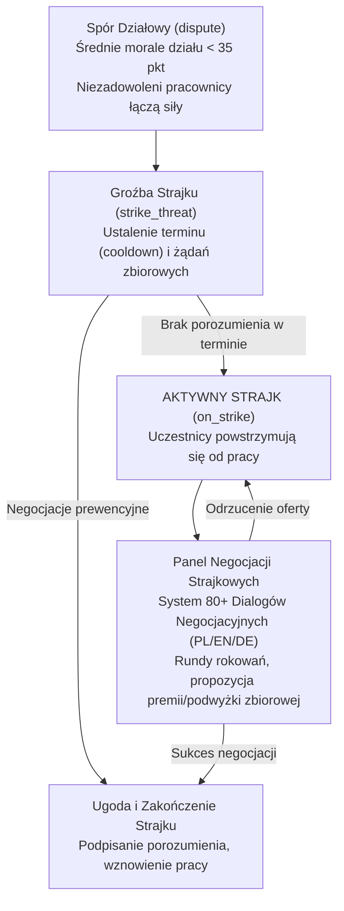
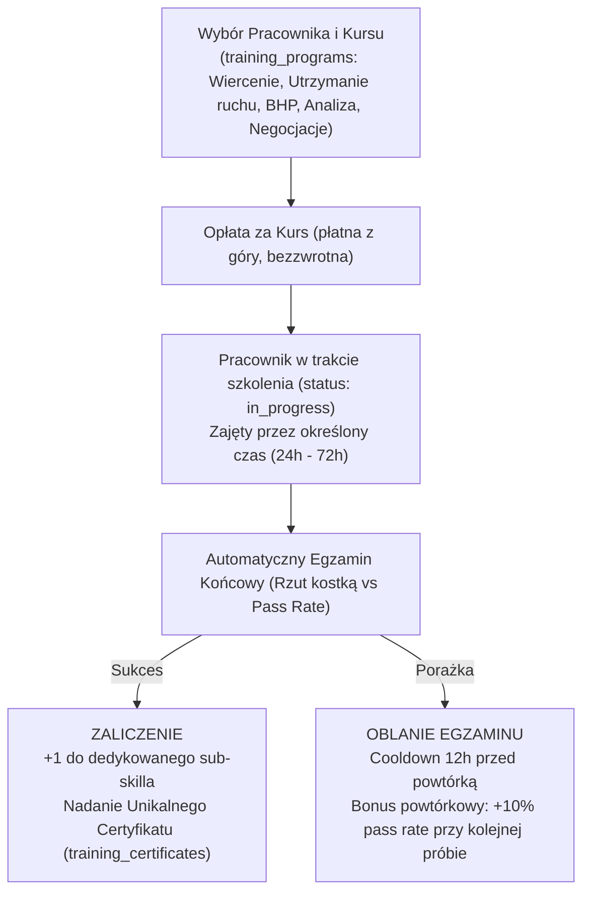
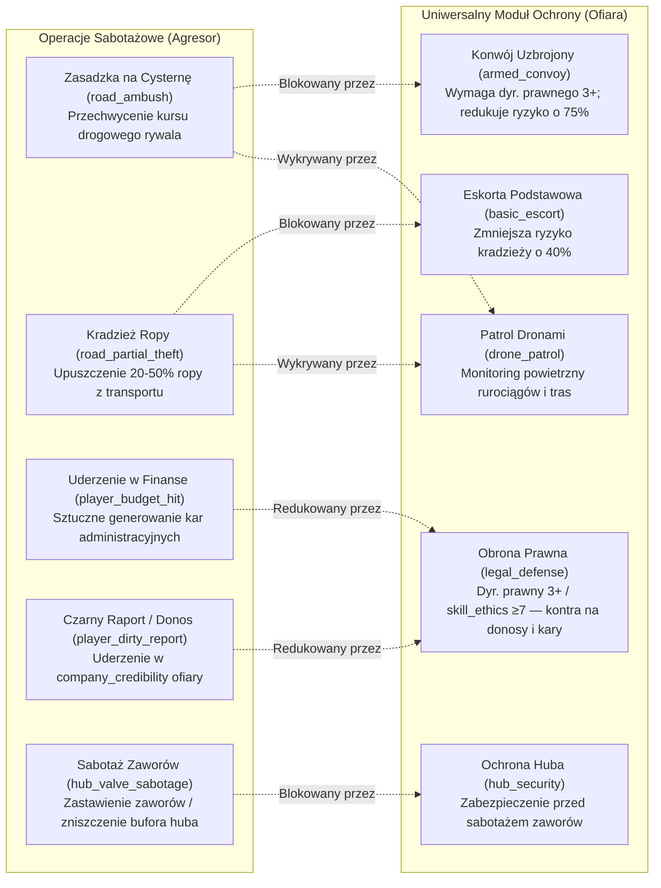
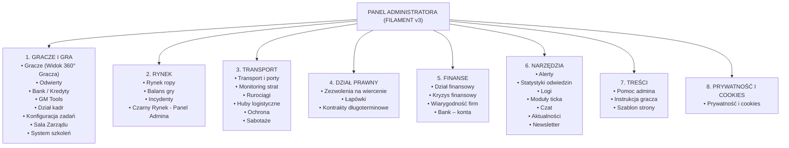
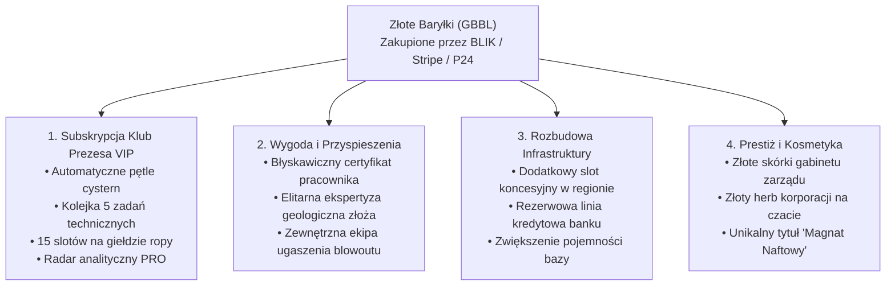

> **Archiwum.** Aktualna specyfikacja jest w `OILEMPIRE_ARCHITEKTURA_SYSTEMOWA.md`. Obowiązują Laravel 13 i Filament 5.

# OilEmpire: Kompletna Architektura Modularna (Laravel 11 + Inertia.js + Vue 3)

## 1. Wprowadzenie i Założenia Systemowe

Projekt stanowi kompleksową, nowoczesną implementację strategicznej gry korporacyjno-naftowej **OilEmpire (oilempire.pl)** w architekturze **Modular Monolith** z frontendem **SPA (Single Page Application)**:
- **Backend:** Laravel 11 (PHP 8.3+) z silnym typowaniem i architekturą zdarzeniową (Domain-Driven Events).
- **Frontend Gracza:** Vue 3 (Composition API, `<script setup>`) + Inertia.js + Tailwind CSS.
- **Panel Administracyjny & Mistrz Gry (GM Tools):** Filament v3 (w pełni modułowy — auto-discovery zasobów każdego modułu).
- **Czas Rzeczywisty (WebSockets):** Laravel Reverb (czat, notyfikacje dyrektora, odliczanie do ticka, live feed giełdowy).
- **Stylistyka:** *Dark Luxury* (`#08080f` głębokie tło, złoto `#c8a84b` / `#d8b95c`, akcenty amber/szmaragd, czcionki Montserrat, Syne i JetBrains Mono).
- **Świat Gry (Trwały Świat Ciągły — Persistent Universe / Zero Wipe):** Gra toczy się w jednym, trwałym, nieprzerwanym uniwersum 24/7. **NIE MA SEZONÓW I NIE MA RESETÓW ŚWIATA (BRAK WIPE'ÓW)**. Cały rozwój korporacji, majątek, odwierty, złoża, kadry i reputacja budowane są w sposób trwały. Pakiet startowy dla każdego nowego gracza: **2 000 000 PLN w gotówce** (portfel) + **2 000 000 PLN na koncie bankowym**, magazyn 20 000 bbl, wiarygodność 70 pkt. **Gra ma JEDNĄ walutę** — bez kursów wymiany i przewalutowań; localized jest wyłącznie jej wyświetlana nazwa: **PL → „PLN”, EN → „$”, DE → „€”** (ta sama liczba w każdym języku; szczegóły: §24).

### 1.1. Układ Interfejsu Gracza i Nawigacji (Wzorzec Wizualny OILEMPIRE)

Interfejs gracza opiera się na ściśle zorganizowanej, dwupoziomowej belce nawigacyjnej oraz modularnym pulpicie dowodzenia (Strona Główna):

```
┌────────────────────────────────────────────────────────────────────────────────────────────────────────┐
│ OILEMPIRE  STRATEGICZNA GRA NAFTOWA                       [Avatar] Admin (Awarie: 3)  [PL]  [WYLOGUJ]  │
├────────────────────────────────────────────────────────────────────────────────────────────────────────┤
│ [PULPIT]   [OPERACJE ▾]   [BIZNES ▾]   [FIRMA ▾]                              [? POMOC]    [💬 CZAT]   │
├────────────────────────────────────────────────────────────────────────────────────────────────────────┤
│ (Sub-belka aktywnej kategorii, np. OPERACJE):                                                          │
│ OPERACJE:  [🗺️ Mapa]   [🔧 Technika]   [🚚 Logistyka]                                                 │
│ (lub BIZNES):                                                                                          │
│ BIZNES:    [📊 Rynek]  [🏦 Bank]       [📈 Finanse]    [📜 Kontrakty]                                  │
│ (lub FIRMA):                                                                                           │
│ FIRMA:     [💼 Dyrektor] [👥 Kadry]    [⚖️ Dział prawny]                                               │
├────────────────────────────────────────────────────────────────────────────────────────────────────────┤
│ CENTRUM DOWODZENIA -> Strona główna                                                                    │
│                                                                                                        │
│ [ GOTÓWKA ]       [ SALDO KONTA ]    [ MAGAZYN ]        [ CENA ROPY ]       [ STATUS FIRMY ]           │
│ 100 172 456 PLN   0,00 PLN           18 400 / 20 000 bbl  250,00 PLN/bbl    Awarie odwiertów: 3        │
│                                                                                                        │
│ ┌─ SYGNAŁ Z RYNKU: KRYZYS EKONOMICZNY! ──────────────────────────────┐ ┌─ POZOSTAŁO ─────────────────┐ │
│ │ Ceny ropy spadają o 70%! Globalny wstrząs popytowy.                │ │ ⏳ 08:12 (przez 8h 12m)      │ │
│ └────────────────────────────────────────────────────────────────────┘ └──────────────────────────────┘ │
│                                                                                                        │
│ ┌─ ⚠️ 3 ODWIERTY WYMAGAJĄ UWAGI ─────────────────────────────────────────────────── [ PRZEJDŹ -> ] ─┐ │
│ │ • ME-1: Stan 0% (Awaria głowicy)   • ME-2: Stan 0% (Wstrzymane zasilanie)                           │ │
│ └────────────────────────────────────────────────────────────────────────────────────────────────────┘ │
│                                                                                                        │
│ STATYSTYKI FIRMY -> Wyniki operacyjne             [Zakres: 7 dni | (30 dni) | Rok]                     │
│ [Przegląd]  [Odwierty]  [Logistyka]  [Finanse]                                                         │
│ • Produkcja: 333 bbl/h (+44.1%)    • Przychód: 83 250 PLN/h (-22.7%)    • Aktywne odwierty: 1 / 3       │
└────────────────────────────────────────────────────────────────────────────────────────────────────────┘
```

1. **Górna Belka Brandingu:**
   - Logotyp: `OILEMPIRE` (złoty szeryfowy / syne font z metalicznym połyskiem) + podtytuł `STRATEGICZNA GRA NAFTOWA`.
   - Profil użytkownika: Awatar, Nick (`Admin`), licznik pilnych alertów (`Awarie odwiertów: 3`), selektor języka (`PL`/`EN`/`DE`) oraz przycisk `WYLOGUJ`.
2. **Główny Pasek Modułów (Header Level 1):**
   - **`PULPIT`** (`/dashboard` / `/pulpit`) — Centrum dowodzenia, wskaźniki KPI, alerty awarii, podsumowanie operacyjne.
   - **`OPERACJE`** — menu rozwijane: `Mapa` (`/map`), `Technika` (`/technical`), `Logistyka` (`/logistics`).
   - **`BIZNES`** — menu rozwijane: `Rynek` (`/market`), `Bank` (`/bank`), `Finanse` (`/finance`), `Kontrakty` (`/contracts`).
   - **`FIRMA`** — menu rozwijane: `Dyrektor` (`/boardroom`), `Kadry` (`/hr`), `Dział prawny` (`/legal`).
   - **Narzędzia boczne:** `POMOC` (`/help`) oraz `CZAT` (wysuwany drawer WebSockets).
3. **Pasek Podkategorii (Header Level 2):**
   - Pojawia się kontekstowo pod głównym paskiem dla aktywnej grupy (Operacje, Biznes lub Firma) z eleganckim podświetleniem aktywnej podstrony.
4. **Pulpit Główny (Dashboard Widgets)** *(wartości w mockupie są poglądowe — przykładowa dojrzała korporacja po długiej rozgrywce)*:
   - **Karty KPI:** Gotówka (PLN), Saldo bankowe (PLN), Magazyn (zajętość i pasek pojemności w bbl), Aktualna cena baryłki ropy (w walucie locale — PLN/$/€, §24.1), Status firmy (liczba awarii i wiek korporacji w dniach).
   - **Baner Wydarzeń Globalnych (Market Shocks):** Czerwona ramka informacyjna z odliczaniem czasu (`POZOSTAŁO hh:mm:ss`), informująca o wstrząsach cenowych, embargach i kryzysach.
   - **Baner Awaryjny:** Ostrzeżenie o uszkodzonych odwiertach z bezpośrednim przyciskiem `PRZEJDŹ ->` do Działu Technicznego.
   - **Statystyki Operacyjne:** Tabele i wykresy z filtrami czasu (7 dni / 30 dni / rok) oraz podziałem na Przegląd, Odwierty, Logistykę i Finanse.

---

## 2. Wielowymiarowy System Reputacji i Wiarygodności

W grze funkcjonuje 6 niezależnych, ale wpływających na siebie wskaźników reputacji i zaufania:



1. **Wiarygodność Firmy (`company_credibility`, 0–100):**
   - Poziomy: *Krytyczna (0–19)*, *Niska (20–39)*, *Chwiejna (40–59)*, *Stabilna (60–79)*, *Wysoka (80–100)*.
   - Każda zmiana jest audytowana w `company_credibility_log` z dokładną deltą, stanem przed/po i powodem.
   - **Spadek wiarygodności:** wykrycie czarnego rynku (-12), wejście komornika (-20), bankructwo (-25), złamanie planu naprawczego (-10), katastrofa ekologiczna (-15), wpadka przy łapówce (-18).
   - **Wzrost wiarygodności:** terminowa spłata raty (+2), spłata kredytu (+8), przedterminowa spłata (+6), 7 dni czystej działalności bez incydentów (+3).
2. **Reputacja B2B (`b2b_reputation_scores`) & Kontraktowa (`contract_reputation`):**
   - Realizacja dostaw na czas podnosi reputację; zerwanie umowy, porzucenie kontraktu lub brak dostawy skutkuje potrąceniem kaucji (`security_deposit`) i spadkiem reputacji, co blokuje dostęp do lukratywnych kontraktów rafinerii.
   - **Zasada propagacji (ogólna):** każda zmiana `company_credibility` o Δ przenosi **50% Δ** na `b2b_reputation_scores` (w obie strony, clamp 0–100) — dotyczy WSZYSTKICH zdarzeń (bankructwo, katastrofa, czarny rynek, sabotaż), spójne z §21. `contract_reputation` zmienia się wyłącznie przez zdarzenia kontraktowe (§13) i nie dziedziczy propagacji.
3. **Ślad Czarnorynkowy (`black_market_score`, 0–100):**
   - Wzrost: **+2 pkt** za każdą transakcję czarnorynkową. **Decay: −1 pkt/24h** od ostatniej transakcji (liniowy, do zera; faza 8 ticka §23.2).
   - Ryzyko kontroli skarbowej: przy `score > 30` szansa na godzinę = `(score − 30) × 0,02%`. Skutek kontroli: blokada 50% `PLN_BANK` na 24–72h, grzywna 10% niezadeklarowanych przychodów gotówkowych, `company_credibility` −12, wpis do `company_credibility_log`.
   - Gotówka czarnorynkowa trafia do `PLN_CASH` i **podlega egzekucji komorniczej** (§17.2 Faza 1) — nie jest schronem majątkowym.

---

## 3. Dział Kadr (HR), Rekrutacja ze Świata i Cechy Pracowników

Kadry w OilEmpire to krwiobieg przedsiębiorstwa. Pracownicy nie są bezdusznymi liczbami — posiadają psychologię, cechy charakteru, ambicje i oczekiwania płacowe.



### 3.1. Rekrutacja z Różnych Zakątków Świata:
- **Regiony rekrutacyjne:** Europa, Ameryka Północna, Azja-Pacyfik, Bliski Wschód, Afryka, Ameryka Południowa.
- Każdy rynek posiada inne modyfikatory:
  - *Rynek Lokalny:* czas rekrutacji 2–4 minuty, niskie oczekiwania płacowe, bazowe skille.
  - *Rynek Międzynarodowy:* czas rekrutacji 3–5 minut, wyższa prowizja wstępna, szansa na kandydatów z wysokimi skillami i certyfikatami.
  - *Headhunter:* płatna usługa wyszukiwania ekspertów o rzadkich specjalizacjach (np. `hub_operator`, `pipeline_engineer`, `salary_negotiator`, `oil_flow_analyst`).
- **Równoległe procesy:** gracz może prowadzić jednocześnie maksymalnie 2 procesy rekrutacyjne.

### 3.2. Cechy Osobowościowe Pracowników:
- `trait_loyalty` (Lojalność 1–10): decyduje o tempie spadku morale i odporności na agitację strajkową.
- `trait_ambition` (Ambicja 1–10): ambitni pracownicy szybciej rozwijają skille, ale częściej domagają się podwyżek i awansów.
- `trait_corruption_risk` (Ryzyko korupcji 1–10): podatność pracownika na przekupstwo w sabotażach wrogich korporacji.
- `skill_stress` (Odporność na stres): kluczowa podczas katastrof, pożarów i przeciążeń hubów.

---

## 4. Morale, Zadowolenie Płacowe, Żądania Podwyżek i Negocjacje

Stan emocjonalny pracowników bezpośrednio przekłada się na wyniki finansowe i operacyjne firmy:

### 4.1. Formuła Zadowolenia Płacowego i Morale:
$$\text{salary\_satisfaction} = \operatorname{clamp}\Bigl(0,\ 120,\ \frac{\text{current\_salary}}{\max(\text{expected\_salary},\ \text{min\_market\_salary})} \times 100\Bigr)$$

(`min_market_salary` per stanowisko w `game_balance` — chroni przed dzieleniem przez zero i sztucznym zaniżaniem oczekiwań; wynik zawsze w zakresie 0–120.)
- **Co obniża morale:** pensja poniżej oczekiwanej (`salary_satisfaction < 80`), przeciążenie obiektów (huby na trybie turbo), brak podwyżki od dłuższego czasu, odrzucenie żądania płacowego, zwolnienia kolegów z działu, cięcia budżetowe.
- **Co podnosi morale:** terminowe podwyżki, premie uznaniowe (`hr_bonus`), szkolenia i certyfikaty, udane mediacje dyrektora HR, praca w bezpiecznych warunkach.

### 4.2. Proces Żądania Podwyżki (`employee_raise_requests`):
Gdy `salary_satisfaction` spada **poniżej 60 pkt**, pracownik generuje żądanie podwyżki — max **jedno otwarte żądanie na pracownika** (duplikaty blokowane w fazie 6 ticka). Termin decyzji: **72h**; odroczenie możliwe **RAZ** (+48h, po czym konflikt eskaluje automatycznie). Szansa ugody w kontrofercie:

`szansa_ugody = clamp(5%, 95%, 40% + 5% × skill_negotiation dyr. HR + 15% [obecny salary_negotiator] + 2% × trait_loyalty − 2% × trait_ambition)`

Gracz ma 5 dróg wyboru:
1. **Pełna akceptacja żądania:** pensja rośnie do wnioskowanej kwoty; morale +20 pkt, lojalność +5 pkt, ryzyko odejścia spada do zera.
2. **Propozycja mniejszej podwyżki (Kontroferta):**
   - Uruchamia probabilistyczny silnik negocjacji.
   - Szansa na ugodę zależy od: poziomu negocjacji dyrektora HR, obecności specjalisty `salary_negotiator`, lojalności i ambicji pracownika.
   - Sukces: częściowa podwyżka, morale +8 pkt. Porażka: pracownik czuje się zlekceważony, spór eskaluje.
3. **Odmowa:** natychmiastowy spadek morale o 20 pkt, skok ryzyka odejścia, wzrost poparcia dla strajku.
4. **Odroczenie decyzji:** pracownik czeka do kolejnego terminu (deadline); po przekroczeniu terminu konflikt eskaluje automatycznie.
5. **Zwolnienie pracownika:** natychmiastowe rozwiązanie umowy, ale rodzi niepokój i spadek morale u pozostałych pracowników działu.

---

## 5. Konflikty Działowe, Strajki i Baza Dialogów Negocjacyjnych

Strajk nie spada jak grom z jasnego nieba — jest wynikiem ignorowania narastającego napięcia:

```
normalny stan ➔ niezadowolenie ➔ żądanie podwyżki ➔ spór działowy ➔ groźba strajku ➔ AKTYWNY STRAJK
```

**Populacja średniej morale:** do progu `< 35 pkt` wliczają się wyłącznie aktywni pracownicy przypisani do działu (bez zarządu, `in_training`, `unassigned` i już strajkujących); dział bez pracowników nie generuje sporu. Zwolniony niezadowolony pracownik pozostaje w średniej do końca okresu wypowiedzenia (24h), a zespół otrzymuje karę −10 morale (§4.2 pkt 5) — zwalnianie NIE gasi sporu natychmiast.



### 5.1. Porażające Skutki Strajku per Dział:
- **Strajk Logistyki:** przepustowość hubów spada proporcjonalnie do udziału strajkujących: **spadek = 30% + 50% × udział_strajkujących** (stąd zakres 30–80%), koszty cystern rosną o 20%, czas reakcji na awarie wzrasta o 25%. Przy udziale **> 60%** działu trasa główna (odwierty → magazyn) zostaje WSTRZYMANA — ropa nie płynie do magazynu głównego.
- **Strajk Techniczny:** własne ekipy TTS PRZESTAJĄ pracować (kolejka zamrożona, nowe zadania nie startują). Naprawy przejmuje wyłącznie firma zewnętrzna: koszt ×2.5 i czas ×1.4 (+40%) (§21); degradacja sprzętu przyspiesza ×1.5, a ryzyko wybuchu (blowout) rośnie dwukrotnie (`strike_multiplier` §17.4).
- **Strajk Finansów:** paraliż księgowości, brak możliwości składania wniosków kredytowych i audytów, ryzyko opóźnienia przelewów.
- **Strajk Kadr (HR):** zamrożenie rekrutacji, lawinowy spadek morale w całej korporacji (−1 pkt/24h na pracownika poza działem HR). **Rozwiązanie patu mediacyjnego:** negocjacje strajku HR prowadzi Zewnętrzny Mediator Rządowy (50 000 PLN, mechanika §19.2) LUB Dyrektor Prawny z `skill_negotiation ≥ 3` (z karą −10% do szansy ugody za brak kadry HR).
- **Strajk Działu Prawnego:** zawieszenie procedowania pozwoleń na budowę rurociągów i wierceń, brak ochrony przed komornikiem.

### 5.2. Panel Negocjacji Strajkowych i Baza 80+ Dialogów:
- Gracz siada do stołu negocjacyjnego z komitetem strajkowym.
- System losuje warianty rozmów z obszernej bazy szablonów dialogowych (`employee_dialogue_templates`; każdy szablon w 3 wersjach językowych PL/EN/DE z fallbackiem do PL):
  - Argumenty ekonomiczne („Koszty życia wzrosły”, „Konkurencja płaci 25% więcej”).
  - Argumenty bezpieczeństwa („Sprzęt na hubie zagraża życiu”, „Nie będziemy pracować przy wyciekach”).
- Wynik rundy zależy od wysokości zaoferowanej kwoty, talentu dyrektora HR i zaufania komitetu strajkowego.

---

## 6. System Szkoleń, Sub-Skilli i Certyfikatów

Wyszkolony personel to mniejsze straty, szybsza produkcja i odporność na awarie:



**Reguły przydziału i parametry (doprecyzowanie):**
- **Wyłączny przydział:** pracownik `in_training` nie może być obsadą odwiertu/hubu ani wykonawcą zadania TTS; pracownik przypisany do TTS nie podejmuje drugiego zadania (spójne z kolejką VIP §22.6 i obsadą §9.1).
- **Zwolnienie w trakcie kursu:** opłata przepada, certyfikat nie zostaje nadany. Strajk w trakcie kursu: szkolenie biegnie dalej (wykładowca zewnętrzny — spójne z §21).
- **Egzamin:** bazowy `pass_rate` per kurs w `game_balance` (domyślnie 70%); bonus powtórkowy **+10 p.p., maksymalnie +30 p.p.** (3 oblania); po trzecim oblaniu kurs dostępny ponownie po 7 dniach.
- **Sub-skille:** cap **10**; kursy mają poziomy **I–III**, certyfikat unikalny per poziom (`training_certificates` UNIQUE(`employee_id`,`course_id`,`level`)); koszty kursów: tabela `game_balance` (domyślnie 10 000–100 000 PLN).

### 6.1. Cztery Nowe Sub-Skille Techniczne (`technical_staff_skills`):
1. `skill_drilling` (Wiercenie): skraca czas operacji wiertniczych, redukuje ryzyko uszkodzenia głowic przy głębokich warstwach.
2. `skill_maintenance` (Utrzymanie ruchu): zmniejsza tempo zużycia (wear rate) odwiertów i rurociągów, skraca czas napraw.
3. `skill_safety` (BHP i Bezpieczeństwo): radykalnie redukuje prawdopodobieństwo wybuchu i wycieków powierzchniowych.
4. `skill_analysis` (Analiza geologiczna): zwiększa precyzję eksploatacji złoża, zmniejszając straty ropy.

### 6.2. Skille Zarządu:
- `skill_organization` (Zarządzanie), `skill_negotiation` (Zniżki na kontraktach, lepsze warunki w banku), `skill_analysis` (Precyzja raportów finansowych), `skill_stress` (Odporność firmy na kryzysy), `skill_ethics` (Ochrona wiarygodności korporacji).

---

## 7. Wojna Korporacyjna i Sabotaże Między Graczami (PvP)

Gra naftowa to bezwzględna walka o dominację rynkową. Moduł sabotażu (`/sabotage`) pozwala na tajne operacje wymierzone w rywali:



- **Warunki wykonania sabotażu:** dostępny przez Dział Prawny i Czarny Rynek, wymaga opłaty w gotówce, posiada czas odnowienia (cooldown).
- **Ryzyko wpadki:** w razie niepowodzenia agresor zostaje zdemaskowany, co skutkuje potężną karą do `company_credibility`, procesem sądowym i alertem u ofiary.
- **Uniwersalny Moduł Ochrony (`ProtectionService`):** gracz może wykupić ochronę na konkretne aktywa (odwierty, cysterny, huby, rurociągi). Działanie logiczne: `basic_escort`/`armed_convoy` chronią kursy drogowe (ambush/theft), `drone_patrol` wykrywa operacje fizyczne na trasach i rurociągach (+15 p.p. do ryzyka wpadki agresora), `hub_security` chroni huby i zawory (`hub_valve_sabotage`), a `legal_defense` (Dyrektor Prawny ≥3 LUB `skill_ethics ≥ 7`) redukuje skutki `player_budget_hit` i `player_dirty_report` o 50%.

### 7.1. Tabela Parametryczna Sabotaży (config `game_balance`)

| Operacja | Koszt (PLN) | Cooldown agresora | Cooldown na parę A→B | Limit szkody | Bazowe ryzyko wpadki |
|---|---|---|---|---|---|
| `road_ambush` | 25 000 | 6h | 24h | przejęcie max 30% ładunku kursu | 15% − ochrona kursu |
| `road_partial_theft` | 15 000 | 6h | 24h | kradzież 20–50% ładunku (losowo) | 20% − ochrona kursu |
| `hub_valve_sabotage` | 40 000 | 12h | 48h | max 2 000 bbl z bufora + `wear` +15 | 25% − `hub_security` |
| `player_budget_hit` | 60 000 | 24h | 72h | **min(50 000 PLN, 2% majątku netto ofiary)** | 30% − `legal_defense` |
| `player_dirty_report` | 35 000 | 48h | 96h | **−4 do −8 `company_credibility`** (losowo; −50% przy `legal_defense`) | 20% − `legal_defense` |

- **Limity ofiary (anty-griefing zero-wipe):** max **5 udanych sabotaży łącznie** na jedną firmę w oknie 7 dni — kolejne operacje przeciw tej ofierze są automatycznie odrzucane z pełnym zwrotem kosztu. Równoczesne operacje wielu agresorów rozstrzygane w fazie 8 ticka (§23.2) w kolejności zgłoszeń.
- **Wpadka (nieudany sabotaż):** agresor zdemaskowany — `company_credibility` **−15**, kara sądowa **100 000 PLN** (→ `SYS_TREASURY`), alert u ofiary z dowodami, trwały wpis w Centrum Nadzoru Sabotaży (§18.1).
- **Zmiana stanu celu przed wykonaniem:** cel wszedł pod Tarczę Startową/urlop → operacja `cancelled`, zwrot 100% kosztu; cel sprzedał lub utracił atakowane aktywo → `cancelled`, zwrot 50%. Żadna opłacona operacja nie uderza w cel chroniony.

---

## 8. Modułowa Architektura w Laravel 11 i Integracja z Filament v3

Każda domena biznesowa tworzy w pełni samodzielny moduł (`modules/`):

```
modules/
├── Core/               # Użytkownicy, Finanse FTS, Portfel, Czat Reverb, Layouty
├── Extraction/         # Odwierty, Warstwy geologiczne, Tiers sprzętu, Degradacja
├── Logistics/          # Huby pośrednie, Rurociągi inbound/outbound, Cysterny, Porty
├── Incidents/          # Awarie micro..major, Katastrofy, Spirala ryzyka, Naprawy TTS
├── Market/             # Giełda spot, Kontrakty terminowe, B2B Escrow, Czarny rynek
├── Banking/            # Rachunki, Kredyty, Komornik, Bankructwo, Restrukturyzacja
├── Staff/              # Kadry, Zarząd, Morale, Płace, Strajki, Negocjacje, Szkolenia
├── Legal/              # Zezwolenia Poziom 1 i 2, Sabotaże, Ochrona, Łapówki
├── Cms/                # Static pages (/p/{slug}), nawigacja dynamiczna, branding (§15, §18.2)
├── Privacy/            # Zgody cookies, polityki, prawa RODO, retencja (§16)
└── Admin/              # Panele Filament v3, Game Master Tools, Monitoring ticka, GM Action Log
```

### 8.1. Integracja Panelu Filament v3 (Dla Admina i GM):
Wszystkie moduły automatycznie rejestrują swoje zasoby w Filament v3:
- **Zarządzanie Kadrami:** podgląd każdego pracownika w grze, edycja cech, wymuszanie zakończenia strajku, monitoring zadowolenia płacowego.
- **Konfigurator Rynków Pracy:** edycja widełek płacowych, kosztów rekrutacji międzynarodowej i parametrów headhuntera.
- **Zarządzanie Szkoleniami:** dodawanie nowych kursów, edycja zdawalności (pass rate), podgląd wydanych certyfikatów.
- **Centrum Nadzoru Sabotaży:** monitoring wojen korporacyjnych między graczami, wykrywanie multikont i nadużyć.
- **Zarządzanie Logistyką & Hubami:** podgląd buforów pośrednich, symulacja przeciążeń i wycieków.
- **Narzędzia Mistrza Gry (GM Tools):** ręczne wywoływanie kryzysów rynkowych, katastrof przemysłowych, audyt i korekty sald FTS.

### 8.2. Mapa Moduł ↔ Trasy ↔ Filament ↔ Kluczowe Tabele

| Moduł | Trasy gracza | Filament (grupa) | Kluczowe tabele |
|---|---|---|---|
| Core | `/dashboard`, `/profile`, `/help`, czat | Gracze, Logi, Alerty, Czat | `users`, `sessions`, `trusted_devices`, `financial_transaction_service` |
| Extraction | `/map` | Odwierty | `wells`, `well_buffers`, `strata`, `licenses` |
| Logistics | `/logistics` | Transport i porty, Huby, Rurociągi, Monitoring strat | `hubs`, `pipelines`, `trucks`, `transport_runs` |
| Incidents | (w `/technical`, `/map`) | Incydenty | `incidents`, `incident_repairs` |
| Market | `/market` | Rynek ropy, Czarny Rynek, Balans gry | `market_offers`, `price_history`, `black_market_trades` |
| Banking | `/bank` | Bank/Kredyty, Bank – konta, Kryzys finansowy, Wiarygodność | `loans`, `bailiff_proceedings`, `company_credibility_log` |
| Staff | `/hr`, `/boardroom` | Dział kadr, Sala Zarządu, System szkoleń | `employees`, `employee_raise_requests`, `strikes`, `training_programs`, `training_certificates`, `employee_dialogue_templates` |
| Legal | `/legal`, `/sabotage` | Zezwolenia, Łapówki, Sabotaże, Ochrona | `permits`, `sabotage_operations`, `protections` |
| Contracts (Market/B2B) | `/contracts` | Kontrakty długoterminowe | `system_contracts`, `b2b_offers`, `b2b_escrow_lock` |
| Finance | `/finance` | Dział finansowy | `player_finance_decisions`, `department_budgets` |
| Monetization | `/shop` | FINANSE & SKLEP (§22.4) | `payment_orders`, `payment_transactions`, `gbbl_ledger`, `promo_codes` |
| Cms | `/p/{slug}` | TREŚCI, Nawigacja (§18.2) | `static_pages`, `navigation_items`, `site_settings` |
| Privacy | stopka, `/profile/privacy` | PRYWATNOŚĆ I COOKIES | `cookie_consents_log`, `privacy_policies` |
| Simulation | — | Moduły sweepa/sweepera | `simulation_sweeps`, `game_balance`, `world_events` |
| Admin | — | cały panel | `gm_action_log` |

---

---

## 9. Wydobycie (Extraction) — Odwierty, Geologia i Degradacja

Moduł `Extraction` opisuje pełny cykl życia odwiertu: koncesję, badania geologiczne, wiercenie, eksploatację, zużycie i wyczerpanie złoża.

### 9.1. Model Odwiertu (`wells`)
- **Tożsamość i lokalizacja:** kod (np. `E-1`, `ME-2`), region, współrzędne na mapie, powiązana koncesja Poziomu 1 (moduł Legal).
- **Warstwa geologiczna (`stratum`):** `shallow` / `mid` / `deep` / `offshore` — determinuje bazową wydajność, koszt wiercenia i profil ryzyka awarii (§17.4).
- **Zasobność złoża:** `initial_reserves_bbl`, `extracted_bbl`, `remaining_bbl` — zasób skończony i nieodnawialny (zero-wipe; krzywa wyczerpania §9.2).
- **Stan i zużycie:** `condition` (0–100%), `wear_level` (0–100%), tier wyposażenia (`black_market` / `standard` / `premium`), poziom upgrade'u 0–3.
- **Status pracy:** `drilling`, **`awaiting_connection`** (wywiercony, czeka na podłączenie rurociągu dopływowego — produkcja 0, §9.4), `active`, `paused_staff` (brak obsady), `paused_storage` (pełny bufor/magazyn), `broken` (awaria), `seized` (egzekucja §17.2), `depleted` (złoże wyczerpane).
- **Obsada wymagana:** 1 operator odwiertu + współdzielony technik (max 3 odwierty na technika) — brak obsady = `paused_staff` (bez degradacji przyspieszonej, bez produkcji).
- **Bufor przyodwiertowy (`well_buffer_bbl`):** pojemność zależna od tieru: 500 / 2 000 / 5 000 bbl; produkcja trafia najpierw do bufora, dalej transport (cysterny/rurociąg, moduł Logistics) → magazyn główny. Bufor pełny i brak odbioru = `paused_storage` (ropa nie wycieka — §19.2).

### 9.2. Produkcja i Krzywa Wyczerpania
Naliczanie w fazie 1 ticka (§23.2), metodą delta-time:

`production_bbl = base_rate(stratum) × (condition/100) × depletion_factor × (1 + 0.05 × upgrade_level) × budget_tech_factor × skill_analysis_factor`

- **`depletion_factor` (doprecyzowanie §19.1):** do wydobycia 70% zasobu = 1.0; powyżej 70% spada **liniowo o 1,5 punktu procentowego bazowej wydajności za każde kolejne 10 000 bbl** (bez kapitalizacji), aż do podłogi 0.10; `remaining_bbl = 0` → status `depleted`.
- **`budget_tech_factor`:** low 0.85 / standard 1.0 / high 1.10 (§10).
- **`skill_analysis_factor`:** `1 + 0.02 × skill_analysis` operatora.

### 9.3. Zużycie i Degradacja (wear)
`wear_gain_per_h = base_wear(stratum, tier) × budget_tech_wear_multiplier × (1 − 0.04 × skill_maintenance) × turbo_multiplier`

- `budget_tech_wear_multiplier`: low 1.6 / standard 1.0 / high 0.75; `turbo_multiplier` 1.5 (przeciążenie huba/odwiertu).
- `condition` spada proporcjonalnie do przyrostu `wear_level`; przy `condition < 20%` rośnie bazowe ryzyko awarii (§17.4); `condition = 0%` → `broken` (naprawa wyłącznie TTS §11 lub firma zewnętrzna 2,5× kosztu).

### 9.4. Wiercenie Nowego Odwiertu (lejek)
1. **Koncesja Poziomu 1** na region (Legal) → 2. **Badanie geologiczne** (48h; skrót 20 GBBL §22.3; precyzja wyniku zależna od `skill_analysis` geologa) → 3. **Wiercenie** (czas bazowy per stratum × (1 − 0.05 × skill_drilling); koszt wg tabeli 9.5) → 4. **Odbiór techniczny** — odwiert w stanie `awaiting_connection` → 5. **Zakup i montaż rurociągu dopływowego** (nowy / używany / z czarnego rynku — §11A.3) → 6. **Uruchomienie**: status `active`.
- **Zasada nadrzędna: odwiert NIE produkuje bez podłączonego rurociągu dopływowego.** Transport cysternowy (odcinek 1) jest dostępny dopiero dla odwiertu URUCHOMIONEGO — jako uzupełnienie przepustowości i trasa zastępcza przy awarii rury (`auto_road_fallback`, §11A.3).
- Odwiert morski: uruchomienie wymaga połączenia morskiego — rurociągu podmorskiego (rodzaj 4, §11A.3) LUB umowy tankowcowej z portem (bufor morski §11A.5).
- Porażka/niższa precyzja badania = ryzyko „suchego odwiertu" (zasobność zaniżona względem prognozy). Tier wyposażenia wybierany przy wierceniu; późniejsza zmiana = płatny upgrade (0→3).

### 9.5. Tabela Parametrów Domyślnych (config `game_balance`, edytowalna w Filament → „Balans gry")
| Parametr | shallow | mid | deep | offshore |
|---|---|---|---|---|
| `base_rate` (bbl/h) | 40 | 70 | 110 | 160 |
| Koszt wiercenia (PLN) | 800 000 | 2 000 000 | 5 000 000 | 12 000 000 |
| Czas wiercenia (h) | 6 | 12 | 24 | 48 |
| `base_wear` (%/h) | 0,05 | 0,08 | 0,12 | 0,18 |
| OPEX wydobycia (PLN/bbl) | 30 | 45 | 70 | 110 |
| Bazowe ryzyko awarii/tick | 0,2% | 0,4% | 0,7% | 1,2% |

Wartości startowe do kalibracji headless symulatorem (§23.7) — nie docelowe „na sztywno". Każda zmiana w panelu podlega wersjonowaniu i audytowi (Etap 3, P2-8).

---

## 10. Dział Finansowy (`/finance`) — Płynność, Budżety i Ryzyko

Rozdział uprawnień: **podgląd** danych finansowych ma każdy gracz zawsze; **podpisywanie kontraktów, wnioski kredytowe i ustawianie budżetów działowych** wymagają obsadzonego Dyrektora Finansowego (`BoardAccess::require('finance')`). **Tryb awaryjny (wakat dyrektora):** gracz zachowuje sprzedaż spot (limit 20 000 PLN/h), spłatę zobowiązań, wypłatę pensji i aktywację mediatora (§19.2) — firma nie jest zakładnikiem nieobsadzonego fotela; operacje awaryjne logowane w `player_finance_decisions` z flagą `emergency`. Centrala zarządzania kapitałem i płynnością korporacji podzielona na 5 zakładek:

1. **Przegląd Finansowy (Overview):**
   - KPI w czasie rzeczywistym: przychody brutto, koszty wydobycia OPEX, koszty transportu (cysterny i rurociągi), opłaty hubowe, podatki regionalne, zysk netto.
   - Wykresy przepływów pieniężnych (Cash Flow) dla ostatnich 24 godzin i 7 dni.
2. **Budżety Działowe (Department Budgets):**
   - Gracz konfiguruje poziom finansowania dla 4 kluczowych obszarów:
     - **Dział Techniczny (`low`, `standard`, `high`):** obniżenie tnie koszty, ale drastycznie przyspiesza zużycie sprzętu i podnosi awaryjność; podwyższenie wydłuża żywotność odwiertów.
     - **Logistyka (`low`, `standard`, `high`):** steruje wydatkami na serwis hubów i floty; poziom niski generuje wycieki i opóźnienia transportu.
     - **Kadry (HR) (`low`, `standard`, `high`):** wpływa na tempo rekrutacji i zadowolenie pracowników; cięcia natychmiast obniżają morale i prowokują strajki.
     - **Bezpieczeństwo BHP (`low`, `standard`, `high`):** tarcza przeciwko katastrofom ekologicznym i wybuchom (blowout).
3. **Płynność i Prognozy (Liquidity Engine):**
   - Prognoza gotówki na 1/6/24h: `cash(t) = PLN_CASH + PLN_BANK + Σ(przychody_zakontraktowane − koszty_stałe) × t` na bazie bieżącej produkcji, kursów i rat (§23 faza 5).
   - **Wskaźnik pokrycia kosztów:** `(PLN_CASH + PLN_BANK) / max(1, opex_per_h + salaries_per_h)` → liczba godzin przetrwania bez sprzedaży ropy.
   - **Rezerwa awaryjna (Emergency Cash Reserve):** cel konfigurowany przez gracza; system wysyła alert (in-app + e-mail, §27.2) przy spadku poniżej rezerwy; środki NIE są blokowane.
4. **Analiza Ryzyka Korporacyjnego (Risk Matrix):**
   - Radar 5 filarów, każdy normalizowany 0–100 (wagi równe, config): **płynność** = `clamp(pokrycie_h / 72 × 100)`; **logistyka** = 100 − udział opóźnień/przeciążeń hubów w 24h; **koszty** = 100 − `(OPEX / przychód × 100)`; **odwierty** = średnie `condition %` floty; **polityka** = udział budżetów `standard`/`high` (§10.2) × 100.
5. **Dziennik Decyzji Finansowych (History):**
   - Niezmienny rejestr audytowy (`player_finance_decisions`) zapisujący każdą zmianę polityki, cięcia budżetowe i ich skutki.

---

## 11. Dział Techniczny (`/technical`) — Procedury BHP, Konserwacja i TTS

Kierowany przez Dyrektora Technicznego. Zapewnia ciągłość ruchu i bezpieczeństwo instalacji wydobywczych:

1. **Procedury Bezpieczeństwa BHP (Poziomy 1–5):**
   - Gracz inwestuje w modernizację procedur BHP. Każdy poziom obniża szansę na najgroźniejsze katastrofy przemysłowe (`blowout`, `surface_spill`).
2. **Integralność Procedur i Degradacja:**
   - Procedury BHP nie są wieczne — podlegają powolnemu zużyciu i rozluźnieniu dyscypliny (`procedure_integrity`).
   - Gracz musi cyklicznie zlecać płatne audyty i kalibrację procedur (`repair_procedure_integrity`), aby utrzymać maksymalny poziom ochrony.
3. **Kolejka Zadań Serwisowych (Task Queue):**
   - Zlecenia dla personelu technicznego: inspekcje rurociągów, naprawa głowic po awarii, konserwacja buforów huba.
   - Każde zadanie posiada dokładny czas trwania (`seconds_remaining`), koszt materiałów oraz przypisanego inżyniera.
4. **Zarządzanie Zespołem Technicznym:**
   - Podgląd obsady odwiertów (operator + technik), wysyłanie techników na kursy podnoszące sub-skille wiertnicze i naprawcze.

---

## 11A. Logistyka — Huby, Rurociągi, Cysterny i Porty

*(sekcja scalona z trzech niezależnych opracowań: GPT, DeepSeek, Qwen — synteza w `OILEMPIRE_LOGISTYKA_3AI_SYNTEZA.md`; numeracja „11A" celowa, aby nie łamać odwołań do §12–§30)*

Trzy środki transportu ropy: **drogowy (cysterny)**, **rurociągi** i **morski (tankowce + porty)**. Wszystkie liczby to wartości startowe konfiguracji `game_balance` (wersjonowanej §29.5) — do kalibracji symulatorem (§23.10).

### 11A.1. Zasady nadrzędne łańcucha dostaw
1. **Ropa nie trafia do magazynu automatycznie po wydobyciu.** Każdy łańcuch ma dwa odcinki z obowiązkowym hubem pośrodku:
   - odwiert lądowy: `odwiert → [rurociąg | cysterna] (odcinek 1) → HUB → [rurociąg | cysterna] (odcinek 2) → magazyn główny`;
   - odwiert morski: `odwiert → bufor morski → rejs tankowcem → PORT → HUB → (odcinek 2) → magazyn główny`.
2. **Bilans baryłki:** każda strata (wyciek, kradzież, wypadek, rozlanie) to jawny wpis w niezmiennym rejestrze ruchów ropy `oil_movements` (`źródło, cel, wolumen, reason_code, sweep_no, idempotency_key`). Zawsze zachodzi: `wydobyte = magazyn + w transporcie + w buforach + udokumentowane straty`. Rekoncyliacja (§29.2) obejmuje ropę, nie tylko pieniądze.
3. **Stany partii ropy:** `at_well → reserved_inbound → at_hub → reserved_outbound → at_storage → reserved_sale | reserved_b2b → consumed`; strata kończy część partii stanem `lost` z przyczyną. Partia zachowuje właściciela przez całą drogę.
4. **Zero „cichej magii":** przerwany łańcuch zatrzymuje ropę w buforze poprzedniego ogniwa; po zapełnieniu kaskada: magazyn pełny → odcinek 2 staje (`paused_storage`) → bufor huba rośnie → przepełnienie huba = udokumentowane rozlanie (`hub_overflow_spill`) → bufor odwiertu pełny → odwiert w stanie `choked` (produkcja 0, pełny koszt utrzymania, powiadomienie kategorii `critical`). Istnieje jawny, drogi tryb awaryjny bez huba (`fallback_direct`, domyślnie WYŁĄCZONY): przepustowość 100 bbl/h, koszty ×2, strata 3%.
5. **Precyzja:** wolumeny `DECIMAL(16,4)` bbl we wszystkich tabelach logistyki, jedno zaokrąglenie przy kredycie do magazynu; kondycja `DECIMAL(9,5)` (przy rozliczeniu Δt zużycie 0,05%/h = 0,00083 na godzinę — mniejsza precyzja zerowałaby degradację, dosłowny błąd starej gry). Pieniądze wyłącznie `BIGINT` grosze przez FTS (§24.2).
6. **Rozliczenia:** logistyka działa w modelu delta-time (§23): ciągły przepływ rurociągów rozliczany z Δt, kursy i rejsy jako encje z czasem przybycia (ETA), plateau przy nasyceniu buforów (§23.4), zdarzenia dyskretne przez wspólną rutinę „zapadłych zdarzeń" (§23.6).

### 11A.2. Huby logistyczne
**Własność (kanoniczny model — usuwa trzy sprzeczne stany prawdy ze starej gry):**

| Rodzaj | Opis |
|---|---|
| `npc` | Infrastruktura systemowa; gracz kupuje dostęp (opłata za miejsce) lub wynajmuje część |
| `owned` | Własność gracza (budowa lub przejęcie); pełna kontrola: tryb pracy, odcinek 2, rozbudowa, wynajem innym |
| `leased` | Hub systemowy wynajęty przez gracza (`tenant_player_id`); czynsz za miejsce, najemca ustawia tryb i obsadę w granicach umowy |

- **Przejęcie huba:** cena = `koszt_budowy × (0,4 + 0,6 × kondycja%) × mnożnik_regionu`; huby używane startują z kondycją 42–72% (generator świata, NIE losowanie z numeru rekordu). Przejęcie od bankruta wyłącznie przez aukcję (§19.4). Aktywny najem i ropa osób trzecich są chronione — przejęcie ich nie zeruje.
- **Wynajem:** umowa min. 7 dni, kaucja = 2× dzienny czynsz miejsca, wypowiedzenie 7 dni.
- **Pozwolenia:** budowa/rozbudowa huba i budowa rurociągu wymagają **pozwolenia drugiego stopnia** na region: koszt startowy 500 000 zł, rozpatrzenie ~12 h, stany `oczekujące → opóźnione → przyznane | odmowa`, po odmowie 12 h przerwy; jeden wniosek na gracza na region. Dostępność domyślnie z generatora świata (nie globalny wyłącznik — martwa mechanika ze starej gry).
- **Rozbudowa:** poziomy 1–3; każdy: przepustowość ×1,5, bufor ×1,6, +2 miejsca; w trakcie rozbudowy przepustowość ×0,7.

**Parametry bazowe (`game_balance`):**

| Parametr | mały | średni | duży |
|---|---|---|---|
| Przepustowość nominalna (bbl/h) | 150 | 400 | 1 000 |
| Bufor (bbl) | 4 000 | 12 000 | 40 000 |
| Miejsca na odwierty (odcinek 1) | 3 | 6 | 12 |
| Zatoki rozładunkowe (odcinek 2) | 2 | 4 | 8 |
| Utrzymanie (zł/h) | 1 800 | 4 800 | 12 000 |
| Budowa (zł) | 800 000 | 2 500 000 | 8 000 000 |
| Zużycie bazowe (%/h) | 0,045 | 0,040 | 0,035 |

**Opłata za przypisanie odwiertu** (jednorazowa, w jednej transakcji z zapisem przypisania): `koszt_dzienny_miejsca × 5` (nowy hub) / `× 8` (używany) / najem: 2 dni czynszu z góry; `koszt_dzienny_miejsca = utrzymanie_dobowe / liczba_miejsc`. Po odpięciu odwiertu **4 h przerwy** (spójne z zasadą anty-reroll §23.6).

**Tryby pracy:**

| Tryb | Przepustowość | Zużycie | Utrzymanie | Ryzyko awarii |
|---|---|---|---|---|
| oszczędny | ×0,75 | ×0,60 | ×0,85 | ×0,80 |
| standardowy | ×1,00 | ×1,00 | ×1,00 | ×1,00 |
| turbo | ×1,50 | ×2,20 | ×1,40 | ×1,60 |

**Przepustowość skuteczna (wzór kanoniczny):**
`przepustowość = nominalna × f_kondycji × tryb × obsada × budżet_działu (§10) × (1 − redukcja_strajkowa) × wydarzenia (§25)`,
gdzie `f_kondycji`: <20% → 0,10; 20–40% → 0,30; ≥40% → kondycja/100. Przetworzenie w rozliczeniu: `min(dopływ + bufor, przepustowość × Δt_h)`. Wydajność i obsada nigdy nie tworzą ropy — tylko ją przetwarzają.

**Zużycie i konserwacja:** `zużycie = bazowe × tryb × wiek_konserwacji × przeciążenie × przyspieszenie_kondycji × Δt_h`, z ogranicznikiem `8 × bazowe × max(1, Δt_h)` (wzorzec legacy do zachowania — zapobiega podwójnemu kaskadowaniu i działa przy długich Δt). Brak konserwacji >72/144/240 h: mnożnik ×1,15/×1,35/×1,60. Przeciążenie (>100% obłożenia): ×2,8. Kondycja podnosi koszty utrzymania: ×1,10 (<70), ×1,25 (<50), ×1,50 (<30), ×1,80 (≤20). **Naprawa** (przywraca kondycję, zadanie ekip technicznych §11) i **konserwacja** (resetuje mnożnik wieku, nie naprawia) to dwie różne czynności.

**Obsada:** operator huba to wyłącznie stanowisko techniczne (jedna ścieżka rekrutacji — decyzja legacy z 18.07 do zachowania). Przypisania z alokacją 0–100% na pracownika (suma ≤100%, blokada wiersza przy zapisie). Wymagana obsada: 1/2/4 (mały/średni/duży). Brak obsady: przepustowość 70% i ryzyko ×2 — **jawne w interfejsie** (ukryta kara to błąd legacy). Premia operatora działa wyłącznie na przypisany hub (globalny bonus wszystkim hubom — regresja legacy, nie przenosimy). Wymagane stanowiska: operator huba, inżynier rurociągów; dyspozytorzy/logistycy jako personel działowy (§3).

**Przepięcie odwiertu do innego huba:** 2 przebiegi rozliczeniowe; w trakcie odwiert nie przekazuje ropy (produkcja do bufora, po zapełnieniu `choked`), koszty miejsca lecą; kursy już w trasie dojeżdżają do STAREGO huba; potwierdzenie z pełnym kosztem w oknie dialogowym.

**Maszyna stanów huba:**
```
planowany → budowa → aktywny ⇄ zdegradowany(40–70) ⇄ krytyczny(20–40) → uszkodzony(<20 | incydent)
aktywny/zdegradowany → rozbudowa → aktywny ; aktywny → konserwacja → aktywny
dowolny roboczy → wstrzymany (urlop §19.2 / zajęcie §17.2 / blokada konta §30.4) → wznowienie
uszkodzony → naprawa (zadanie TTS) → aktywny ; wyłączony — wyłącznie decyzją administratora (§18.3)
```

### 11A.3. Rurociągi
**Model odcinków:** rurociąg ma zawsze JEDEN skierowany odcinek: `dopływowy` (konkretny odwiert → konkretny hub) albo `wypływowy` (konkretny hub → magazyn). Zakaz wartości zastępczych typu „odwiert 0" (błąd legacy) — puste pole + unikalność: dopływowy `UNIQUE(well_id, leg)`, wypływowy `UNIQUE(hub_id, leg)`. Zakup odcinka dopływowego wymaga aktywnego przypisania odwiertu do huba, z ponownym sprawdzeniem pod blokadą w tej samej transakcji (wyścig „zakup rurociągu vs przepięcie odwiertu" — naprawa legacy z 15.07 jako zasada od początku).
**Własność odcinka 2 przy hubie wielonajemcowym:** należy do właściciela huba; przy `npc` — systemowy, dostępny wszystkim najemcom za stawką za baryłkę; przy `owned` — właściciel, najemcy płacą stawkę. Wybór trasy należy do gracza (nie do huba — błąd legacy z migracji etap10/11).

**Rodzaje rurociągów (potwierdzone: 1–4 w pierwszej wersji; 5–6 planowane):**

| Rodzaj | Rola | Przepustowość (bbl/h) | Budowa (zł) | Czas | Utrzymanie (zł/h) | Straty | Zużycie (%/h) | Ryzyko |
|---|---|---|---|---|---|---|---|---|
| 1. Polowy | tani start | 80 | 250 000 | 4 h | 120 | 0,8% | 0,070 | ×1,25 |
| 2. Standardowy | środek gry | 200 | 600 000 | 8 h | 180 | 0,4% | 0,050 | ×1,00 |
| 3. Magistralny | duże wolumeny | 500 | 1 400 000 | 16 h | 480 | 0,3% | 0,035 | ×0,85 |
| 4. Podmorski | odwierty morskie → port/hub | 300 | 3 000 000 | 24 h | 400 | 0,3% | 0,045 | sztormy (§25); odporny na sabotaże drogowe |
| 5. Podgrzewany *(planowany — z gatunkami ropy)* | ropa gęsta/parafinowa | 200 | 900 000 | 10 h | ×2 (grzanie) | 0,4% | 0,050 | bez zasilania zarasta parafiną: −50% przepustowości aż do przepchania (zadanie TTS) |
| 6. Nielegalne wcięcie *(planowane)* | czarny rynek | 100 | 150 000 | 2 h, bez pozwolenia, bez opłat za miejsce | 60 | 1,0% | 0,10 | +1 do wskaźnika czarnorynkowego/dobę; wykrycie = konfiskata + kara + −12 wiarygodności (§2) |

Koszt i czas × `mnożnik_odległości_regionu ∈ [0,8; 1,6]`. Pozwolenie drugiego stopnia wymagane PRZED rozpoczęciem budowy (11A.2) — **wyjątek: rura z czarnego rynku (poniżej), montowana bez pozwolenia na własne ryzyko**.

**Źródła nabycia rurociągu dopływowego (warunek uruchomienia odwiertu §9.4):**

| Źródło | Cena | Kondycja na start | Klasa (§18.1) | Pozwolenie | Czas montażu | Cechy szczególne |
|---|---|---|---|---|---|---|
| **Nowy — standard** | 100% ceny z tabeli | 100% | `standard` | wymagane (11A.2) | wg tabeli | — |
| **Nowy — premium** | ×1,6 | 100% | `premium` | wymagane | wg tabeli | zużycie ×0,8, ryzyko ×0,8, odporny na przeciążenia (turbo huba / przeciążenie nie kaskadują kary) |
| **Używany** | `cena_nowego × (0,4 + 0,6 × kondycja%)` | 42–72% (oferta) | `standard` | wymagane | ×0,5 (montaż, nie produkcja) | rynek systemowy z rotującymi ofertami + aukcje (§19.4); wada ukryta z szansą 15% (niższa kondycja o 10–20 pkt po montażu) |
| **Czarnorynkowy** | 30–40% ceny nowego | 30–60% (losowo) | `black_market` | **BRAK** (na tym polega pokusa) | ×0,5 | przepustowość ×0,9, zużycie ×1,5, ryzyko awarii ×1,5; zakup +2 do wskaźnika czarnorynkowego (§2); przy kontroli skarbowej (szansa §2) możliwa **konfiskata**: rura przepada, odwiert wraca do `awaiting_connection`, wiarygodność −12; sprzedaż legalna niemożliwa — tylko z powrotem na czarny rynek |

Zasady wspólne: zakup w jednej transakcji z wpisem FTS (`reason_code=LOG_PIPELINE_BUILD`); rurociąg kupowany jest NA ODCINEK (odwiert→hub) i wymaga aktywnego przypisania odwiertu do huba (11A.3); przy zakupie używanego/czarnorynkowego kondycja startowa jest jawna (używany) lub zakryta do montażu (czarnorynkowy — element ryzyka). Klasy wyposażenia z §18.1 (`black_market`/`standard`/`premium`) są WYNIKOWĄ źródła nabycia — nie osobnym bytem.

**Przepływ i straty (rozliczenie ciągłe Δt):**
```
Q_we  = min(dostępny_wolumen_źródła, przepustowość × f_kondycji × obsada × budżet × strajk × Δt_h)
straty% = min(10, straty_bazowe + max(0, 70 − kondycja%) × 0,05 + (wyciek ? +3,0))
Q_wy  = Q_we × (1 − straty/100)
```
Koszt jednostkowy przy pełnym obciążeniu (zweryfikowany liczbowo przy cenie 250 zł/bbl): polowy 3,50 zł/bbl, standardowy 1,90 zł/bbl, magistralny 1,71 zł/bbl.

**Zużycie, wycieki, przeglądy:** wyciek samoistny przy kondycji <60% (szansa `0,0008 × Δt_h × ryzyko × (60−kondycja)/60 × czynnik_obsady`); wyciek: +0,4 pkt strat/h, zużycie ×1,2, do naprawy. **Przegląd obowiązkowy co max 12 h** (zadanie TTS, nie wstrzymuje przesyłu): spóźniony przegląd = ryzyko ×1,3 + ukryte wady (obniżają skuteczną kondycję o 5–15 pkt do wykrycia). Eksplozja (kondycja <40%, szansa `0,0006 × Δt_h × mnożniki`): stan `uszkodzony`, **utrata wyłącznie ropy w tranzycie TEGO odcinka** (nie magazynu — dosłowny błąd legacy: `min(x, 0,05x)` zawsze = 5% magazynu) + kara środowiskowa (§17.4).
**Obsada odcinka:** inżynier rurociągów (zużycie i ryzyko; brak = ×2,0 — jawne) oraz opcjonalnie specjalista logistyki (straty do −20%). Eksploatacja uszkodzonego odcinka dopływowego NIE zatrzymuje produkcji po cichu: jawna flaga odwiertu `auto_road_fallback` — włączona: cysterny (drożej, ryzykowniej); wyłączona: kaskada 11A.1 pkt 4.
**Maszyna stanów rurociągu:**
```
planowany → pozwolony → budowa → aktywny → zdegradowany(<70) → krytyczny(<40) → uszkodzony(kondycja=0 | incydent | eksplozja)
aktywny..krytyczny ⇄ wyciek (rzut | sabotaż) ; wyciek → uszkodzony (kondycja=0)
aktywny ⇄ wstrzymany (gracz; utrzymanie ×0,5 nadal biegnie — wyłączenie nie znosi kosztów)
uszkodzony → naprawa (TTS) → aktywny
ZAKAZ: skrótu wstrzymany/uszkodzony → aktywny (błąd legacy „wskrzeszanie rurociągów" — przejście odrzucane i testowane)
```

### 11A.4. Transport drogowy (cysterny)
Transport cysternowy na odcinku 1 jest dostępny wyłącznie dla odwiertów **uruchomionych** (z podłączonym rurociągiem dopływowym §9.4) — jako uzupełnienie przepustowości i trasa zastępcza przy awarii rury (`auto_road_fallback`). Odwiert bez rury nie produkuje w ogóle (§9.4).

**Flota jest skończonym zasobem** (`transport_vehicles`: właściciel/najem, pojemność, stan, dostępność, kierowca). Pojazd nie obsługuje dwóch kursów równocześnie. Zakup = składnik majątku; najem = rezerwacja konkretnego pojazdu + czynsz.

| Pojazd | Pojemność (bbl) | Koszt kursu bazowy (zł) | Czas bazowy | Ryzyko | Zakup (zł) | Najem (zł/dobę) | Szybkość rozładunku (bbl/min) |
|---|---|---|---|---|---|---|---|
| standard | 500 | 1 250 | 12 min | ×1,00 | 150 000 | 750 | 500 |
| ciężki | 900 | 2 000 | 18 min | ×0,85 | 260 000 | 1 300 | 450 |
| opancerzony | 350 | 3 500 | 12 min | ×0,35 | 400 000 | 2 000 | 350 |

`czas_kursu = czas_bazowy × mnożnik_odległości_regionu × mnożnik_strajkowy`; `koszt_kursu = baza × odległość × (1 + dodatek_ryzyka_regionu) × strajk × budżet`, płatny przy wysyłce (rezerwacja + zapis FTS w jednej transakcji). **Opłata dotyczy każdego wysłanego kursu, także utraconego** (zasada legacy do zachowania). Rozładunek w zatoce wg `szybkość_rozładunku` — NIE „1 pojazd na przebieg" niezależnie od wolumenu (większa cysterna nie może być darmowym ulepszeniem zatoki).

**Kurs = encja** (`road_trips`: wolumen, czas wyjazdu, ETA, stan, dostarczone bbl, incydent, klucz idempotencji), nie licznik. Stany: `w_kolejce → załadunek → w_trasie → opóźniony → w_trasie → zatoka → rozładunek → dostarczony | utracony | zajęty`.
**Trasy:** odcinek 1 wybiera właściciel odwiertu (ten sam region, wolne miejsce, hub roboczy, przerwa po odpięciu); odcinek 2 — właściciel/najemca huba (przy `npc` — gracz wybiera z opcji systemowych i płaci stawkę). Priorytet trasy: `ręczna | najtańsza | najszybsza | najbezpieczniejsza`. Zmiana trasy w locie NIE teleportuje ładunku — dotyczy przyszłych kursów albo jawnego przekierowania z nowym ETA i kosztem.
**Płatny doradca tras** (1 500–5 000 zł przez FTS): rekomendacja mieszanki transportu z prognozą kosztu jednostkowego — wyłącznie DORADZTWO, bez automatycznego przełączania (koszt kiedyś omijał rejestr finansowy — błąd legacy).
**Ręczny vs automat (VIP §22.6):** ręczny — dla każdego, warunek: bufor ≥50% pojemności pojazdu; pętla automatyczna VIP — wysyłka przy buforze ≥80%, pierwszeństwo odcinka 2, szacunek limitu zatok. **Koniec VIP w trakcie kursu: kurs dojeżdża i jest normalnie rozliczany, kolejne automatyczne wysyłki ustają** (§22.6). Pojazd opłacony z góry nie przepada.
**Zatoki i kolejka:** limit zatok na hub (2/4/8); oczekiwanie >30 min → opłata postojowa 2 000 zł/h (§21, księgowana w fazie 5 rozliczeń); kolejka pierwszeństwa z priorytetem VIP; przepełnienie kolejki → cysterna nie rusza, ropa zostaje w buforze (kaskada 11A.1).

**Incydenty drogowe — znaczenie strat (POPRAWIONE względem legacy):**

| Zdarzenie | Skutek | Waga losowania |
|---|---|---|
| napad (`road_ambush`) | utrata 100% kursu | 2 |
| kradzież częściowa (`road_partial_theft`) | utrata 30–70% | 3 |
| wypadek | utrata 50–100% + awaria pojazdu | 4 |
| blokada trasy (`route_block`) | **OPÓŹNIENIE 30–120 min, BEZ utraty ropy** (legacy błędnie kasowało cały ładunek) | 2 |
| sabotaż gracza (§7) | wg katalogu §7.1 | tylko przy aktywnej operacji agresora |

Szansa bazowa: `0,8% × godziny_kursu × mnożniki` (ograniczona do 95%), liczona od RZECZYWISTEGO czasu w trasie (z opóźnieniami), nie od planu — błąd legacy. Losowanie wyłącznie ziarnem deterministycznym (§23.6).

### 11A.5. Transport morski i porty
- Odwiert morski składa produkcję do **bufora morskiego**; rejs startuje, gdy bufor ≥ `min_load` (domyślnie 80% ładowności tankowca). **Zakaz mikrorejsów co przebieg** (dosłowna naprawa legacy z 07.06); JEDNO źródło wartości progów: `game_balance` (w legacy dokument mówił 4 000, kod miał 5 000).
- Rejs = encja (`marine_voyages`) ze stanami `w_kolejce → wyjście → w_trasie → oczekiwanie_na_port → rozładunek → dostarczony | opóźniony | częściowo_stracony | utracony` — z zachowaniem historii i wolumenu (ciche kasowanie rejsów to błąd legacy).

| Tankowiec | Ładowność (bbl) | Koszt rejsu (zł) | Czas bazowy | Koszt jednostkowy* (zł/bbl) |
|---|---|---|---|---|
| mały | 8 000 | 15 000 | 45 min | 3,63 |
| średni | 25 000 | 40 000 | 60 min | 3,35 |
| duży | 60 000 | 90 000 | 75 min | 3,25 |

*z opłatą portową 0,50 zł/bbl i oczekiwaną stratą incydentową 0,5%×250 zł.

- **Porty (systemowe):** przepustowość rozładunku 500/1 500/4 000 bbl na przebieg (mały/średni/duży), kolejka pierwszeństwa (z priorytetem opłaconej rezerwacji), opłata obsługi 0,50 zł/bbl, ryzyko przeciążenia i awarii. Port `zamknięty` (incydent/wydarzenie §25) wznawia się WYŁĄCZNIE jawnie — naprawą lub decyzją administratora (automatyczne samootwieranie to błąd legacy). Każdy port jest przypisany do huba (`port.hub_id`).
- **Kiedy morze się opłaca:** dla odwiertów morskich — zawsze (brak alternatywy); dla lądowych dalekodystansowych partii >8 000 bbl przy dostępie do portu (3,25–3,63 zł/bbl vs 4,00 zł/bbl drogą), ale wolniej (bufor + kolejka portowa). Regułę wbudować w doradcę tras.

### 11A.6. Ekonomika środków transportu
| Środek | Koszt skuteczny (zł/bbl)* | Czas | Nakład | Ryzyko |
|---|---|---|---|---|
| rurociąg magistralny | 1,71 | ciągły (Δt) | 1 400 000 | niskie ×0,85 |
| rurociąg standardowy | 1,90 | ciągły | 600 000 | bazowe |
| rurociąg polowy | 3,50 | ciągły | 250 000 | podwyższone ×1,25 |
| tankowiec duży | 3,25 | 75 min | 90 000/rejs | średnie + port |
| cysterna standard | 4,00 | 12 min | 1 250/kurs | wysokie |
| cysterna opancerzona | 8,10 | 12 min | 3 500/kurs | ×0,35 |
| tryb awaryjny bez huba | ~6,3 | ciągły | 0 | — |

*koszt bezpośredni + oczekiwana strata incydentowa; bez utrzymania hubów.
**Progi opłacalności:** rurociąg standardowy vs cysterny powyżej **1 440 bbl/dobę** na odwiert; zwrot nakładu 600 000 zł przy pełnym obciążeniu ~**60 dni**. Cysterny = start, awarie, rozbudowa regionu, przepięcia huba (rola gameplayowa — zachowana z legacy).

**Utrzymanie (faza 5 rozliczeń, Δt):** huby własne (najemcy: czynsz), rurociągi (dla świeżo ukończonych — proporcjonalnie do RZECZYWISTEGO czasu od zakończenia budowy, bez „sztucznej pełnej godziny" — naprawa legacy z 15.07 do zachowania), najem floty, opłaty postojowe (§21), stawki odcinka 2. Każda pozycja ma JEDNEGO właściciela naliczenia; utracona ropa jest stratą aktywów, nie drugim wydatkiem pieniężnym.

**Budżet działu logistyki (§10):**

| Budżet | Utrzymanie | Zużycie | Ryzyko incydentów | Przepustowość |
|---|---|---|---|---|
| niski | ×0,90 | ×1,20 | ×1,10 | ×0,95 |
| standard | ×1,00 | ×1,00 | ×1,00 | ×1,00 |
| wysoki | ×1,15 | ×0,85 | ×0,90 | ×1,05 |

Budżet nie obniża należnych pensji, czynszów ani opłat za wykonane kursy; brak środków wstrzymuje NOWE płatne wysyłki i tworzy zaległość (§19.2), nie usuwa ładunków w drodze.

**Strajk logistyki (§5.1) — wzór kanoniczny:** dla udziału strajkujących `u ∈ [0,1]`: `redukcja = 0,30 + 0,50×u`; `mnożnik_przepustowości = max(0, 1 − redukcja)`; `u > 0,60` → główna trasa firmy (jawny identyfikator trasy) w stanie `strike_stop`: nowe wysyłki zablokowane, kursy w trasie DOJEŻDŻAJĄ. Koszty ×(1+0,25u), czasy ×(1+0,30u), waga blokady trasy ×2. Koszty stałe biegną. Test granicy `u = 0,60` obowiązkowy.

**Kolejność mnożników (JEDNA funkcja `applyModifierStack`, zakaz rozsiewania po serwisach — lekcja „zużycia do kwadratu" z legacy):**
`bazowy → typ/klasa → kondycja → tryb pracy → obsada → budżet §10 → strajk §5.1 → ochrona §7 → wydarzenia §25`; wynik ograniczany widełkami z `game_balance`.

### 11A.7. Incydenty, ochrona i sabotaże
Katalog incydentów logistycznych (klasy §17.4, powiadomienia §27.2): rurociąg — mikro/mały/średni, wyciek, eksplozja; hub — przepełnienie z rozlaniem, awaria sprzętu, sabotaż zaworów; droga — tabela 11A.4; morze — sztorm, piractwo, awaria, kataklizm; port — awaria, przeciążenie.

**Ochrona (architektura legacy `ProtectionService` — przeniesiona 1:1 jako sprawdzona):** opcje i efekty w bazie danych (nie w kodzie), cel + kontekst, mnożniki ograniczone do **[0,05; 1,0]** (ochrona nigdy nie zeruje ryzyka), modyfikacja wag typów zdarzeń z renormalizacją (typy niechronione — wypadek, blokada, sztorm — zachowują dokładnie bazowe szanse), max 1 aktywna ochrona na gracza+cel+kontekst, wygasanie po `ends_at`, dziennik zastosowań. **Zakup ochrony tylko przez podmiot, którego rozliczenie ją zastosuje** (najemca nie kupuje ochrony huba, której silnik nie zaczyta — dosłowny błąd legacy z 12.06).

| Opcja | Cel | Koszt startowy | Czas | Działanie |
|---|---|---|---|---|
| `escort_basic` | kurs drogowy | 75 000 zł | 60 min | napad ×0,6; kradzież częściowa ×0,5 |
| `armed_convoy` | kurs drogowy | 500 000 zł (wym. dyr. prawny 3+) | 60 min | napad ×0,25; kradzież ×0,3 |
| `drone_patrol` | kurs/hub/rurociąg | 50 000 zł/h | 120 min | napad ×0,35; kradzież ×0,45; sabotaż zaworów ×0,5; +15 pkt proc. ryzyka wpadki agresora (§7.1) |
| `hub_security` | hub | 120 000 zł | 60 min | sabotaż zaworów ×0,4; awarie sprzętu ×0,7 |
| `pipeline_monitor` | odcinek rurociągu | 30 000 zł/h | 120 min | incydenty rurociągu ×0,6; wyciek ×0,7 |

Sabotaże graczy wyłącznie przez usługę §7 z limitami (5 udanych/7 dni na ofiarę, okno kroczące). `hub_valve_sabotage`: kondycja −5…−15, rozlanie 2–5% bufora, przepustowość ×0,5 na 6–24 h.

### 11A.8. Rozliczanie w silniku delta-time (§23)
Kolejność podfaz w przebiegu rozliczeniowym logistyki (faza 2 §23.3): **2.1** wysyłka odcinka 1 (załadowanie cystern z buforów odwiertów; rezerwacja wolumenu + koszt przez FTS) → **2.2** rozliczenie przybyć (kursy i rejsy z ETA ≤ teraz; rzuty incydentów ziarnem §23.6; kredyt dwufazowy do bufora huba/magazynu) → **2.3** kolejki portowe (priorytet, limit przepustowości, opłata obsługi) → **2.4** przepływ rurociągów dopływowych (ciągły, straty/wycieki) → **2.5** przetwarzanie hubów (przepustowość skuteczna, opróżnianie bufora, przepełnienie → rozlanie, zużycie, incydenty — JEDNO źródło rzutu, nie dublować) → **2.6** odcinek 2 (rurociągi wypływowe + wysyłka cystern z bufora huba) → **2.7** kredyt do magazynu z limitem (nadmiar → `paused_storage` + kaskada; uzgodnienie bilansu bbl) → **2.8** zapis incydentów, statystyk, zdarzenia na zewnątrz dopiero po zatwierdzeniu transakcji (§23.8).
**Kredyt dwufazowy (wzorzec legacy do zachowania):** przybycie przechodzi `w_trasie → kredytowany` (wolumen i incydenty utrwalone) → kredyt do magazynu/huba + `kredytowany → dostarczony` w JEDNEJ transakcji z kluczem `(sweep_no, trip_id)`. Restart: rekordy `kredytowany` na starcie = kredyt NIE zatwierdzony → ponowny kredyt BEZ ponownych rzutów. Zakaz stanów przejściowych poza transakcją (błąd legacy: utrata ropy przy awarii w stanie `opóźniony`).
**Dostawa między graczami (§13.2) = REALNY transport, nie sam licznik:** po `accepted` rezerwacja wolumenu z magazynu sprzedającego + escrow; sprzedający wybiera środek transportu (11A.6); `delivered` dopiero po fizycznym rozładunku u kupującego (`delivery_receipt` **wygrywa** z automatycznym zwrotem po przekroczeniu terminu — domknięcie luki §13.2). Strata częściowa w trasie → rozliczenie częściowe + ścieżka sporu; utrata całkowita → zwrot escrow kupującemu + opcjonalne ubezpieczenie kursu (płatne, `game_balance`). Termin dostawy = ETA + margines; magazyn kupującego pełny → kurs czeka w zatoce kupującego, opłata postojowa po stronie KUPUJĄCEGO (§21).

### 11A.9. Logistyka w panelu administratora
1. **Podgląd łańcucha (tylko do odczytu):** widok „gdzie jest każda baryłka" na podstawie `oil_movements` (bufor odwiertu / cysterna z ETA / hub / magazyn / escrow) — podstawowe narzędzie obsługi zgłoszeń; mapa regionu: huby z obłożeniem miejsc i zatokami, rurociągi z kondycją i przepływem, porty z kolejkami, pojazdy w trasie.
2. **Nadzór strat:** agregaty `oil_movements` na gracza/region/okres z podziałem na przyczyny (rozlanie, kradzież, wypadek, wyciek); **raport spójności bilansu** („wydobyte = magazyn + tranzyt + bufory + udokumentowane straty") — rozjazd = alarm (§29.2).
3. **Działania (każde w dzienniku `gm_action_log`: kto, co, stan przed/po):** wymuszenie incydentu na obiekcie (testy); **korekta partii ropy wyłącznie wpisem `GM_ADJUST` z konta systemowego przez `oil_movements`** — zakaz cichej zmiany liczb (bilans musi się uzgadniać); naprawa/wyłączenie huba, rurociągu, portu; przekierowanie kursu; jawne otwarcie portu po awarii; rozstrzyganie sporów między graczami z materiałem dowodowym w jednym widoku (trasa, potwierdzenie rozładunku, ochrona, zapisy sabotaży). **Zakaz: kasowanie kursów w trasie i „zerowanie buforów"** (legacy to robiło — przy zerowym kasowaniu świata niedopuszczalne).
4. **Konfiguracja świata i balansu (tylko `admin`, zasada czterech oczu §18.3):** edycja `game_balance` logistyki (typy pojazdów i statków z polami `szybkość_rozładunku` i `klasa_drogi`, wielkości hubów, rodzaje rurociągów, stawki odcinka 2, opcje ochrony, mnożniki regionów); generator świata (rozmieszczenie hubów systemowych, przypisanie port→hub, dostępność pozwoleń w regionach). Każda zmiana = wersja balansu (§29.5): kursy w toku na starej wersji, nowe na nowej.
5. **Telemetria (§29.3):** kolejki zatok na hub, wykorzystanie floty, czas fazy 2 rozliczeń, wolumeny w oknie zaniżania ceny, skuteczność sabotaży vs limit 5/7 dni, ofiary nękania (§30.3).
6. **Uprawnienia (wiersze logistyczne macierzy §18.3):** podgląd partii/nadzór strat/bilans — wszystkie role; wymuszenie incydentu i rozstrzyganie sporów — `admin` + `gm_support`; korekta partii `GM_ADJUST`, wyłączanie hubów/portów, przekierowania, edycja balansu i generator świata — wyłącznie `admin` (korekty i balans z zatwierdzeniem drugiego administratora). Powód działania: obowiązkowy dla `gm_support`, dla `admin` opcjonalny (§18.3).

### 11A.10. Rozszerzalność — kontrakt na nowe typy pojazdów i rur
Dodanie np. większej cysterny to **wiersz w konfiguracji, nie zmiana w kodzie**. Gwarancje architektury: wszystkie mechanizmy operują na wolumenach i procentach (kaskada plateau, próg załadunku 50%/80% pojemności, sabotaże procentowe, bilans partii, zaniżanie ceny od wolumenu w oknie). Wymogi dla nowego typu: pojemność, cena/koszt kursu, czas bazowy, mnożnik ryzyka, **`szybkość_rozładunku` (bbl/min)** — żeby duży pojazd nie był darmowym ulepszeniem zatoki, oraz opcjonalne **`klasa_drogi`** (ograniczenia tras — kontra na „superciężkie"). Po dodaniu typu: przepuścić symulator (§23.10) i skalibrować progi opłacalności 11A.6. Ta sama procedura dotyczy nowych rodzajów rurociągów i klas tankowców.

### 11A.11. Testy odbiorcze logistyki (rozszerzenie §23.10, blokują wydanie)
(T1) restart procesu między `kredytowany` a kredytem magazynu — brak podwójnej/utraconej ropy; (T2) koniec VIP w trakcie kursu — kurs dojeżdża, nowe automatyczne nie startują; (T3) magazyn pełny → pełna kaskada do `choked`, bilans bbl co do 0,0001; (T4) uszkodzony odcinek dopływowy z flagą `auto_road_fallback` włączoną i wyłączoną — oba zachowania; (T5) strajk `u=0,60` i `u>0,60` z trybem turbo — ograniczenia i `strike_stop`; (T6) `drone_patrol` vs napad — mnożniki w [0,05;1,0], typy niechronione bez zmian; (T7) jednoczesna sprzedaż tej samej ropy: spot + między graczami + zlecenie limit — rezerwacja blokuje podwójną sprzedaż; (T8) wzorzec złotych formuł logistyki (1000 przebiegów bez graczy); (T9) przepięcie huba podczas kursu odcinka 1 — kurs do starego huba; (T10) potwierdzenie rozładunku przed automatycznym zwrotem escrow; (T11) wstrzymaj/wznów uszkodzonego rurociągu — przejście odrzucone; (T12) rozliczenie Δt=12 h (plateau) i Δt>7 dni (ogranicznik + `dormant` §19.2/§23.5); (T13) eksplozja rurociągu — strata wyłącznie z tranzytu odcinka, magazyn nietknięty; (T14) równoległe rozliczenie leniwe + zamiatacz tej samej cysterny — dokładnie jedno rozliczenie (CAS §23.2).

---

## 12. Rynek Ropy (Giełda Spot, Oferty Limit i Czarny Rynek)

Moduł handlu surowcem (`/market`) zapewniający spieniężenie wydobytej ropy:

1. **Rynek Spot (Natychmiastowa Sprzedaż):**
   - Błyskawiczna sprzedaż dowolnej ilości ropy z magazynu głównego po bieżącym kursie rynkowym.
   - Wypłata środków trafia na konto bankowe gracza z pełnym wpisem w historii transakcji FTS.
   - **Blokada wolumenu (anty-double-spend):** ropa zablokowana przez zlecenia limit (`reserved_bbl`) oraz depozyt B2B (`locked_in_escrow_bbl`) jest wyłączona ze sprzedaży spot. Sprawdzenie salda, rezerwacja i księgowanie FTS wykonują się w JEDNEJ transakcji bazodanowej z `SELECT ... FOR UPDATE` na wierszu magazynu (§23.5) — podwójna sprzedaż tej samej baryłki jest technicznie wykluczona.
2. **Zlecenia Limitowane (`market_offers`):**
   - Gracz blokuje partię ropy w magazynie i ustala minimalną cenę sprzedaży (`limit_price`).
   - Gdy giełda osiągnie zadany pułap cenowy, zlecenie zostaje zrealizowane automatycznie.
   - Możliwość modyfikacji ceny limitu lub anulowania oferty (ropa natychmiast wraca do magazynu).
3. **Dynamiczny Silnik Kształtowania Ceny:**
   - Cena ropy kształtowana jest przez: globalną relację popytu do podaży, indeksy konsumpcji, trendy makroekonomiczne (Boom, Pandemia, Embargo, Wojna naftowa) oraz szoki rynkowe. Sprzedaż graczy obniża cenę przez slippage liczony od SKUMULOWANEGO wolumenu w kroczącym oknie 60 minut (§19.3) — dzielenie zleceń nie omija poślizgu.
   - Płynny wykres notowań — **Chart.js** (decyzja ostateczna: lżejszy, spójny z Tailwind, bez zewnętrznych licencji), zasilany kanałem `market.prices` i historią `price_history` (§28).
4. **Czarny Rynek Ropy (`/market?tab=black_market`):**
   - Pokątny skup ropy oferujący ceny wyższe niż oficjalna giełda, płatne w czystej gotówce.
   - Czarny rynek prowadzi także **sprzedaż taniego sprzętu**: rurociągi dopływowe bez pozwolenia (§11A.3 — klasa `black_market`, cena 30–40% nowego, zużycie i awaryjność ×1,5, ryzyko konfiskaty przy kontroli) oraz wyposażenie odwiertów tieru `black_market` (§18.1).
   - Ryzyko: transakcje podnoszą wskaźnik podejrzliwości (`black_market_score`), ściągając kontrole policji, blokady kont i obniżając ogólną wiarygodność korporacji (`company_credibility`).

---

## 13. System Kontraktów Długoterminowych i Giełda B2B

Moduł kontraktowy (`/contracts`) oddzielony od giełdy spot:

1. **Kontrakty Długoterminowe (Systemowe z Odbiorcami Przemysłowymi):**
   - Umowy na regularne dostawy ropy z rafineriami, koncernami petrochemicznymi i sieciami stacji paliw.
   - **Tryby cenowe:** stała cena gwarantowana (`fixed`), mnożnik ceny rynkowej (`market_multiplier`) lub cena rynkowa z bonusem (`market_plus_bonus`).
   - **Zabezpieczenie finansowe (Kaucja):** podpisanie kontraktu wymaga wpłaty kaucji (`security_deposit` = **10% wartości kontraktu**, config `game_balance`), zwracanej po pomyślnym zrealizowaniu wszystkich transz.
   - **Kary i Reputacja (proporcjonalność):** niedostarczenie transzy = kara umowna **5% wartości niedostarczonej transzy** + `contract_reputation` **−6 pkt**; dopiero **trzy niewykonane transze z rzędu** = przepadek kaucji całego kontraktu i blokada dostępu do przetargów na 7 dni.
2. **Giełda Kontraktów B2B (Handel Między Graczami) — Maszyna Stanów:**
   - **Stany oferty:** `draft → published → accepted → in_delivery → delivered → settled`; ścieżki wyjątków: `cancelled`, `expired`, `disputed → resolved | refunded`. Każde przejście atomowe w jednej transakcji (§23.5).
   - **Rezerwacja dwustronna:** w momencie `accepted` system ATOMOWO blokuje środki kupującego (`b2b_escrow_lock`, 100% wartości) **oraz ropę sprzedawcy** (`locked_in_escrow_bbl`). Zablokowana ropa nie podlega sprzedaży spot, limit ani innemu kontraktowi (§12).
   - **Dowód dostawy:** rozliczenie następuje wyłącznie na podstawie systemowego protokołu rozładunku w hubie/magazynie kupującego (`delivery_receipt`); dla dostaw ratalnych każda transza ma własny protokół i własne rozliczenie escrow (częściowe `settled`).
   - **Timeouty:** czas dostawy wynika z trasy (24–72h, config). Po przekroczeniu terminu oferta przechodzi w `disputed`; brak reakcji sprzedawcy przez kolejne 24h = automatyczne `refunded` na korzyść kupującego (środki wracają do kupującego, ropa do sprzedawcy, `b2b_reputation` sprzedawcy −8 pkt).
   - **Procedura sporu (`disputed`):** otwiera ją dowolna strona (powód + dowody); rozstrzyga automat (po timeoutach) lub GM w panelu B2B; środki i ropa pozostają zablokowane do rozstrzygnięcia.
   - **Anulowanie i wygasanie:** kupujący wycofuje ofertę tylko w stanie `published`; po `accepted` anulowanie = kara 5% wartości na rzecz drugiej strony. Każda oferta `published` wygasa automatycznie po **max 7 dniach** (`expired`) — escrow nie może być schronem majątkowym (§21).
   - **Kontrola kont powiązanych:** transakcje B2B między kontami o wspólnym odcisku (urządzenie, metoda płatności, IP) są blokowane do ręcznego przeglądu GM — uszczelnienie schronów i anty-multikonto (§22.6).
   - Oceny i reputacja handlowa B2B (`b2b_reputation_scores` 0–100%) budujące markę rzetelnego kontrahenta; delta naliczana przy każdym `settled` (+) i `refunded`/sporze przegranym (−), wartości w `game_balance`.

---

## 14. Profil Gracza, Tożsamość, Bezpieczeństwo i Sesje (`/profile` & Auth Engine)

Centrum tożsamości, logowania i cyberbezpieczeństwa konta korporacyjnego:

1. **Logowanie Społecznościowe przez Google (OAuth 2.0 / Laravel Socialite):**
   - Integracja z Google Identity Services jednym kliknięciem (`/auth/google/redirect` -> `/auth/google/callback`).
   - Nowy gracz logujący się przez Google otrzymuje natychmiast wygenerowane konto z pakietem startowym (2 000 000 PLN cash, 2 000 000 PLN bank, 20 000 bbl magazyn) i zweryfikowany adres email.
   - Gracz logujący się przez Google może opcjonalnie zdefiniować w profilu hasło tradycyjne.
   - **Deduplikacja i łączenie kont:** `google_id` unikalne (1 konto gry na tożsamość Google). Logowanie Google na e-mail istniejącego konta uruchamia proces LINKOWANIA: potwierdzenie hasłem konta lokalnego LUB (konto bez hasła) weryfikacja `verified_email` + 48h karencji z powiadomieniem na dotychczasowy e-mail. Brak cichego przejmowania kont.
   - **Limit pakietu startowego:** pakiet przysługuje RAZ na odcisk tożsamości (device fingerprint + metoda płatności + korelacja IP). Kolejne konto z tego samego odcisku startuje BEZ pakietu (zero + pożyczka rozruchowa 500 000 PLN od `SYS_TREASURY`) — farmienie starterów nieopłacalne.
   - **Detekcja multikont:** fingerprint urządzenia, korelacja IP i sieci płatniczych, analiza wzorców transferów B2B (§13.2) — flagi w Centrum Nadzoru (§18.1). Potwierdzone multikonto: blokada kont pobocznych, przepadek przetransferowanego majątku na rzecz konta głównego + kara −10 `company_credibility`.

2. **Polityka Hasła (NIST 800-63B) i Interfejs UX:**
   - **Wymagania techniczne hasła:**
     1. Długość: minimum **12 znaków**, maksimum 128.
     2. Brak wymogu klas znaków (NIST: długość > złożoność) — dozwolone passphrases.
     3. **Brak na listach wycieków** (HIBP k-anonymity API / lista lokalna).
     4. Zakaz haseł zawierających nazwę firmy, nick gracza i „oilempire".
   - **Dynamiczna lista kontrolna na żywo w formularzu Vue 3 (Live Checklist):**
     Podczas wpisywania hasła gracz widzi interaktywną listę 4 kryteriów, które w czasie rzeczywistym zmieniają kolor z czerwonego/szarego na złoto-zielony ptaszek (`✓`):
     - `[✓/✗] Minimum 12 znaków`
     - `[✓/✗] Nie znajduje się na liście wycieków (HIBP)`
     - `[✓/✗] Nie zawiera nazwy firmy ani nicku`
     - `[✓/✗] Siła hasła: słabe/średnie/mocne (entropy estimate)`
   - **Podgląd hasła (Eye Toggle):**
     Wbudowana ikonka oka (`lucide-eye` / `lucide-eye-off`) w prawym rogu pola tekstowego, umożliwiająca przełączenie `type="password"` na `type="text"`, by gracz mógł zweryfikować wpisywany ciąg znaków i uniknąć pomyłek.
   - **Reguła walidacji w Laravel:**
     ```php
     'password' => [
         'required',
         'string',
         Password::min(12)
             ->max(128)
             ->uncompromised(), // HIBP k-anonymity
     ]
     ```

3. **Uwierzytelnianie Dwuskładnikowe (2FA / TOTP):**
   - **Dla Administratora (Filament v3):** bezwzględnie obowiązkowe dla ról `admin` i `gm` (Google Authenticator, Microsoft Authenticator, kody zapasowe). Blokada IP po 5 błędnych próbach.
   - **Dla Gracza (Vue 3 SPA):** opcjonalne w `/profile/security`. Włączenie 2FA daje **JEDNORAZOWY** bonus **+5 pkt `company_credibility`** (flaga `twofa_bonus_granted` — brak farmienia przez włącz/wyłącz) oraz ikonę konta zweryfikowanego w profilu B2B. Wyłączenie 2FA odejmuje te 5 pkt (nie niżej niż stan sprzed przyznania bonusu). Zabezpieczenie konta NIE wpływa na `b2b_reputation_scores` — nie zastępuje terminowości dostaw.

4. **Procedura Odzyskiwania Hasła (Password Recovery):**
   - Bezpieczny, kryptograficzny link resetujący wysyłany na email, ważny **60 minut** (tabela `password_reset_tokens`).
   - Ochrona przed enumeracją użytkowników: komunikat neutralny (*„Jeśli podany email istnieje w naszej bazie, wysłano link resetujący”*).
   - Rate limiting: max 3 prośby o reset na godzinę z jednego adresu IP/konta.
   - Pomyślny reset hasła natychmiast unieważnia token oraz wylogowuje wszystkie pozostałe sesje gracza na innych urządzeniach.

5. **Ochrona Sesji, Brute-Force i Zaufane Urządzenia:**
   - Ochrona przed brute-force: throttle **na konto** (5 prób = 60 s, 10 prób = 15 min + powiadomienie e-mail o podejrzanej aktywności) oraz miękki limit na IP (50 prób/h z ostrzeżeniem) — **pełna blokada IP nie jest stosowana** (gracze za wspólnym NAT nie blokują się nawzajem).
   - Regeneracja ID sesji po zalogowaniu (`Session::regenerate()`), ciasteczka `HttpOnly`, `Secure`, `SameSite=Lax`.
   - Zaufane urządzenia (`trusted_devices`): rejestr oparty na **hashu tokenu sesji** (IP i User-Agent wyłącznie poglądowo — nie są identyfikatorem sesji); pola: `session_token_hash`, fingerprint, `expires_at` (90 dni, sliding). Zdalne wylogowanie unieważnia konkretne tokeny.
   - **Step-up auth dla operacji wrażliwych** (hasło lub kod 2FA podane w ciągu ostatnich 15 min): zmiana hasła/e-maila, wyłączenie 2FA, przelew powyżej 100 000 PLN, zakup/wymiana GBBL, aktywacja urlopu.

6. **Dane Korporacyjne i Awatary:**
   - Nazwa firmy (do 80 znaków) z natychmiastową walidacją unikalności.
   - Wgrywanie i kadrowanie oficjalnego logotypu / awatara korporacji (PNG/JPEG/WEBP do 2MB, walidacja mime + unikalny hash). Każdy upload jest **re-encode'owany** (nowy plik generowany z samych pikseli — usunięcie EXIF i osadzonych payloadów); storage **prywatny**, dostęp przez signed URL (15 min); publiczne awatary cache'owane jako WebP.
   - Statystyki kariery: data powołania spółki, łączna liczba posiadanych koncesji i odwiertów, całkowity wolumen wydobytej ropy, rating kredytowy i historia odznaczeń.

---

## 15. System CMS: Tworzenie Podstron i Zarządzanie Treścią

W starej wersji podstrony modyfikowały plik `.htaccess` na dysku. W nowej architekturze Laravel 11 wdrażamy bezpieczny, nowoczesny moduł **CMS Podstron Statycznych**:

1. **Model Danych `static_pages`:**
   - Pola: `id`, `slug` (unikalny adres URL), `title`, `icon`, `content_html`, `active`, `sort_order`, `updated_by`.
2. **Panel Zarządzania w Filament v3:**
   - Wygodny edytor WYSIWYG (TipTap / RichEditor) do tworzenia regulaminów, polityk, poradników dla graczy i komunikatów zarządu.
3. **Routing SPA:**
   - Dedykowana trasa `/p/{slug}` obsługiwana przez Vue 3 (`StaticPageView.vue`) z eleganckim renderowaniem, nawigacją okruszkową (breadcrumbs) i pełnym wsparciem i18n (PL/EN/DE).
4. **Sanityzacja treści (anty-XSS):**
   - `content_html` czyszczony **przy zapisie** (HTML Purifier, biała lista: formatowanie, linki http/https, obrazy wyłącznie z własnego storage, tabele; zakaz: `script`, `iframe`, event handlery, `javascript:` URI) + kontekstowy escape przy renderze.
   - Nagłówek **CSP** na wszystkich odpowiedziach (`default-src 'self'`; skrypty bez `unsafe-inline`).
5. **Model i18n treści:** kolumny per locale (`title_pl/en/de`, `content_html_pl/en/de`) z **fallbackiem do PL**; `slug` wspólny i unikalny globalnie.

---

## 16. Moduł Prywatności, Cookies i Zgodności RODO (`PrivacyComplianceModule`)

Moduł gwarantuje pełną zgodność prawną bez utrudniania rozgrywki:

1. **Baner Zgód Cookies (Frontend Vue 3):**
   - Wyświetlany nowym użytkownikom lub po podbiciu wersji polityki cookies (`policy_version`).
   - Trzy przyciski: *Akceptuję wszystkie*, *Tylko niezbędne*, *Ustawienia zaawansowane*.
2. **Kategorie Plików Cookies:**
   - *Niezbędne (Wymagane):* sesja logowania, ochrona CSRF, stan uwierzytelnienia.
   - *Funkcjonalne:* wybór języka, preferencje motywu, token zapamiętanego urządzenia (Remember Me).
   - *Analityczne (Opcjonalne):* statystyki odwiedzin.
3. **Modal Ustawień i Stopka:**
   - Trwały odnośnik w stopce gry umożliwiający graczowi zmianę zgód w dowolnym momencie.
   - Logowanie zgód w `cookie_consents_log` dla celów audytowych. Odmowa kategorii „Funkcjonalne" **usuwa istniejący token Remember-Me** i wyłącza zapamiętywanie urządzenia; `policy_version` wersjonowany w tabeli `privacy_policies` (wersja, data, treść) — podbicie wersji ponownie wyświetla baner.
4. **Prawa RODO (art. 15–21):**
   - Eksport danych konta (JSON/CSV, self-service w `/profile/privacy`); usunięcie konta = **anonimizacja** danych osobowych (e-mail, IP, urządzenia, `trusted_devices`) przy zachowaniu ciągłości świata: korporacja przechodzi w `dormant` i na aukcję (§19.4, §30).
   - Niezmienna historia FTS i logów audytowych pozostaje po anonimizacji (podstawa: uzasadniony interes — integralność gospodarki gry); powiązanie z osobą jest nieodwracalnie usuwane.
5. **Retencja i narzędzia:** `cookie_consents_log` — 3 lata; logi logowań/IP — 12 miesięcy (potem anonimizacja); logi czatu — 30 dni (§26); partycjonowanie i archiwum wg §29.4. Analityka: **Matomo self-hosted** (bez przekazywania danych osobowych podmiotom trzecim), aktywna wyłącznie po zgodzie na cookies analityczne.

---

## 17. Bank, Komornik, Bankructwo i Incydenty (Banking & Incidents)

Moduły `Banking` i `Incidents`: pełny obieg pieniądza kredytowego, egzekucji długu oraz zdarzeń awaryjnych.

### 17.1. Kredyty i Scoring (`loans`)
Progi `credit_score` (0–115; doprecyzowanie §2 — nadwyżka powyżej 100 to bonus za nieskazitelną historię spłat):

| `credit_score` | Max kwota kredytu (PLN) | Oprocentowanie | Max okres |
|---|---|---|---|
| 0–39 | brak zdolności | — | — |
| 40–59 | 2 000 000 | 12%/rok | 30 dni |
| 60–79 | 10 000 000 | 8%/rok | 60 dni |
| 80–99 | 40 000 000 | 5%/rok | 90 dni |
| 100–115 | 100 000 000 | 3,5%/rok | 120 dni |

- Wniosek kredytowy wymaga obsadzonego Dyrektora Finansowego (§10); marżę i limit negocjuje `skill_negotiation` dyrektora + `bank_trust_scores` (pojedynczy wskaźnik 0–100: rośnie przy terminowych spłatach i udanych negocjacjach umorzeń, spada przy `late`).
- `credit_score = f(company_credibility, historia spłat, zadłużenie/aktywa)` — formuła i wagi w `game_balance`.
- **Spłata:** raty pobierane automatycznie co 24h gry z `PLN_BANK` (wpis FTS). Brak środków → status `late`: odsetki karne +150% stopy bazowej, `bank_trust_scores` −5/tydzień; **72h w `late` bez spłaty → Faza 1 komornika** (§17.2).
- Przedterminowa spłata: +6 `company_credibility` (§2); terminowa rata: +2.

### 17.2. Komornik — 3 Fazy Egzekucji (`bailiff_proceedings`)
1. **Faza 1 — Blokada wpływów:** 50% KAŻDEGO wpływu na `PLN_BANK` **i `PLN_CASH`** (sprzedaż spot, kontrakty, czarny rynek — gotówka nie jest schronem) przechodzi na poczet długu. Faza 2 po 7 dniach bez zatwierdzonego planu spłaty.
2. **Faza 2 — Licytacja ropy:** komornik sprzedaje ropę z magazynu głównego po 70% ceny rynkowej (wyłączone: `locked_in_escrow_bbl` i `reserved_bbl` — §13.2), aż do pokrycia długu.
3. **Faza 3 — Aukcja odwiertów:** zajęcie (`seized`) i licytacja odwiertów od najmniej rentownego; cena wywoławcza 60% wyceny systemowej; kupujący: NPC-bank lub gracze; obsada przechodzi do rezerwy `unassigned` (§21).
- Każda faza: wpis FTS (konto przeciwstawne `SYS_TREASURY`), `company_credibility` −20 przy wejściu komornika (§2), powiadomienie e-mail + in-app.

### 17.3. Bankructwo i Tryb Naprawczy (`recovery_mode`)
- **Próg bankructwa:** majątek netto < 0 ORAZ brak płynności na OPEX/pensje przez 48h → `bankruptcy`: `company_credibility` −25, wstrzymane nowe kredyty i kontrakty systemowe, egzekucja (§17.2) biegnie dalej.
- **Plan naprawczy (7 dni):** system (lub GM) wyznacza mierzalne cele: spłata X% długu, sprzedaż aktywów, cięcia budżetowe. Realizacja → wyjście z `recovery_mode` (+8 credibility). Złamanie planu → −10 credibility i natychmiastowy powrót do egzekucji Fazy 2/3.
- **Zero-wipe:** firma nigdy nie jest kasowana — po bankructwie restart operacyjny z zachowaną pełną historią i reputacją (ujemną). Kroplówka GBBL w `recovery_mode` zablokowana (§24.3).

### 17.4. Incydenty i Katastrofy (`incidents`)
- **Klasy:** `micro` (usterka, spadek `condition`), `minor` (przestój odwiertu), `major` (pożar, wyciek `surface_spill`), `catastrophe` (`blowout`, skażenie ekologiczne).
- **Ryzyko na tick — kanoniczna kolejność mnożników** (doprecyzowanie §5.1/§11):

`risk = base_risk(stratum, wear) × (1 − 0.12 × bhp_level) × (2 − procedure_integrity/100) × (1 − 0.05 × skill_safety) × budget_bhp_multiplier × strike_multiplier`

  gdzie: `bhp_level` 1–5 (§11), mnożnik `(2 − procedure_integrity/100)` = 1.0 przy pełnej integralności i 2.0 przy zerowej (zużyte procedury PODWAJAJĄ ryzyko), `budget_bhp_multiplier`: low 1.5 / standard 1.0 / high 0.7 (§10), `strike_multiplier` = 2.0 przy strajku technicznym (§5.1), `base_risk` rośnie przy `condition < 20%` (tabela w `game_balance`).
- **Skutki per klasa:** czas naprawy, koszt materiałów, delta wiarygodności (katastrofa ekologiczna −15, §2), przyrost `wear_level`, utrata ropy z bufora — tabela wartości w `game_balance`. Naprawy przez TTS (§11); czas naprawy × 1.4 przy strajku technicznym.
- **Blowout:** eskaluje w każdym ticku do ugaszenia (własna ekipa / firma zewnętrzna 2,5× / Prywatna Straż 35 GBBL §22.3); każdy tick eskalacji = rosnące ryzyko rozszerzenia na sąsiednie odwierty w regionie.
- **Losowanie incydentów:** deterministyczne RNG ticka (§23.4) — każdy rzut replayowalny i audytowalny („dlaczego wybuchło").

---

## 18. Panel Administratora (Filament v3) — 100% Parytetu z Panelem Oryginalnym

Układ nawigacji w panelu Filament v3 zostaje odwzorowany dokładnie 1:1 według struktury zaprezentowanej na zrzutach ekranu:



### 18.1. Kompleksowy Widok 360° Gracza (`PlayerResource` w Filament v3)

Odpowiednik rozbudowanego `admin/player_clean.php`. Administrator klikając w gracza zyskuje pełny wgląd w każdy aspekt jego korporacji w podzielonym na zakładki widoku (Infolist / Tabs / Relation Managers):

1. **Zakładka: Profil i Tożsamość Korporacyjna:**
   - ID gracza, Nick, Adres e-mail, Status konta (Aktywny, Zablokowany, Bankrut).
   - Nazwa firmy (`company_name`), Awatar korporacyjny, Data rejestracji, Ostatnie logowanie, IP i zaufane urządzenia.
2. **Zakładka: Finanse, Portfel i Reputacja:**
   - Gotówka w portfelu (`cash`) oraz saldo na koncie bankowym (`bank_balance`).
   - Magazyn centralny: pojemność bazowa, aktualna zajętość ropy w baryłkach (`used_bbl`), stan zapełnienia (%).
   - Wiarygodność firmy (`company_credibility` 0–100) wraz z pełnym logiem historii delty (`company_credibility_log`).
   - Zaufanie banku (`bank_trust_scores`) i scoring kredytowy (`credit_score`).
   - Wskaźnik czarnego rynku (`black_market_score`).
3. **Zakładka: Posiadane Odwierty (`Wells`):**
   - Tabela wszystkich odwiertów gracza: Nazwa/Kod (np. `E-1`, `ME-2`), Region i Lokalizacja geograficzna.
   - Stan techniczny (`condition %`), poziom zużycia (`wear_level`), poziom złoża, tier wyposażenia (`black_market`, `standard`, `premium`), poziom upgrade'u (0–3), aktywna warstwa geologiczna (`shallow`, `deep` itp.).
   - Status pracy: `drilling`, `awaiting_connection`, `active`, `paused_staff`, `paused_storage`, `broken`, `seized`, `depleted` (§9.1).
4. **Zakładka: Kredyty, Komornik i Restrukturyzacja:**
   - Lista pożyczek: kwota początkowa, pozostały dług do spłaty, wysokość raty, status (`active`, `late`, `paid_off`).
   - Postępowania komornicze (`bailiff_proceedings`): kwoty zajęte z giełdy ropy, status egzekucji.
   - Status bankructwa: tryb naprawczy (`recovery_mode`), historia interwencji ratunkowych.
5. **Zakładka: Kadry i Personel (Zarząd i Technicy):**
   - Członkowie Zarządu: Dyrektor Techniczny, Finansowy, HR, Prawny, Logistyki wraz z ich skillami.
   - Personel techniczny i specjaliści: operatorzy odwiertów, operatorzy hubów, inżynierowie rurociągów.
   - Wskaźniki per pracownik: pensja, zadowolenie płacowe, morale, lojalność, status relacji (pracuje, spór, strajk).
6. **Zakładka: Logistyka, Huby i Transport:**
   - Przypisane huby logistyczne i rurociągi (inbound/outbound).
   - Flota cystern w trasie: aktywne kursy, czas dojazdu, przewożony wolumen.
7. **Zakładka: Koncesje i Zezwolenia Prawne:**
   - Zezwolenia Poziomu 1 (wiercenia regionalne) i Poziomu 2 (infrastruktura lokalna).
8. **Narzędzia Mistrza Gry dla Gracza (GM Action Modals):**
   - *Korekta środków finansowych:* zmiana salda gotówki/banku przez FTS; powód obowiązkowy dla wsparcia (`gm_support`), dla administratora głównego opcjonalny — wszystko i tak w rejestrze audytowym.
   - *Ręczne wywołanie incydentu / awarii:* testowe uszkodzenie odwiertu lub rurociągu.
   - *Reset stanu:* czyszczenie zadłużenia, odblokowanie zajętych odwiertów, natychmiastowe zakończenie strajku.

---

### 18.2. Dynamiczny Edytor Nagłówków i Menu Nawigacji (Navigation & Header Manager w Filament v3)

Administrator posiada pełną kontrolę nad nagłówkiem gry, brandem i strukturą menu z poziomu panelu Filament v3 (`TREŚCI -> Szablon strony / Nawigacja`):

1. **Branding i Tytuł Gry:**
   - Edycja głównej nazwy gry (`site_brand_title`, domyślnie: **OILEMPIRE**).
   - Edycja podtytułu (`site_brand_subtitle`, domyślnie: **STRATEGICZNA GRA NAFTOWA**).
   - Upload oficjalnego logotypu i favicony (SVG/PNG).
2. **Zarządzanie Menu Głównym (Poziom 1) i Podkategoriami (Poziom 2):**
   - **Grupy Główne:** `PULPIT`, `OPERACJE`, `BIZNES`, `FIRMA`, `POMOC`, `CZAT`.
   - **Podmenu:**
     - `OPERACJE` -> `Mapa` (`/map`), `Technika` (`/technical`), `Logistyka` (`/logistics`).
     - `BIZNES` -> `Rynek` (`/market`), `Bank` (`/bank`), `Finanse` (`/finance`), `Kontrakty` (`/contracts`).
     - `FIRMA` -> `Dyrektor` (`/boardroom`), `Kadry` (`/hr`), `Dział prawny` (`/legal`).
3. **Możliwości Edycyjne w Panelu (Bez Ruszania Kodu):**
   - Zmiana etykiet (pełne wsparcie i18n: PL, EN, DE).
   - Zmiana kolejności wyświetlania (drag & drop w Filament).
   - Ukrywanie i pokazywanie wybranych modułów (`is_active`).
   - Dodawanie nowych pozycji w menu (np. dodanie `Rafineria` w `OPERACJE` w kolejnych etapach rozwoju gry).
   - Wybór ikony z zestawu ikon Lucide (`home`, `map`, `truck`, `wrench`, `landmark`, `users` itd.).
4. **Integracja z Vue 3 SPA:**
   - Struktura nagłówka jest pobierana z cache i przekazywana do frontendu w `HandleInertiaRequests` jako `$page.props.navigation`.
   - Komponent `AppHeader.vue` renderuje nagłówek z `$page.props.navigation`; po zapisie w panelu serwer emituje zdarzenie Reverb `navigation.updated` (kanał publiczny, payload: sam znacznik wersji) — otwarte sesje odświeżają propsy bez przeładowania strony (§28). Pełna zmiana widoczna zawsze przy następnej nawigacji Inertia.

### 18.3. Macierz Uprawnień GM i Audyt Akcji

Auto-discovery Filament to za mało — każda akcja GM ma jawną politykę (role: `admin` > `gm_support` > `gm_readonly`; wszystkie role z obowiązkowym 2FA §14.3):

| Akcja GM | admin | gm_support | gm_readonly |
|---|---|---|---|
| Podgląd zasobów i logów | ✅ | ✅ | ✅ |
| Ręczne wywołanie incydentu / wydarzenia światowego | ✅ | ✅ | ❌ |
| Wymuszenie zakończenia strajku, rozstrzyganie sporów B2B | ✅ | ✅ | ❌ |
| Blokady kont, flagi multikont | ✅ | ✅ | ❌ |
| Korekta sald FTS (`admin_adjustment`) | ✅ | ❌ | ❌ |
| Reset stanu gracza / umorzenie długu | ✅ | ❌ | ❌ |
| Korekty GBBL, kody promocyjne | ✅ | ❌ | ❌ |
| Edycja `game_balance` | ✅ (zasada czterech oczu: drugi admin zatwierdza) | ❌ | ❌ |

Każde wykonanie akcji GM: wpis do `gm_action_log` (kto, co, stan przed/po, `sweep_no`) — rejestr niezależny i nieusuwalny (§29.4). **Powód działania: obowiązkowy dla roli wsparcia (`gm_support`), dla administratora głównego (`admin`) opcjonalny** — administrator główny nie musi się tłumaczyć, ale każdy jego czyn i tak trafia do rejestru.

### 18.4. Konwencje Modułów i Bezpieczne Ukrywanie

- **Auto-discovery namespace:** każdy moduł rejestruje zasoby z `modules/<Moduł>/src/Filament/` przez własny ServiceProvider (konwencja `{Vendor}\Modules\{Moduł}\Filament`) — panel Admin nie ma sztywnych namespace'ów globalnych.
- **`is_active` menu (§18.2) ukrywa WYŁĄCZNIE nawigację** — trasy i procesy modułu działają dalej (deep-linki, procesy w toku). Ukrycie modułu z aktywnymi procesami krytycznymi (negocjacje strajku, egzekucja, dostawa `in_delivery`) jest blokowane z komunikatem dla GM.
- **GM „Reset stanu" jest transakcyjny:** jedna transakcja DB wygasza WSZYSTKIE procesy zależne (raty, licytacje, ultimatum, zadania TTS, przypisania, oferty) razem ze zmianą flag — brak osieroconych jobów odtwarzających stary stan; całość z wpisem do `gm_action_log` i audytem FTS.

---

## 19. Ekonomia Trwałego Świata (Persistent Universe), Balans Długofalowy i Polityka Offline

OILEMPIRE funkcjonuje w **jednym, trwałym świecie 24/7 bez sezonów i bez resetów (Zero Wipe)**. Wymusza to architekturę samobilansującą, która zapobiega hiperinflacji oraz chroni graczy niebędących non-stop online.

### 19.1. Bilans Długofalowy: Faucets & Sinks (Równowaga Monetarna i Surowcowa)

Aby gospodarka nie zbankrutowała ani nie uległa dewaluacji po 2 latach ciągłej gry, każdy dopływ kapitału jest równoważony przez stałe mechanizmy ubytku:

```
┌──────────────────────────────────────────────┐    ┌──────────────────────────────────────────────┐
│           FAUCETS (Źródła Dopływu)           │    │           SINKS (Ujścia Kapitału)            │
├──────────────────────────────────────────────┤    ├──────────────────────────────────────────────┤
│ • Sprzedaż ropy na giełdzie spot (kupcy NPC) │    │ • Progresywny podatek majątkowy (Wealth Tax) │
│ • Wypłaty z kontraktów długoterminowych      │    │ • Bieżące koszty OPEX (paliwo, energia, pompy)│
│ • Kredyty bankowe z linii kapitałowej        │    │ • Wyczerpywanie złóż (konieczność nowych złóż)│
│ • Przychody z kontraktów B2B w depozycie     │    │ • Pensje, podwyżki i premie załogi w kadrach │
│ • Zyski ze spekulacji na czarnym rynku       │    │ • Naprawy maszyn, zużycie rur (wear_level)   │
│                                              │    │ • Kary umowne, opłaty sądowe i komornicze    │
└──────────────────────────────────────────────┘    └──────────────────────────────────────────────┘
```

1. **Wyczerpywanie Złóż (Resource Depletion Curve):**
   - Złoża ropy nie są nieskończone. Każdy odwiert ma zasobność geologiczną. Po wydobyciu 70% zasobu wydajność spada **addytywnie o 1,5 p.p. bazowej produkcji za każde kolejne 10 000 bbl** (kanoniczny wzór: §9.2), wymuszając na dojrzałych graczach inwestycje w nowe koncesje i geologów.
2. **Progresywny Podatek Majątkowy (Wealth Tax):**
   - **Podstawa opodatkowania:** `PLN_BANK` + `PLN_CASH` + własne środki w `PLN_ESCROW` + 70% wyceny aktywów trwałych (odwierty, huby, rurociągi) — parkowanie kapitału w gotówce ani w escrow NIE omija podatku.
   - **Stawki marginalne (dobowe, naliczane w fazie 5 ticka co 24h, wpływy na `SYS_TAX`):** do 200M PLN — 0%; 200–500M — 0,03%/dzień od nadwyżki; 500M–1B — 0,05%/dzień; powyżej 1B — 0,08%/dzień (progi i stawki w `game_balance`).
   - Podatek motywuje do reinwestowania kapitału w infrastrukturę, kontrakty B2B lub ryzykowny czarny rynek zamiast chomikowania pustego pieniądza.

### 19.2. Ochrona Nowych Graczy i Polityka Graczy Offline (24/7 Persistence)

1. **Tarcza Startowa (Newbie Shield):**
   - Nowo zarejestrowana korporacja posiada **7 dni bezwzględnego immunitetu** lub do momentu osiągnięcia majątku netto **10 000 000 PLN liczonego Z WYŁĄCZENIEM wartości pakietu startowego** (z progu wyłączona jest wartość pakietu startowego: 4M PLN gotówki oraz — do rozstrzygnięcia produktowego — wartość początkowego magazynu; §1 musi jednoznacznie określić, czy „magazyn 20 000 bbl” to pojemność, czy przyznana ropa; pełny algorytm wyceny majątku netto do doprecyzowania przed implementacją).
   - W tym okresie gracz nie może być celem żadnych sabotaży PvP, ani nie mogą w niego uderzać wrogie kontrole skarbowe ze strony innych graczy.
   - **Tarcza jest DWUKIERUNKOWA:** gracz osłonięty nie może atakować innych firm, handlować na czarnym rynku ani być stroną agresora w jakiejkolwiek operacji PvP — pierwsza taka próba natychmiast i trwale zdejmuje tarczę.
2. **Polityka Pracy w Trybie Offline (Gdy gracz nie jest zalogowany):**
   - **Bezpieczeństwo Magazynowe:** Odwierty wydobywają ropę do zapełnienia buforów/magazynu, po czym bezpiecznie przechodzą w stan `paused_storage`. Ropa nie wycieka na ziemię, ani nie powoduje natychmiastowego wybuchu.
   - **Długie Terminy Ultimatum:** Wszelkie spory pracownicze i groźby strajku mają licznik ultimatum min. **48 godzin**. Gracz otrzymuje natychmiastowe powiadomienie e-mailowe z linkiem do akcji.
   - **Automatyczny Bezpiecznik (Fail-Safe Circuit Breaker):** Jeśli gracz nie zaloguje się przez 72 godziny w trakcie strajku, zarząd automatycznie zatrudnia Zewnętrznego Mediatora Rządowego za **10% rezerwy gotówkowej, minimum 25 000 PLN**; przy braku środków mediator obejmuje urząd na koszt firmy jako oprocentowane zobowiązanie `mediator_debt` (25 000 PLN, 10%/rok, windykacja jak §17.1) — ochrona nigdy nie jest darmowa. Mediator zamraża konflikt na 7 dni: strajk nie eskaluje, skutki z §5.1 złagodzone o połowę.
   - **Tryb Urlopowy (Vacation Mode):** min. 48h, max 30 dni. **Twarde warunki aktywacji:** brak aktywnych incydentów `major`/`catastrophe`, brak aktywnego strajku, brak kontraktów/ofert B2B w stanach `accepted`/`in_delivery`, brak Fazy 1+ egzekucji — urlopu NIE da się aktywować, by zamrozić trwającą awarię czy strajk.
   - Podczas urlopu: produkcja, pensje, OPEX, cooldowny i terminy (w tym ultimatum) zamrożone; firma ma **immunitet PvP** (nie może być celem i nie może atakować — spójne z Tarczą §19.2); nowe incydenty nie powstają. Ponowna aktywacja dostępna po 7 dniach od powrotu.
   - **Podłoga offline (bez urlopu):** OPEX i pensje biegną normalnie, ale przy `PLN_CASH + PLN_BANK = 0` firma przechodzi w stan `dormant`: produkcja i nowe incydenty ustają, zobowiązania (pensje, raty) księgują się jako dług; **bankructwo (§17.3) może zostać ogłoszone najwcześniej po 14 dniach `dormant`** — powrót i spłata zaległości przywracają operacje. Nieobecność sama w sobie nie kasuje firmy.

### 19.3. Uczestnicy Rynku NPC i Algorytmiczny Market Maker

Ponieważ w świecie trwałym liczba graczy może się wahać, giełda ropy nie może opierać się wyłącznie na innych użytkownikach:
1. **Państwowe i Międzynarodowe Rafinerie NPC:**
   - Zapewniają stałą, bazową głębokość księgi popytu (*Order Book Depth*), gwarantując, że każdy gracz zawsze może sprzedać ropę na rynku spot.
2. **Poślizg Cenowy (Slippage) — model okna wolumenu:**
   - Slippage liczony od **skumulowanego wolumenu sprzedaży w kroczącym oknie 60 minut** (wszystkie zlecenia łącznie, nie pojedyncze zlecenie) — dzielenie dużej partii na małe zlecenia NIE omija poślizgu.
   - Spadek ceny skupu 3–12% proporcjonalnie do `Σwolumen_okna / pojemność_okna` (pojemność w `game_balance`); powrót do równowagi: **liniowo 10% PIERWOTNEGO spadku co 10 minut** (pełna regeneracja po dokładnie 100 min; model deterministyczny — docelowo rozważyć komponent RNG i spread MM, patrz lista priorytetów).

---

### 19.4. Catch-up w Zero-Wipe: Frontier Basins, Wygasanie Koncesji i Aukcje

Trwały świat bez resetów wymaga mechanizmów utrzymujących przestrzeń dla nowych graczy:
1. **Frontier Basins (Nowe Zagłębia Fronturowe):** co **90 dni** (config) system otwiera nowy region z dziewiczymi złożami o podwyższonym `base_rate` (+20%) i obniżonym koszcie wiercenia (−25%). **Pierwszeństwo losowania koncesji** dla firm młodszych niż 90 dni (70% slotów), pozostałe 30% — aukcja otwarta.
2. **Wygasanie koncesji:** każda koncesja wymaga opłaty odnowieniowej co **180 dni** (5% wyceny regionu); brak opłaty przez 30 dni od terminu → koncesja wraca do puli (trafia na najbliższe Frontier Basins / aukcję).
3. **Aukcja opuszczonych aktywów:** aktywa firm w `dormant` dłużej niż **90 dni** (odwierty, koncesje) trafiają na aukcję systemową (licytacja gracze + NPC); przychód spłaca najpierw długi firmy (§17.2), nadwyżka czeka na właściciela w `SYS_TREASURY` przez 180 dni, potem przepada na rzecz skarbu.
4. **Ochrona powracających:** firma wracająca z `dormant` lub po utracie aktywów w aukcji otrzymuje 7-dniową ochronę PvP na zasadach Tarczy Startowej (§19.2, dwukierunkowa).

---

## 20. Słownik Pojęć Technicznych i Domenowych (Glossary)

Dla zachowania 100% spójności pomiędzy wszystkimi modułami i programistami:

* **bbl (Blue Barrel):** Międzynarodowa baryłka ropy naftowej (standardowo 158.987 litra). Główna jednostka wolumenu w grze.
* **FTS (Financial Transaction Service):** Niezmienny, atomowy rejestr transakcji finansowych w bazie danych z podwójnym zapisem (debit/credit) i obowiązkowym powodem audytowym; plan kont i waluty: §24.
* **TTS (Technical Task Service):** Asynchroniczna kolejka zleceń inżynieryjnych (naprawy, instalacje zaworów, inspekcje rurociągów) z czasem trwania i wymaganymi kwalifikacjami personelu.
* **OPEX (Operational Expenditures):** Koszty bieżącego utrzymania infrastruktury, naliczane płynnie metodą delta-time (Δt od `last_calc_at`) w każdym ticku symulacji (§23) — utrzymanie pomp, paliwo dla cystern, prąd, pensje.
* **wear_level (Stan Zużycia %):** Wskaźnik degradacji mechanicznej odwiertu lub rurociągu (0% = fabrycznie nowy, 100% = krytyczny stan przedkatastroficzny).
* **tier (Klasa Wyposażenia):** Poziom technologiczny głowicy lub rurociągu: `black_market` (tani, zawodny), `standard` (fabryczny), `premium` (odporny na przeciążenia).
* **Escrow (Depozyt Zaufany):** Mechanizm blokady środków finansowych kupującego na czas transportu surowca przez sprzedającego w transakcjach B2B.
* **HSE (Health, Safety, Environment):** Dział i procedury Bezpieczeństwa i Higieny Pracy oraz Ochrony Środowiska.
* **Persistent World (Trwały Świat):** Model serwera działający 24/7 bez resetów bazy danych i bez sztucznych sezonów.
* **GBBL (Gold Barrel):** Waluta premium kupowana za realne PLN; **niezbywalna między graczami** (brak transferów i prezentów); wymienialna na gotówkę w grze wyłącznie przez Kroplówkę Kapitałową (§24.3).
* **Tier Firmy (I–V):** Poziom korporacji wg majątku netto z wyłączeniem pakietu startowego; limituje dzienną Kroplówkę i zakupy premium (§22.6).
* **Waluta lokalizowana (PLN/$/€):** jedna abstrakcyjna waluta gry; wyświetlana nazwa zależy od locale interfejsu: PL → PLN, EN → $, DE → € (§24.1). Kwoty IDENTYCZNE w każdym locale — nie istnieje kurs wymiany ani przewalutowanie.
* **Sweep / Rozliczenie Δt:** Jedno przejście rozliczeniowe encji/gracza (Δt od `last_calc_at`) lub przebieg Background Sweepera (cron co 5 min); kanoniczna kolejność 8 faz rozliczeń — §23. Termin „tick" w starszych sekcjach oznacza sweep.

---

## 21. Macierz Interakcji Międzymodułowych i Stany Krawędziowe (Edge Cases)

| Sytuacja Krawędziowa | Moduły w Kolizji | Zdefiniowana Reguła Systemowa |
| :--- | :--- | :--- |
| **Magazyn zapełniony podczas przyjazdu cysterny** | `Logistics` $\leftrightarrow$ `Extraction` | Cysterna czeka w kolejce rozładunkowej (status `waiting_bay`), nie tracąc ładunku. Po 2h pobierana jest opłata postojowa (2 000 PLN/h); kolejka max 5 cystern na hub (nadmiarowe czekają przy wjeździe bez opłat); przy braku środków opłata narasta jako zobowiązanie; po 48h systemowy holownik zwozi cysternę do zajezdni (ładunek bezpieczny, koszt holowania 10 000 PLN). |
| **Strajk logistyki a termin kontraktu z rafinerią** | `Staff` $\leftrightarrow$ `Contracts` | Strajk nie zwalnia automatycznie z kar, chyba że gracz wykupił w Dziale Prawnym klauzulę *Siły Wyższej (Force Majeure)* – wówczas termin dostawy wydłuża się o 24h. |
| **Komornik a środki zablokowane w Escrow** | `Finance` $\leftrightarrow$ `Market (B2B)` | Środki w depozycie Escrow są prawnie wydzielone – komornik nie może ich zająć do momentu rozliczenia lub anulowania umowy handlowej. Uszczelnienie: oferta wygasa automatycznie po max 7 dniach, a transakcje między kontami powiązanymi są blokowane do przeglądu (§13.2) — escrow nie służy do parkowania majątku. |
| **Zajęcie / licytacja odwiertu podczas strajku** | `Banking` $\leftrightarrow$ `Staff` | Zlicytowanie odwiertu automatycznie rozwiązuje spór na tym obiekcie; pracownicy przechodzą do rezerwy kadrowej firmy ze statusem `unassigned`. |
| **Awaria odwiertu w trakcie szkolenia technika** | `Technical` $\leftrightarrow$ `Training` | Pracownik nie przerywa kursu certyfikacyjnego. Naprawę musi zrealizować inny wolny technik lub firma zewnętrzna z rynku (za stawkę 2.5x wyższą). |
| **Sprzedaż na czarnym rynku a reputacja B2B** | `Market` $\leftrightarrow$ `Contracts` | Bezpośrednia transakcja czarnorynkowa nie wpływa na B2B od razu; dopiero wykrycie przez policję obniża `company_credibility`, co propaguje 50% Δ na rating B2B (§2.2). |
| **Próba aktywacji urlopu podczas blowoutu / strajku / dostawy** | `Core` $\leftrightarrow$ `Incidents/Staff/Contracts` | Urlop odrzucony — twarde warunki aktywacji (§19.2); najpierw rozwiązanie stanów krytycznych. |
| **Wygaśnięcie VIP podczas pętli cystern i kolejki TTS** | `Monetization` $\leftrightarrow$ `Logistics/Technical` | Rozpoczęte kursy/zadania dokańczają się, nowe nie startują; nadmiarowe zlecenia limit (>3) anulowane od najmłodszych ze zwrotem `reserved_bbl` (§22.6). |
| **Refund/chargeback po zużytym beneficie** | `Monetization` $\leftrightarrow$ `Core/FTS` | Historia FTS niezmieniona (immutable); konto otrzymuje dług GBBL + blokadę zakupów i Kroplówki (§22.5). |
| **Zakup GBBL / Kroplówka podczas Fazy 2 egzekucji** | `Monetization` $\leftrightarrow$ `Banking` | Zakup GBBL dozwolony; Kroplówka (GBBL→gotówka) zablokowana do zakończenia egzekucji (§24.3). |
| **Magazyn kupującego pełny przy dostawie B2B** | `Contracts` $\leftrightarrow$ `Logistics` | Dostawa wchodzi w `waiting_bay`; opłatę postojową po 2h ponosi KUPUJĄCY; sprzedający nie dostaje kary kontraktowej za opóźnienie wynikające z przepełnienia kupującego. |
| **Cel sabotażu wszedł pod Tarczę/urlop w trakcie wykonania** | `Legal/PvP` $\leftrightarrow$ `Core` | Operacja `cancelled` ze zwrotem 100% kosztu (§7.1) — opłacony atak nigdy nie uderza w cel chroniony. |
| **Strajk techniczny + blowout + brak gotówki** | `Staff` $\leftrightarrow$ `Incidents` $\leftrightarrow$ `Banking` | Prywatna Straż (GBBL) i firma zewnętrzna działają mimo strajku i braku gotówki (płatność GBBL lub zobowiązanie); eskalacja blowoutu biegnie normalnie (§17.4). |
| **Globalny kryzys cenowy (np. −70%) a aktywne zlecenia limit** | `Market` $\leftrightarrow$ `WorldEvents` | Wydarzenie modyfikuje cenę bazową od pierwszego ticka po `starts_at` (§25); zlecenia limit nie realizują się poniżej `limit_price`; brak przeliczania wstecz zrealizowanych transakcji. |
| **Aukcja odwiertu (Faza 3) a cysterny w trasie** | `Banking` $\leftrightarrow$ `Logistics` | Ładunek w trasie należy do dłużnika do rozładunku; po `seized` bieżące kursy z tego odwiertu dokańczają się, a przychód trafia do egzekucji. |

---

## 22. Moduł Monetyzacji, Sklep i Architektura Bramki Płatności (`PaymentGatewayModule`)

Gra musi generować stabilny przychód na utrzymanie serwerów, infrastruktury, baz danych, domen oraz rozwój. Wdrażamy elastyczną, rozszerzalną **architekturę mikropłatności i usług premium**, opartą na walucie premium oraz subskrypcjach wygody (Quality of Life) i pakietach wsparcia.

### 22.1. Architektura Bramki Płatności (Driver Pattern)

System płatności nie jest sztywno związany z jednym operatorem. Stosujemy wzorzec fabryki sterowników (`PaymentGatewayManager`):

```
┌────────────────────────────────────────────────────────────────────────┐
│                        PAYMENT GATEWAY MANAGER                         │
├───────────────────┬────────────────────┬───────────────────────────────┤
│ StripeDriver      │ Przelewy24Driver   │ PayUDriver / MockDriver       │
│ (Karty, ApplePay, │ (BLIK, polskie     │ (Szybkie przelewy bankowe,    │
│ GooglePay)        │ przelewy online)   │ lokalne testy deweloperskie)  │
└───────────────────┴────────────────────┴───────────────────────────────┘
```

1. **Przebieg Transakcji (Transaction Flow):**
   - Gracz wybiera pakiet w sklepie w grze (`/shop` w Vue 3 SPA).
   - Backend tworzy rekord zamówienia ze statusem `pending` i unikalnym `order_uuid`.
   - Przekierowanie do bezpiecznej bramki (Stripe Checkout lub P24/BLIK).
   - Webhook zwrotny operatora trafia na chroniony endpoint `/api/payments/webhook/{gateway}`.
2. **Kryptograficzne Zabezpieczenie Webhooków (Anti-Fraud):**
   - Weryfikacja sygnatury nagłówka (`Stripe-Signature` / `P24-Sign` / `PayU-Signature` — wszystkie HMAC-SHA256; każdy driver, w tym PayU, implementuje ten sam kontrakt weryfikacji, rozliczenia i zwrotów).
   - **Idempotencja:** Zabezpieczenie przed podwójnym doładowaniem (tabela `payment_transactions` z unikalnym indeksem `transaction_id` operatora).
   - Atomowe zaksięgowanie waluty premium w transakcji bazodanowej z wpisem do `financial_transaction_service`.

### 22.2. Waluta Premium: Złote Baryłki (GBBL / Gold Barrels)

* Główna jednostka rozliczeniowa sklepu kupowana za realne pieniądze (PLN):
  - **Pakiet Baryłka:** 100 GBBL za 19.99 PLN
  - **Pakiet Zbiornik:** 300 GBBL za 49.99 PLN
  - **Pakiet Cysterna:** 700 GBBL za 99.99 PLN
  - **Pakiet Rurociąg:** 1 600 GBBL za 199.99 PLN
  - **Pakiet Supertankowiec:** 4 500 GBBL za 499.99 PLN
* Ceny płatności REALNYCH w PLN (P24/BLIK); dla locale EN/DE Stripe prezentuje równoważnik w walucie rzeczywistej po WŁASNYM kursie operatora — to jedyna konwersja w projekcie, zewnętrzna wobec gospodarki gry i niezależna od §24.1 (w grze waluta pozostaje jedna).

### 22.3. Katalog Usług Premium (Na czym gra zarabia)



1. **Subskrypcja „Klub Prezesa VIP” (30 dni za 150 GBBL)** — zakup jednorazowy, odnawiany ręcznie (brak auto-pobrania); wygasanie uprawnień i walidacja automatyzacji: §22.6:
   - **Asystent Transportowy:** Cysterny mogą realizować kursy w pętli automatycznej (brak konieczności ręcznego klikania każdego przejazdu z odwiertu do hubu).
   - **Kolejkowanie Zadań TTS:** Możliwość zakolejkowania do 5 prac naprawczych i konserwacyjnych w Dziale Technicznym zamiast 1.
   - **Giełda PRO:** Do 15 aktywnych zleceń sprzedaży ropy na rynku limit zamiast 3.
   - **Radar Analityczny:** Zaawansowane wykresy średnich kroczących cen ropy i powiadomienia e-mail o gwałtownych ruchach cenowych.
2. **Usługi Wygody i Przyspieszeń (Convenience & Boosts):**
   - **Błyskawiczna Certyfikacja (15 GBBL):** skraca CZAS trwającego szkolenia do zera; egzamin pozostaje losowy (§6) — usługa nie gwarantuje zaliczenia.
   - **Ekspresowa Ekspertyza Geologiczna:** Odkrycie dokładnych parametrów złoża od ręki bez czekania 48 godzin (np. 20 GBBL).
   - **Prywatna Straż Przemysłowa (35 GBBL):** dostępna wyłącznie w trakcie AKTYWNEGO incydentu; natychmiast gasi pożar głowicy i opanowuje blowout, zapobiegając DALSZYM skutkom (kary wiarygodności, skażenie); nie usuwa już poniesionych strat ani historycznych wpisów w logach (§17.4).
   - **Zewnętrzny Łowca Głów (Executive Headhunter, 25 GBBL, max 1 użycie na dobę):** gwarantowane wylosowanie kandydata z rzadką pozytywną cechą i wysokim poziomem umiejętności.
3. **Pakiety Zastrzyku Gotówki (Kroplówka Kapitałowa):**
   - Sztywny kurs wymiany: **1 GBBL = 1 000 PLN** gotówki w grze, księgowane przez FTS (`SYS_TREASURY` → `PLN_CASH`, §24.3).
   - Max **1 wymiana na 24h**; dzienny limit GBBL zależy od **Tieru firmy I–V** (definicja i limity: §22.6). Wymiana zablokowana w `recovery_mode` i od Fazy 2 egzekucji komorniczej (§17.2) — Kroplówka nie jest ucieczką przed długiem.
   - **GBBL ani gotówka z Kroplówki nie podlegają transferom między graczami** (brak prezentów/handlu) — blokada RMT i farmienia multikont.
4. **Vouchery i Kody Promocyjne (Promo Codes):**
   - System kodów jednorazowych i wielorazowych generowanych w panelu admina (do konkursów, streamów, rekompensat za przerwy techniczne).

### 22.4. Zarządzanie Monetyzacją w Panelu Admina (Filament v3)

W menu administratora pojawia się dedykowany moduł **FINANSE & SKLEP**:
* **Rejestr Płatności (`PaymentResource`):** Lista wszystkich wpłat, data, kwota w PLN, waluta premium, operator (BLIK/Stripe/P24), prowizja, status.
* **Statystyki Finansowe:** Dzienne, tygodniowe i miesięczne przychody brutto/netto, wskaźniki ARPU (Average Revenue Per User) i współczynnik konwersji graczy darmowych na płacących.
* **Generator Kodów Promocyjnych (`PromoCodeResource`):** Tworzenie kodów podarunkowych (kod, ilość GBBL, data ważności, limit użyć).
* **Ręczne Korekty GM:** Możliwość manualnego dodania/odjęcia Złotych Baryłek graczowi (np. w ramach wsparcia); powód obowiązkowy dla roli `gm_support`, dla administratora głównego opcjonalny — korekty księgowane jako `admin_adjustment` z kontem przeciwstawnym `SYS_TREASURY` (§24.2), zapis podwójny zachowany.


### 22.5. Maszyna Stanów Zamówienia i Księga GBBL

**Stany zamówienia:** `pending → redirected → paid → fulfilled`; ścieżki wyjątków: `failed`, `refunded`, `chargebacked`, `expired` (nieopłacone po 2h).

**Cztery niezależne identyfikatory (unikalność we właściwych zakresach):**
- `order_uuid` (nasz, niezmienny), `gateway_event_id` (UNIQUE globalnie — idempotencja webhooków), `gateway_payment_id` (UNIQUE per operator), `fulfillment_id` (UNIQUE per `order_uuid` — **najwyżej jedno świadczenie na zamówienie**).

**Weryfikacja webhooka:** sygnatura HMAC + zgodność `amount / currency / product_id` z zapisanym `order_uuid`. Zdarzenia ponowione i poza kolejnością obsługuje tabela zdarzeń operatora: webhook ustawia STAN DOCELOWY (np. `paid`), nigdy „dodaj +1" — ponowienie tego samego zdarzenia jest no-opem.

**Niedopłata / rozbieżność danych:** zamówienie → `failed` + alert GM; brak automatycznego świadczenia.

**Refund / chargeback po zużyciu benefitów:** historia FTS jest niezmienna — konto otrzymuje **dług GBBL** (saldo ujemne blokujące zakupy) i blokadę wymiany Kroplówki; chargeback fraudowy = blokada konta do wyjaśnienia. Rozliczenie wyłącznie przez support z wpisem audytowym.

**Księga GBBL:** każde wydanie = atomowe `check → debit → grant` w jednej transakcji DB z `idempotency_key` per żądanie klienta; pobranie GBBL bez udzielenia usługi = automatyczna kompensata (zwrot).

**Kody promocyjne:** limit użyć egzekwowany atomowo (UNIQUE na `(promo_code_id, use_no)` + transakcja) — równoległe realizacje nie przekroczą limitu.

### 22.6. Granice Fair-Play (Polityka P2W) i Tiery Firmy

**Decyzja projektowa (wiążąca dla implementacji):** za GBBL NIE można kupić: punktów wiarygodności/reputacji bezpośrednio, ominięcia scoringu kredytowego (rezerwowa linia podlega zwykłej ocenie §17.1 i egzekucji §17.2), kasowania historii FTS/logów, gwarantowanego zaliczenia egzaminu (§6 — Błyskawiczna Certyfikacja skraca wyłącznie czas), bezkarności PvP (Prywatna Straż działa tylko na AKTYWNY incydent i nie cofa historii).

**Trwałe przewagi mają limit dożywotni na konto:** dodatkowy slot koncesyjny max **+2**; zwiększenie pojemności bazy max **+25%**.

**Tiery firmy** (majątek netto **z wyłączeniem pakietu startowego** — spójne z tarczą §19.2):

| Tier | Majątek netto (PLN) | Kroplówka max/dobę | Sloty koncesyjne premium |
|---|---|---|---|
| I | < 10M | 20 GBBL (20 000 PLN) | 0 |
| II | 10–50M | 50 GBBL | 1 |
| III | 50–200M | 100 GBBL | 1 |
| IV | 200M–1B | 200 GBBL | 2 |
| V | > 1B | 400 GBBL | 2 |

(Wartości startowe do kalibracji z bilansem §19.1 — emisja z Kroplówki jest wliczana do faucets/sinks. Zmiana tieru w dół obcina limit od następnego dnia.)

**Wygaśnięcie VIP (po 30 dniach bez odnowienia):** zlecenia limit powyżej 3 anulowane od NAJMŁODSZYCH z natychmiastowym zwrotem `reserved_bbl` do magazynu; pętle cystern i kolejka TTS **dokańczają rozpoczęte** kursy/zadania, ale nie podejmują nowych; Radar PRO wyłączony. Brak cliffów w środku operacji.

**Automatyzacja VIP z walidacją stanów fizycznych:** pętla cystern przy KAŻDYM kursie weryfikuje stan cysterny, ładunek, strajk logistyki i zapełnienie bufora; kolejka TTS rezerwuje KONKRETNEGO technika (wyłączny przydział §9.1) — premium nie omija ograniczeń fizycznych ani nie wykonuje wielu prac jedną osobą.

---

## 23. Silnik Symulacji Delta-Time (Real-Time Settlement) + Background Sweeper

### 23.1. Model czasu — świat bez globalnego ticka
- Świat symulowany jest **ciągle w czasie rzeczywistym**: każda encja (odwiert, bufor, hub, rurociąg, pojazd, kurs, rejs, pracownik, konto, procedura BHP) przechowuje `last_calc_at` (UTC, `DATETIME(3)`) i jest rozliczana z **Δt = now − last_calc_at** własnymi formułami (produkcja, OPEX, wear, decay — stawki zawsze „na godzinę", wynik = `stawka × Δt_h`).
- **Sweep** = jedno przejście rozliczeniowe (encja, gracz lub cały przebieg zamiatacza). Mapowanie terminologiczne: dotychczasowe wzmianki „tick" w §1–§22 oznaczają sweep/rozliczenie Δt; pole `tick_no` → `sweep_no`; tabela `simulation_heartbeats` → `simulation_sweeps` (`sweep_id`, `scope`, `status pending|in_progress|done|failed`, `seed`, `secret_id`, `started_at`, `finished_at`).
- **Background Sweeper (cron co 5 minut** — kadencja odziedziczona po legacy `cron-5min.php`**):** rozlicza (a) graczy nieaktywnych, (b) stany globalne (rynek, wydarzenia, podatki, decay), (c) materializuje zapadłe zdarzenia i powiadomienia. Nie istnieje stały „krok symulacji" — gracz klikający w interfejsie ma stan zawsze aktualny, rozliczony w locie.

### 23.2. Dwie ścieżki rozliczeń, JEDNA rutina, poprawność przez CAS
- **Ścieżka LENIWA (gracz):** każdy request przechodzi przez middleware `SettlePlayer` — rozlicza encje gracza (wielkości ciągłe Δt + zapadłe zdarzenia dyskretne) w jednej transakcji, dopiero potem wykonuje akcję na świeżym stanie.
- **Ścieżka SWEEPER („śpiochy"):** kandydaci `WHERE last_calc_at < NOW() − INTERVAL 5 MINUTE`. Filtr jest WYŁĄCZNIE optymalizacją (zmniejsza zbiór i liczbę blokad) — **nie gwarantuje poprawności**: gracz może wrócić dokładnie w oknie między zapytaniem a rozliczeniem.
- **Gwarancje poprawności (niezależne od filtru):** (1) rozliczenie encji w transakcji DB z `SELECT ... FOR UPDATE`; (2) **optymistyczny CAS na `last_calc_at`**: `UPDATE ... SET last_calc_at = :new WHERE id = :id AND last_calc_at = :old` — przegrana ścieżka cofa transakcję (no-op, zero podwójnych naliczeń); (3) `idempotency_key` per rozliczenie i per zdarzenie (§23.6).
- Obie ścieżki wywołują **ten sam kod** (`SettlementService`) — zakaz drugiej „cronowej" logiki naliczeń (lekcja legacy: dwa silniki ryzyka w jednym serwisie, dryf MySQL vs SQLite).

### 23.3. Kolejność rozliczeń (kanoniczna, niezmienna)
W obrębie sweepa (gracza lub przebiegu sweepera): **1** Wydobycie (§9) → **2** Transport/Logistyka → **3** Rynek (§12) → **4** Kontrakty (§13) → **5** Finanse (OPEX/pensje/raty/podatki) → **6** HR (§3–§6) → **7** Awarie (§17.4) → **8** Decay i efekty czasowe (cooldowny, wygasania, ultimatum). Zasada: 1–4 zmieniają stan fizyczny, 5 księguje jego skutki finansowe, 6–8 modyfikują wejścia kolejnych rozliczeń. Fazy 3–4 w zakresie GLOBALNYM (cena, matching, wydarzenia) wykonuje wyłącznie sweeper, sekwencyjnie, pod jednym lockiem — poza schematem per-gracz.

### 23.4. Plateau — segmentowe rozliczanie długiego Δt (nasycenie buforów)
Naiwne `rate × Δt` jest niedozwolone. Rozliczenie jest **segmentowe (piecewise, closed-form)**:
- Dla KAŻDEGO ogniwa łańcucha (bufor odwiertu → leg 1 → bufor huba → leg 2 → magazyn główny) liczony jest punkt nasycenia: `t_full = (pojemność − stan) / produkcja_na_sekundę`.
- Δt cięty jest na segmenty w punktach: (a) **najwcześniejsze nasycenie któregokolwiek ogniwa**, (b) znaczniki czasu zmian modyfikatorów (start/koniec wydarzeń §25, zmiana trybu/budżetu, początek/koniec strajku — wszystkie zapisywane z timestampem), (c) zapadłe zdarzenia dyskretne (§23.6).
- W segmencie stawki są stałe; wynik liczony wzorem zamkniętym (bez iteracji po sekundach).
- Po nasyceniu: ogniwo w górę łańcucha przechodzi w `paused_storage`/`choked` (kaskada §9.2); **OPEX jałowy = 20%** stawki nominalnej, zużycie jałowe ≈ 0, rośnie licznik `idle_hours`.
- **Ryzyko restartu:** `idle_hours > 24` → jednorazowy rzut `restart_incident` (micro/minor) przy ponownym rozruchu; parametry w `game_balance`.

### 23.5. Chunking, cap Δt i Disaster Recovery
- **Chunking:** Δt > `MAX_DELTA_CHUNK` (1 h) rozliczany segmentami z §23.4 — koszt O(liczba segmentów), nie O(sekundy); proces PHP nigdy nie „wisi" nad wielomiesięcznym rozliczeniem.
- **Cap DR = 7 dni (604 800 s):** jeśli `Δt > 7 dni` (sweeper nie działał / awaria serwera), silnik rozlicza segmentowo pierwsze 7 dni, a korporację przekazuje w **istniejący stan `dormant` wg §19.2** (zobowiązania narastają jako dług, brak nowych incydentów, ścieżka bankructwa §17.3 po 14 dniach) — BEZ wprowadzania osobnego trybu „zero kosztów" (spójność z §19.2/§17.3/§30). Powrót gracza lub wznowienie sweepera = standardowe rozliczenie od `last_calc_at` z zasadami dormant.
- Zdarzenia dyskretne z okresu powyżej capu rozliczane regułą agregacji §23.6, nigdy replayem.

### 23.6. Zdarzenia dyskretne, RNG i bramki czasowe
- Zdarzenia zapadłe (ETA kursu/rejsu, egzamin, inspekcja, rata, ultimatum, timeout escrow, rzut incydentu) obsługuje wspólna rutina **due-events** — wywołana przez ścieżkę leniwą LUB sweeper („kto pierwszy, ten rozlicza"), idempotentycznie (`due_slot` + `idempotency_key`).
- **Zagregowane ryzyko:** dla długiego Δt NIE odtwarzamy N rzutów — jeden **zagregowany rzut dwumianowy**: `p_agg = 1 − (1 − p_per_h)^n` (n = godziny segmentu), dotkliwość losowana osobno; wpis incydentu z adnotacją `aggregated(n)`.
- **RNG deterministyczne:** `seed = HMAC(SERVER_SECRET, "{entity}:{due_slot}")`, `due_slot` = czas zdarzenia zaokrąglony w dół do 5 min; `secret_id` zapisywany w `simulation_sweeps` (rotacja klucza nie łamie odtwarzalności); anty-reroll: slot raz rozliczony nie losuje ponownie.
- **Bramki czasowe z timestampu, nie z flagi:** KAŻDA autoryzacja (tarcza, cooldown sabotażu, wygaśnięcie oferty, pozwolenie, urlop, VIP) porównuje `expires_at <= NOW()` w momencie decyzji. Sweeper jedynie **materializuje** przejścia stanów i wysyła powiadomienia — nie istnieje okno „nielegalnego stanu" między przebiegami.

### 23.7. Podział odpowiedzialności: Leniwa Delta vs Sweeper (kanoniczny)

| Mechanika | Leniwa (gracz) | Sweeper (5 min) | Zasada |
|---|---|---|---|
| Wydobycie, OPEX, pensje, wear, decay (ciągłe) | ✅ w locie przy requeście | ✅ dla nieaktywnych >5 min | jedna rutina + CAS (§23.2); stan „śpiocha" jest potrzebny podatkom, B2B i egzekucji — nie może czekać na jego login |
| Zapadłe ETA (kursy, rejsy, budowy, szkolenia, egzaminy) | ✅ kto pierwszy | ✅ | idempotentny `due_slot` (§23.6) |
| Ryzyko incydentów | ✅ agregowane | ✅ | jeden rzut na slot |
| Cena ropy, matching limit, slippage, wydarzenia światowe | ❌ | ✅ wyłącznie | stan globalny, sekwencyjnie pod lockiem (§23.3) |
| Podatki, raty, mediator z urzędu, eskalacja ultimatum | ❌ (podgląd: odczyt z timestampów) | ✅ | materializacja + powiadomienia (§27.2) |
| Wygasania (tarcze, cooldowny, oferty, pozwolenia, VIP) | sprawdzane z `expires_at` przy autoryzacji | materializacja stanu i powiadomień | §23.6 — brak okien nielegalnych stanów |

### 23.8. Transakcje i blokady
- Rozliczenie gracza: jedna transakcja DB na sweep gracza; batch 100 graczy na job sweepera; stała kolejność wg `player_id` — eliminuje deadlocki krzyżowe. Zasoby współdzielone przez dwóch graczy (escrow B2B, matching) blokowane w **globalnym porządku blokad** (typ zasobu → `entity_id`), z ograniczonym retry.
- Każda operacja gospodarcza = rezerwacja + księgowanie FTS + zmiana stanu w JEDNEJ transakcji z `idempotency_key` — ponowienie nie wypłaca niczego dwa razy.
- Zdarzenia Reverb wyłącznie `after_commit`; rozłączenie klienta nie wpływa na rozliczenia (serwer jedynym źródłem prawdy).

### 23.9. Kontrakt frontendu — interpolacja liczników (Vue 3)
Serwer przekazuje w shared props Inertia per zasób (magazyn, gotówka, bank):

```json
{ "storage_used": 18400.0, "capacity": 20000.0, "net_rate_per_sec": 0.45,
  "synced_at": 1731196800.123, "rate_version": 42, "valid_until": 1731197100 }
```

- Komponent Vue interpoluje przez `requestAnimationFrame`: `widok = clamp(0, capacity, storage_used + (t_skorygowany − synced_at) × net_rate_per_sec)`; **`net_rate_per_sec` jest podpisany** (ujemny dla gotówki przy OPEX).
- **Skew zegara klienta:** `t_skorygowany` = czas lokalny + offset wyznaczony przy ładowaniu (pomiar RTT + serwerowy timestamp w nagłówku) — nigdy surowy `Date.now()`.
- **Ważność stawki:** po zmianie modyfikatorów (wydarzenie, tryb, strajk) serwer podbija `rate_version`; interpolacja poza `valid_until` zatrzymuje się na ostatniej wartości do resync (jeden request).
- Każda akcja gracza = rozliczenie serwerowe + świeże propsy; interpolacja jest WYŁĄCZNIE kosmetyczna (§28.4).

### 23.10. Budżet, skala i testowalność
- Budżet sweepera: pełny przebieg ≤ **60 s** przy 1 000 graczy (zapas 5× w oknie 5-minutowym); metryki per faza sweepa i per ścieżka (leniwa/sweeper); alerty: przekroczenie budżetu, lock-error, sweep `failed`.
- **Headless symulator** (ten sam `SettlementService`, bez HTTP/WS, deterministyczny seed): golden-master formuł (§4.1, §9.2, §17.4, §23.4), testy balansu („1000 przebiegów bez graczy = stabilna cena").
- **Scenariusze acceptance (rozszerzenie listy z §23.10 poprzedniej wersji):** (a) równoległe Lazy+Sweeper na tej samej encji — dokładnie jedno rozliczenie (CAS); (b) plateau 12h — pełna kaskada do `choked`, bilans bbl co do 0,0001; (c) Δt > 7 dni — cap + dormant §19.2, bez osobnego trybu; (d) agregacja ryzyka n=168h vs golden-master; (e) klient ze skewem +5 min — brak desyncu liczników; (f) ponowienie rozliczenia zapadłego zdarzenia — no-op; (g) dwóch graczy + escrow + egzekucja równolegle (globalny porządek blokad).

---

## 24. Jedna Waluta (nazwa per locale: PLN/$/€) i Plan Kont FTS

### 24.1. Jedna Waluta — Lokalizowana Jest WYŁĄCZNIE Nazwa
- W grze istnieje **jedna abstrakcyjna waluta**. Zapis: `BIGINT` w jednostkach najmniejszych (1/100), arytmetyka bez float; wszystkie salda, ceny, koszty, kary i podatki wyłącznie w tej walucie.
- **Nazwa waluty jest kosmetyczna i zależy od locale interfejsu:** PL → **PLN (zł)**, EN → **$**, DE → **€ (EUR)**. Kwota jest IDENTYCZNA w każdym locale — **nie istnieje kurs wymiany, przewalutowanie ani druga waluta** (wcześniejsze oznaczenia „$/bbl" w mockupach były prezentacją locale EN).
- **Konwencja zapisu w tym dokumencie:** wszystkie kwoty podano w zapisie locale PL (PLN). Frontend renderuje tę samą liczbę z symbolem locale (`250.00 PLN/bbl` = `$250.00/bbl` = `250,00 €/bbl`).
- **Notowania ropy:** prowadzone bezpośrednio w walucie gry za bbl (cena bazowa na start: **250 PLN/bbl**, config `game_balance`) — model ceny w fazie 3 ticka (§23.2) operuje wyłącznie tą jedną walutą.
- Progi spójne w całej specyfikacji: pakiet startowy 2M + 2M (§1); podatek od 200M (§19.1); opłata postojowa 2 000/h (§21); tarcza 10M netto bez pakietu (§19.2).

### 24.2. Trzy Pieniądze i Plan Kont FTS
| Konto | Zakres | Opis |
|---|---|---|
| `PLN_CASH` | per gracz | Portfel gotówkowy (także wpływy czarnorynkowe — podlega egzekucji §17.2) |
| `PLN_BANK` | per gracz | Rachunek bankowy: raty, podatki, wypłaty spot, Kroplówka |
| `PLN_ESCROW` | per transakcja | Depozyt B2B (§13.2), wydzielony prawnie do rozliczenia/zwrotu |
| `GBBL_PREMIUM` | per gracz | Waluta premium; **niezbywalna między graczami**; dopuszcza saldo ujemne wyłącznie jako dług po refundzie/chargebacku (§22.5) |
| `SYS_TREASURY` | system | Konto przeciwstawne: Kroplówka, korekty GM (`admin_adjustment` z obowiązkowym powodem), wpływy z kar |
| `SYS_MARKET_MAKER` | system | Płynność NPC i rozliczenia slippage (§19.3) |
| `SYS_TAX` | system | Podatek majątkowy (§19.1) |

Każdy wpis FTS: `debit_account`, `credit_account`, `amount_grosze`, `reason_code`, `actor_id`, `sweep_no`, `idempotency_key` — double-entry, immutable, z odtwarzalnym saldem każdego konta (rekoncyliacja po awarii; retencja i partycjonowanie — §29.4). Nazwy kont (`PLN_CASH`, `PLN_BANK`, ...) to **identyfikatory techniczne niezależne od locale** — gracz widzi salda z nazwą waluty ze swojego locale (§24.1); kwoty nigdy nie są przeliczane.

### 24.3. Kroplówka Kapitałowa (GBBL → gotówka gry)
- Sztywny przelicznik (wewnętrzny, nie walutowy): **1 GBBL = 1 000 jednostek waluty gry** (w zapisie PL: 1 000 PLN); rozliczenie wyłącznie przez księgę konwersji GBBL (§22.5) z kontem przeciwstawnym `SYS_TREASURY` — NIE pojedynczym wpisem debit-GBBL/credit-PLN (osobne księgi per waluta, powiązane `conversion_id`).
- Max **1 wymiana na 24h** (definicja doby: 00:00 UTC); limit dzienny GBBL wg Tieru firmy I–V (§22.6).
- Wymiana zablokowana w `recovery_mode` oraz od Fazy 2 egzekucji komorniczej (§17.2) — monetyzacja nie jest ucieczką przed długiem ani źródłem finansowania sabotaży ponad limit tieru.

### 24.4. Konwencje Danych
- **Czas:** wszystkie timestampy w UTC (`DATETIME(3)`); wyświetlanie w strefie gracza; zegar ticka wyłącznie UTC (§23.1).
- **Pieniądz:** wyłącznie `BIGINT` w groszach (§24.1); zero typów float w warstwie finansowej.
- **Nazewnictwo:** tabele snake_case w liczbie mnogiej (`wells`, `loans`); kolumny stanu w liczbie pojedynczej (`condition`, `wear_level`); nazwy legacy (`bank_trust_scores`, `b2b_reputation_scores`) migrowane na pojedyncze (`bank_trust_score`, `b2b_reputation_score`) — oba to pojedyncze wskaźniki 0–100.
- **JSON vs normalizacja:** atrybuty rzadko filtrowane (cechy psychologiczne, metadane) — kolumny JSON; wszystko uczestniczące w zapytaniach i obliczeniach (skille, statusy, konta, rezerwacje) — kolumny/tabele z indeksami.
- **Enumy:** `VARCHAR` + backed enum PHP 8.3 (bez ENUM-ów MySQL — bolesne migracje); dozwolone przejścia stanów testowane maszynami stanów (§23.7).
- **ID wymagań:** nowe zmiany w specyfikacji numerowane `{DOMENA}-{NR}` (np. `MKT-07`, `HR-12`) z mapowaniem na sekcje i testy akceptacyjne.

---

## 25. Silnik Wydarzeń Światowych (World Events)

Banery z §1.1 i trendy makro z §12 mają JEDEN silnik zdarzeń:
1. **Model `world_events`:** `type` (`boom`, `pandemia`, `embargo`, `wojna_naftowa`, `kryzys_ekonomiczny`, `frontier_open`), `scope` (global / region), `starts_at`, `ends_at`, `magnitude`, `announced_at`, `source` (`scheduler | random | gm`), `payload` (modyfikatory: cena bazowa, popyt NPC, ryzyka, produkcja).
2. **Harmonogram:** pula wydarzeń w `game_balance` + losowanie ważone (RNG ticka §23.4) + wydarzenia GM (§18.3). Max **2 aktywne wydarzenia globalne** jednocześnie (FIFO z kolejką) + dowolna liczba regionalnych.
3. **Okno reakcji:** każde wydarzenie ma `announced_at` ≥ **24h** przed startem — baner „POZOSTAŁO" (§1.1), Reverb `world.events` i e-mail (§27.2). Wydarzenia GM mogą startować natychmiast (kryzys bez zapowiedzi — świadome narzędzie dramatyczne).
4. **Modyfikatory:** wpływ na cenę bazową (§12.3), popyt NPC (§19.3), ryzyka (np. embargo: +20% ryzyka sabotaży). Wydarzeń walutowych NIE MA — waluta jest jedna i nieprzewalutowywalna (§24.1).
5. **Rozliczanie:** start i koniec w fazie 8 ticka (§23.2); po `ends_at` modyfikatory wygasają automatycznie z wpisem do historii notowań.

---

## 26. Czat, Dyplomacja i Kartele Naftowe

1. **Kanały czatu (Reverb, autoryzacja §28):** `global`, `regional_{region}`, `company_{id}` (wewnętrzny), `dm_{pair}` (prywatny), `trade` (ogłoszenia B2B).
2. **Moderacja:** filtry słowne (PL/EN/DE), flood-control (1 msg/2 s, 20/min), muty czasowe nakładane przez GM, zgłoszenia graczy z kolejką w Centrum Nadzoru (§18.1). Log czatu wyłącznie na potrzeby moderacji: retencja 30 dni, dostęp tylko po fladze zgłoszenia (§29.4).
3. **Kartele naftowe (sojusze):** dobrowolne bloki 2–5 firm — wspólny kanał, widoczność statusów sojuszników (online/awarie), **pakt o nieagresji** (sabotaż wewnątrz kartelu = automatyczne wydalenie agresora + kara −10 `company_credibility`), kontrakty B2B wewnątrz kartelu bez prowizji escrow (ryzyko na zaufaniu i reputacji). Założenie: 50 000 PLN + zgoda wszystkich członków; rozwiązanie z 7-dniową karencją.
4. **Anty-zmowa:** rejestr karteli jest publiczny; limit wielkości — max **40% łącznej produkcji serwera** w jednym kartelu (powyżej: blokada rekrutacji); zmowa cenowa na spocie wykrywana telemetrią (§29.3) i rozstrzygana przez GM.

---

## 27. Onboarding, Powiadomienia i Meta-Progresja

### 27.1. Pierwsze 30 Minut (FTUE)
- Tutorial interaktywny (6 kroków): pierwszy odwiert → **zakup i montaż rurociągu polowego** (z środków pakietu startowego; wprowadzenie wyboru nowy/używany/czarny rynek §11A.3) → pierwsza ropa w hubie → cysterna do magazynu → pierwsza sprzedaż spot → zatrudnienie technika i pulpit/KPI. Nagrody krokowe (łącznie ~100 000 PLN, `reason_code=tutorial` w FTS).
- Kontekstowe tooltipy (pierwsze 7 dni) + „Karta Korporacji": uproszczony widok 6 wskaźników reputacji (§2) z wyjaśnieniem zależności.
- **Tryb nauki:** pierwsze 48h bez ryzyka katastrof (incydenty max `micro`) — świat reaguje, ale nowy gracz nie ginie pierwszego dnia.

### 27.2. Centrum Powiadomień
- Jedno centrum in-app (dzwonek w headerze §1.1) + kanały: e-mail transakcyjny i opcjonalny push.
- Kategorie z preferencjami per gracz (`/profile/notifications`): **`critical`** (awarie `major`+, komornik, aktywny strajk, bankructwo — ZAWSZE e-mail, nie można wyłączyć), **`operational`** (egzaminy, dostawy, ultimatum — domyślnie e-mail), **`market`** (ceny, oferty B2B — domyślnie in-app), **`social`** (czat, kartel — in-app).
- Powiadomienia krytyczne mają deep-link do akcji (spójne z polityką offline §19.2) i deduplikację (jeden wątek per problem, agregacja typu „3 odwierty wymagają uwagi").

### 27.3. Meta-Progresja (zamiennik sezonów w zero-wipe)
- **Osiągnięcia:** ~60 kamieni milowych (pierwszy milion, 100k bbl wydobyte, przetrwany blowout, 30 dni bez strajku, pierwszy kontrakt B2B...) — tytuły i kosmetyka, BEZ przewag liczbowych.
- **Leaderboardy:** majątek netto, wydobycie całkowite, najdłuższa nieprzerwana działalność, reputacja — rankingi tygodniowe i wszech czasów (reset tygodniowy dotyczy wyłącznie rankingu, historia zostaje).
- **Dziedzictwo (Legacy):** odznaczenia widoczne w profilu B2B i herbie korporacji na mapie; wiek firmy (§1.1) jako element prestiżu i cel długoterminowy.

---

## 28. Architektura Real-Time: Reverb + Inertia

1. **Kanały i autoryzacja:** publiczne: `market.prices`, `world.events`, `navigation.updated`; prywatne (autoryzacja po `user_id`): `player.{id}` (KPI, alerty, odliczanie ticka), `player.{id}.hr`, `chat.dm.*`, `chat.company.*`; presence: `chat.global`, `chat.regional.*`, `chat.trade`.
2. **Payload minimalny:** zdarzenia niosą ID i deltę (np. `price.updated {price, ts}`) — nigdy pełnych modeli Eloquent; szczegóły klient dociąga requestem Inertia.
3. **Emisja wyłącznie `after_commit`** (§23.5) — stan klienta nigdy nie wyprzedza bazy.
4. **Fallback bez WS:** przy braku połączenia z Reverb frontend przechodzi na polling KPI co 30 s z bannerem „połączenie ograniczone"; rozłączenie klienta NIE wstrzymuje żadnej operacji serwerowej (serwer jest jedynym źródłem prawdy).
5. **Kontrakt propsów Inertia (`HandleInertiaRequests`):** shared props: `auth.user`, `company.kpi` (cash, bank, storage_used/cap, price, alerts_count), `sweeper.next_run_at`, `navigation` (§18.2), `locale`, `world_events.active`, `vip.status`. Strony dziedzinowe otrzymują własne propsy; tabele i wykresy odświeżane częściowo (`router.reload({only: [...]})`).
6. **Wykresy:** Chart.js (decyzja §12.3) — live z `market.prices`, historia z `price_history` (agregacje godzinowe/dzienne).

---

## 29. Operacje: Deploy, Backup, Obserwowalność, Retencja

### 29.1. Deploy w grze 24/7
- Migracje wyłącznie rozszerzające (**expand → migrate → contract**), kompatybilne z pracującym kodem; deploy rolling: nowa wersja przejmuje scheduler po domknięciu bieżącego przebiegu sweepera (`simulation_sweeps` wyklucza podwójne wykonanie).
- Okno serwisowe (opcjonalne, zapowiadane ≥24h jako `world_event`) wyłącznie dla zmian łamiących; wstrzymanie ticka ≤15 min — Δt kompensuje czas (§23.3), świat nie „traci" godzin.
- **Rollback:** snapshot przed każdym deployem + binlog; transakcje niedokończone w momencie awarii oznaczane `failed` w heartbeats i wycofywane (brak stanu pośredniego dla graczy).
- **Środowiska:** `dev` (MockDriver płatności), `staging` z seedowanym światem (zanonimizowana kopia produkcyjna sprzed 7 dni) do QA i testów scenariuszowych (§23.7), `prod`.

### 29.2. Backup i Disaster Recovery
- Backup pełny co 24h + ciągły binlog (**RPO ≤ 5 min**); udokumentowany test odtworzenia raz w miesiącu.
- FTS jest źródłem prawdy: procedura rekoncyliacji odtwarza saldo każdego konta z zapisów double-entry (§24.2) i porównuje ze stanem tabel — rozbieżność = alarm i zamrożenie fazy 5 do wyjaśnienia.

### 29.3. Obserwowalność i Telemetria
- **Infrastruktura:** czas ticka per faza, opóźnienie kolejek, liczba połączeń Reverb, czasy odpowiedzi HTTP, deadloki; alerty: tick > 30 s, kolejka > 5 min, błąd webhooka, nieudany heartbeat.
- **Telemetria growa (strojenie balansu):** lejek FTUE (§27.1), czas do pierwszej sprzedaży/strajku/bankructwa, dystrybucja faucets/sinks (§19.1), wolumeny w oknie slippage, skuteczność sabotaży, ARPU i konwersja (§22.4) — dane zagregowane, bez PII.

### 29.4. Retencja i Partycjonowanie (zero-wipe)
- Partycjonowanie roczne (RANGE po `created_at`): `financial_transaction_service`, `company_credibility_log`, `player_finance_decisions`, `price_history`, `gm_action_log`; `simulation_sweeps` — 90 dni hot, reszta archiwum.
- Archiwum zimne (parquet + obiektowe) dla partycji >24 mies. z zachowaniem możliwości rekoncyliacji (§29.2).
- Retencje operacyjne: `cookie_consents_log` 3 lata, logi logowań/IP 12 mies. (§16), czat 30 dni (§26), logi płatności — trwale (obowiązek podatkowy).

### 29.5. Wersjonowanie Balansu
- Każda zmiana `game_balance` tworzy wersję (kto, kiedy, diff, powód — zasada czterech oczu §18.3); aktywna wersja zapisywana per sweep (`balance_version` w `simulation_sweeps`).
- Stany w toku (strajk rozpoczęty pod starą wersją, trwające kursy) dokańczane wg wersji startowej; NOWE procesy biorą wersję bieżącą — korekta balansu mid-game nie psuje trwających stanów.

---

## 30. Regulamin, BANY i Polityki

1. **ToS/Regulamin:** publikowany przez CMS (§15) z wersjonowaniem (`privacy_policies` / `policy_version`); akceptacja przy rejestracji i przy każdej zmianie wersji (baner §16).
2. **Zakaz handlu kontami i RMT:** sprzedaż/kupno kont, ropy i GBBL za prawdziwe pieniądze poza oficjalnym sklepem = trwałe bany kont powiązanych (egzekucja przez detekcję §14.1 i kontrolę transferów B2B §13.2).
3. **Granice griefingu:** sabotaż jest legalną mechaniką w limitach §7.1; uporczywe nękanie (wyczerpywanie limitu 5/7 dni przeciw tej samej ofierze przez ≥3 cykle z rzędu) = flaga w Centrum Nadzoru i możliwa sankcja moderacyjna.
4. **Bany i odwołania:** bany czasowe (24h / 7 dni / 30 dni) i trwałe; każdy ban z powodem i datą w `gm_action_log`; odwołanie przez formularz z odpowiedzią ≤7 dni. Podczas bana korporacja przechodzi w `dormant` z ochroną jak §19.2 — świat nie konsumuje nieobecnego gracza.
5. **Konta porzucone:** `dormant` >90 dni → aukcja aktywów (§19.4); na żądanie gracza anonimizacja danych osobowych (§16) z zachowaniem integralności gospodarki.


---

## 31. Moduł Rafineryjny i Petrochemiczny (Refining & Petrochemical Complex)

Moduł Rafinerii przenosi korporację gracza z etapu wydobywcy surowca (Upstream) do roli zintegrowanego koncernu paliwowo-energetycznego (Midstream & Downstream). Stanowi kluczowy filar gospodarki dojrzałej (endgame), uniezależniający firmę od wyczerpywania się własnych złóż geologicznych (§9.2, §19.1) i tworzący potężne, trwałe ujście dla nadmiaru kapitału (Sink Walutowy).

---

### 31.1. Wizja, Zasady Gospodarcze i Decyzje Architektoniczne

1. **Rola w Trwałym Świecie (Zero-Wipe):**
   * Rafineria nie posiada własnego złoża, które mogłoby się wyczerpać. Pracuje na ropie surowej dostarczonej z własnych magazynów, kupionej na giełdzie spot (§12) lub sprowadzonej kontraktami B2B od innych graczy (§13).
   * Jest aktywem trwałym o dużej wartości, podlegającym wycenie majątku netto (§19.1), podatkowi kapitałowemu, ubezpieczeniu, a w razie upadłości — licytacji komorniczej (§17.2).
2. **Kanon Techniczny i Standardy Danych (§24.4):**
   * **Brak typów ENUM w bazie SQL:** Wszystkie statusy i typy zapisywane są jako `VARCHAR(32)` / `VARCHAR(64)` i obsługiwane przez PHP 8.3 `BackedEnum`.
   * **Precyzja Czasowa:** Wszystkie znaczniki czasu to `DATETIME(3)` w formacie UTC.
   * **Integralność Relacyjna:** Klucze obce łączące rafinerię z graczem posiadają rygor `ON DELETE RESTRICT`. Zgodnie z polityką Zero Wipe i RODO (§16), usunięcie danych osobowych gracza skutkuje anonimizacją i przejściem korporacji w stan `dormant` (§19.2), po czym aktywa trafiają na licytację (§19.4).
   * **Waluta i Księgowość:** Wyłącznie **PLN** w groszach jako **`BIGINT`** (1 PLN = 100 groszy). Zapis FTS operuje jednoznacznymi polami **`from_account` $\rightarrow$ `to_account`**. Konta gracza nigdy nie wchodzą w debet.
3. **Cztery Wiążące Decyzje Projektowe:**
   * **D1. Logistyka Produktowa (Kolej w v2):** W wersji v1 transport gotowych paliw realizowany jest za pomocą białych cystern drogowych ADR (350–500 bbl) oraz dedykowanych rurociągów produktowych. Terminale kolejowe zostają odłożone do kolejnego etapu.
   * **D2. Prosty Model Jakości (0–100 pkt):** W MVP jakość produktu kalkulowana jest deterministycznie z technologii jednostki, stanu katalizatora i poziomu `skill_refining`. Certyfikacja jest darmowa i wbudowana w proces. Progi: `<70` (Substandard / czarny rynek), `70–84` (Standard przemysłowy), `85–91` (Euro 6 / stacje benzynowe), `92–100` (Specyfikacja Lotnicza Jet A-1).
   * **D3. System Ubezpieczeń z Pół-Otwartą Pulą i Zabezpieczeniami Anty-Fraud:** Pula systemowa `SYS_INSURANCE_POOL` z kapitałem założycielskim 100M PLN, twardy limit wypłat 50M PLN/24h per gracz, franszyza redukcyjna 15%, rosnący malus (+50% składki na 30 dni) oraz bezwzględny brak odszkodowania przy zaniedbaniach BHP i sabotażu powiązanym (§14.1).
   * **D4. Ograniczenie Działek Rafineryjnych:** Twardy limit **2–3 działek na region** (wyłącznie tereny przemysłowe, nizinne i nadmorskie). Działki nabywane są w przetargach publicznych (aukcjach).

---

### 31.2. Działki Rafineryjne, Przetargi Publiczne i Budowa Etapowa

Działka rafineryjna jest unikalną nieruchomością przemysłową w regionie.
* **Aukcje Działek Rafineryjnych:**
  * Gdy w danym regionie dostępna jest wolna działka przemysłowa, system ogłasza 24-godzinną aukcję angielską z ceną wywoławczą zależną od klasy terenu (od 5 000 000 PLN).
  * Każde postąpienie wymaga zablokowania wadium 10% kwoty (`REF_PLOT_AUCTION_BID`: `PLN_BANK` $\rightarrow$ `PLN_ESCROW`).
  * Wygrana aukcji rozlicza pełną kwotę wpisem `REF_PLOT_PURCHASE` (`PLN_ESCROW` + `PLN_BANK` $\rightarrow$ `SYS_TREASURY`). Przegrani otrzymują natychmiastowy zwrot 100% wadium.

Budowa kompleksu przebiega w **4 atomowych etapach**. Brak środków na kolejny krok wstrzymuje budowę w bezpiecznym stanie `building_paused_funds` z opłatą za dozór budowy (5% godzinowego OPEX). Gracz nigdy nie schodzi poniżej 0 PLN.

| Parametr / Klucz `game_balance` | Klasa I: Mała Rozdzielnia | Klasa II: Średnia Rafineria | Klasa III: Kompleks Petrochemiczny |
| :--- | :---: | :---: | :---: |
| **Przepustowość wsadu (`capacity_bbl_h`)** | **120 bbl/h** | **400 bbl/h** | **1 000 bbl/h** |
| **Nakłady całkowite (`refinery.capex`)** | **18 000 000 PLN** | **75 000 000 PLN** | **240 000 000 PLN** |
| **Łączny czas budowy (`build_hours`)** | 72 h | 168 h | 336 h |
| **Bazowy OPEX stały (`fixed_opex_per_h`)** | 1 800 PLN/h | 6 000 PLN/h | 16 000 PLN/h |
| **Koszty zmienne przerobu (`variable_opex`)** | 18 PLN / bbl | 32 PLN / bbl | 55 PLN / bbl |
| **Zbiornik buforowy ropy (`crude_tank_bbl`)** | 3 000 bbl | 10 000 bbl | 25 000 bbl |
| **Zbiorniki produktów (`product_tank_each`)** | 2 000 bbl / produkt | 7 000 bbl / produkt | 18 000 bbl / produkt |
| **Wymagana wiarygodność (`credibility`)** | $\ge 60$ | $\ge 70$ | $\ge 80$ |
| **Minimalna obsada HR** | 4 operatorów + 1 chemik | 10 operatorów + 3 chemików | 24 operatorów + 8 chemików |

#### Transze Budowy i Reżim Prawny:
1. **Etap 1: Projekt Technologiczny i Ocena EIA (10% czasu, 5% CAPEX):** Rozpatrywane przez Dział Prawny i Inspekcję Środowiskową.
2. **Etap 2: Roboty Ziemne i Park Zbiorników (45% czasu, 45% CAPEX):** Fundamenty, obwałowania przeciwrozlewowe Seveso III, montaż zbiorników magazynowych.
3. **Etap 3: Montaż Instalacji Procesowych (35% czasu, 40% CAPEX):** Kolumny destylacji atmosferycznej, reaktory katalityczne, orurowanie wysokociśnieniowe.
4. **Etap 4: Rozruch Technologiczny i Kalibracja (10% czasu, 10% CAPEX):** Próby ciśnieniowe z azotem, kalibracja automatyki, przejście w stan `operational`.

---

### 31.3. Inżynieria Procesowa, Bilans Baryłki i Rejestr `product_movements`

#### Żelazna Zasada Bilansu Masowego (dokładność do 0.0001 bbl):
Ropa nie może ulec zniszczeniu bez śladu. W każdym przebiegu kalkulacyjnym:
$$\Delta \text{Wsad}_{\text{crude}} = \text{Benzyna} + \text{Diesel} + \text{Nafta (Jet A-1)} + \text{Mazut} + \text{LPG} + \text{Straty Technologiczne} + \text{Pochodnia (Flare)}$$

Każdy ruch rejestrowany jest w niezmiennej tabeli `product_movements` (odpowiednik `oil_movements` z §11A.1):

```sql
CREATE TABLE product_movements (
    id BIGINT UNSIGNED AUTO_INCREMENT PRIMARY KEY,
    refinery_id BIGINT UNSIGNED NOT NULL,
    sweep_no BIGINT UNSIGNED NOT NULL,
    movement_type VARCHAR(32) NOT NULL, -- crude_infeed, product_yield, storage_transfer, flare_loss, process_loss, sales_dispatch, gm_correction
    product_type VARCHAR(32) NOT NULL,  -- crude, gasoline, diesel, jet_a1, mazut, lpg
    volume_bbl DECIMAL(16,4) NOT NULL,
    quality_score DECIMAL(5,2) NULL,
    source_tank_id BIGINT UNSIGNED NULL,
    destination_tank_id BIGINT UNSIGNED NULL,
    idempotency_key VARCHAR(64) NOT NULL UNIQUE,
    created_at DATETIME(3) NOT NULL,
    INDEX idx_refinery_sweep (refinery_id, sweep_no),
    INDEX idx_product_type (product_type)
) ENGINE=InnoDB DEFAULT CHARSET=utf8mb4 COLLATE=utf8mb4_unicode_ci;
```

#### Receptury Przetwórcze:
* **Wariant A (Prosta Destylacja Atmosferyczna — instalacja bazowa):**
  * 100 bbl Ropy $\rightarrow$ 28 bbl Benzyna (75 pkt) + 26 bbl Diesel (75 pkt) + 6 bbl Nafta (65 pkt) + 32 bbl Mazut + 4 bbl LPG + 4 bbl Straty.
* **Wariant B (Kraking Katalityczny + Hydroodsiarczanie — pełny łańcuch):**
  * 100 bbl Ropy $\rightarrow$ 42 bbl Benzyna Euro 6 (88 pkt) + 30 bbl Diesel Euro 6 (88 pkt) + 14 bbl Nafta Jet A-1 (94 pkt) + 6 bbl Mazut + 4 bbl LPG + 4 bbl Straty.

#### Katalizatory i Polityka Offline dla Pochodni (Flary):
* **Regeneracja Katalizatorów:** Kolumny krakingu rejestrują `processed_bbl_since_regen`. Co 200 000 bbl wymagana jest regeneracja złoża katalizatora (zadanie TTS, 48h, koszt 400 000 PLN, wpis `REF_CATALYST`). Zwlekanie obniża sprawność o 20% i zwiększa ryzyko awarii o 150%.
* **Flara i Ochrona Gracza Offline:** W przypadku zapełnienia zbiorników produktowych, nadmiar gazów kierowany jest na pochodnię (`flare_loss`), generując mandaty środowiskowe. Zgodnie z polityką offline (§19.2), spalanie na pochodni z naliczaniem kar trwa **maksymalnie 2 godziny** (zamiast 12h), po czym automatyka zakładowa wprowadza rafinerię w stan **`idle_standby`** (odcięcie wsadu), eliminując powstawanie nieskończonego długu pod nieobecność gracza.

---

### 31.4. Pełny Plan Kont FTS i Rejestr Transakcji Rafineryjnych

Wszystkie operacje finansowe księgowane są w walucie **PLN** w groszach jako **`BIGINT`** (1 PLN = 100 groszy). Zgodnie z zasadą jednoznaczności, pola FTS operują wyłącznie kierunkiem **`from_account` $\rightarrow$ `to_account`**.

Konta gracza **nigdy nie wchodzą w debet**. Brak środków wstrzymuje operację lub tworzy zobowiązanie (`obligation`) z 72-godzinnym terminem płatności przed uruchomieniem procedur windykacyjnych (§17).

| Kod Transakcji (`reason_code`) | Opis Operacji Gospodarczej | Konto Źródłowe (`from_account`) | Konto Docelowe (`to_account`) | Jednostka Kwoty | Skutek Braku Środków |
| :--- | :--- | :--- | :--- | :--- | :--- |
| **`REF_PLOT_AUCTION_BID`** | Wadium aukcyjne (10%) na zakup działki | `PLN_BANK` gracza | `PLN_ESCROW` | BIGINT grosze | Odrzucenie oferty licytacyjnej |
| **`REF_PLOT_PURCHASE`** | Finalne rozliczenie wygranej aukcji działki | `PLN_ESCROW` / `PLN_BANK` | `SYS_TREASURY` | BIGINT grosze | Przepadek wadium, anulowanie wygranej |
| **`REF_BUILD_STAGE`** | Opłata za transzę budowy lub modernizacji | `PLN_BANK` gracza | `SYS_TREASURY` | BIGINT grosze | Wstrzymanie prac (`building_paused_funds`) |
| **`REF_ENV_PERMIT`** | Opłata za pozwolenie emisyjne / Seveso III | `PLN_BANK` gracza | `SYS_TREASURY` | BIGINT grosze | Odrzucenie wniosku |
| **`REF_FIXED_OPEX`** | Stały koszt utrzymania instalacji | `PLN_BANK` gracza | `SYS_TREASURY` | BIGINT grosze | Stan zaległości, wstrzymanie po 48h |
| **`REF_PROCESS_OPEX`** | Zmienny koszt energii, wodoru i odczynników | `PLN_BANK` gracza | `SYS_TREASURY` | BIGINT grosze | Zatrzymanie podawania wsadu do wieży |
| **`REF_CATALYST`** | Regeneracja złoża katalizatora w reaktorze | `PLN_BANK` gracza | `SYS_TREASURY` | BIGINT grosze | Anulowanie zadania TTS, postój jednostki |
| **`REF_ECO_FILTER`** | Zakup i montaż filtrów katalitycznych DeNOx | `PLN_BANK` gracza | `SYS_TREASURY` | BIGINT grosze | Brak montażu, emisje na poziomie 100% |
| **`REF_ECO_FINE`** | Mandat za przekroczenie emisji / flarę | `PLN_BANK` gracza | `SYS_TREASURY` | BIGINT grosze | Zobowiązanie 72h $\rightarrow$ procedura długu §17 |
| **`REF_PRODUCT_TRANSPORT`** | Fracht cysternami białymi ADR / rurociągiem | `PLN_BANK` gracza | `SYS_TREASURY` / B2B | BIGINT grosze | Wstrzymanie dyspozycji transportowej |
| **`REF_TANK_EXPAND`** | Rozbudowa parku zbiorników produktowych | `PLN_BANK` gracza | `SYS_TREASURY` | BIGINT grosze | Anulowanie zlecenia rozbudowy |
| **`REF_INSUR_PREMIUM`** | Składka polisy ubezpieczeniowej majątku | `PLN_BANK` gracza | `SYS_INSURANCE_POOL` | BIGINT grosze | Wygaśnięcie ochrony ubezpieczeniowej |
| **`REF_INSUR_PAYOUT`** | Wypłata odszkodowania po katastrofie/pożarze | `SYS_INSURANCE_POOL` | `PLN_BANK` gracza | BIGINT grosze | Wypłata ograniczona do salda puli |
| **`REF_SPOT_SALE`** | Sprzedaż hurtowa produktów do rynku NPC | `SYS_MARKET_MAKER` | `PLN_BANK` gracza | BIGINT grosze | Brak (przychód gracza) |
| **`REF_PRODUCT_LIMIT_NPC`** | Realizacja zlecenia limit sprzedaży paliwa | `SYS_MARKET_MAKER` | `PLN_BANK` gracza | BIGINT grosze | Oczekiwanie w arkuszu zleceń |
| **`REF_PROD_B2B_LOCK`** | Blokada depozytu Escrow na zakup paliwa P2P | `PLN_BANK` kupującego | `PLN_ESCROW` kupca | BIGINT grosze | Odrzucenie transakcji B2B |
| **`REF_PROD_B2B_SETTLE`** | Zwolnienie Escrow po odbiorze paliwa P2P | `PLN_ESCROW` kupca | `PLN_BANK` sprzedawcy| BIGINT grosze | Blokada do czasu potwierdzenia dostawy |
| **`REF_PROD_B2B_REFUND`** | Zwrot depozytu Escrow przy anulowaniu B2B | `PLN_ESCROW` kupca | `PLN_BANK` kupującego | BIGINT grosze | Rozstrzygane przez Dział Prawny |
| **`REF_RETAIL_SALE`** | Przychód z franczyzy/dostaw do stacji paliw | `SYS_MARKET_MAKER` | `PLN_BANK` gracza | BIGINT grosze | Brak (przychód gracza) |
| **`REF_FUEL_DEPOSIT`** | Kaucja gwarancyjna (10%) kontraktu paliwowego | `PLN_BANK` gracza | `PLN_ESCROW` | BIGINT grosze | Odrzucenie oferty przetargowej |
| **`REF_FUEL_PAYOUT`** | Rozliczenie transzy dostawy nafty Jet A-1 | `SYS_MARKET_MAKER` | `PLN_BANK` gracza | BIGINT grosze | Brak (przychód gracza) |
| **`REF_FUEL_PENALTY`** | Kara umowna (5%) za niedostarczoną transzę | `PLN_ESCROW` / `PLN_BANK` | `SYS_TREASURY` | BIGINT grosze | Pobranie z kaucji, utrata po 3 transzach |
| **`REF_BLACK_SALE`** | Przychód ze sprzedaży lewego paliwa/bimbarni | `SYS_TREASURY` | `PLN_CASH` gracza | BIGINT grosze | Gotówka, ryzyko kontroli celnej |
| **`REF_TAX_PENALTY`** | Mandat skarbowy za nielegalny obrót paliwem | `PLN_BANK` / `PLN_CASH` | `SYS_TREASURY` | BIGINT grosze | Kara 200% wartości, rygor komornika |
| **`GM_REF_ADJUST`** | Korekta administracyjna GM z pełnym audytem | `SYS_TREASURY` | `PLN_BANK` / odwrotnie| BIGINT grosze | Wymaga numeru ticka i uzasadnienia |

Każdy rekord FTS zawiera pola: `sweep_no`, `balance_version`, `actor_id` oraz `idempotency_key`.

---

### 31.5. Rynki Zbytu, Sezonowość Popytu i Rezerwy Strategiczne

#### 1. Hurtowy Rynek Spot i Slippage w Oknie 60 Minut:
Sprzedaż paliw do rynku NPC podlega poślizgowi cenowemu liczonemu od łącznego wolumenu sprzedaży w kroczącym oknie **60 minut** (§12, §19.3). Rynki regionalne odnawiają chłonność o 00:00 UTC.

#### 2. Sezonowość Popytu (Integracja z §25 World Events):
Cykle pór roku wywołują systemowe przesunięcia popytu:
* **Szczyt Letni (Sezon Urlopowy):** Wzrost zapotrzebowania na naftę lotniczą Jet A-1 (+30%) oraz benzynę motorową Pb 95/98 (+20%). Ceny spot rosną o 15–25%.
* **Szczyt Zimowy (Sezon Grzewczy i Logistyczny):** Skok popytu na Olej Napędowy (Diesel ON) o +35% oraz Mazut/LPG o +50%. Popyt na naftę lotniczą spada o −20%.

#### 3. Kontrakty Długoterminowe z Liniami Lotniczymi (Jet A-1):
* Wymóg: partia musi posiadać atest laboratoryjny `quality_score >= 92.00`.
* **Kary Umowne (100% Parytetu z §13.1):**
  * Kaucja gwarancyjna: **10% wartości kontraktu** na `PLN_ESCROW`.
  * Kara za niedostarczenie transzy: **5% wartości transzy** pobierane z konta oraz spadek `contract_reputation` o **−6 pkt**.
  * Trzy niewykonane transze: natychmiastowe zerwanie kontraktu, **przepadek całej kaucji 10%** i 7-dniowa blokada udziału w przetargach.

#### 4. Kanał Rządowych Rezerw Strategicznych (RARS):
* Przetargi państwowe na paliwa do narodowych magazynów rezerw: premia cenowa **+20% powyżej średniej spot**.
* Wymóg rygorystyczny: `quality_score >= 90.00`. Odrzucenie dostarczonej partii z powodu zanieczyszczeń skutkuje przepadkiem 15% kaucji oraz natychmiastowym spadkiem wiarygodności państwowej o **−10 pkt**.

#### 5. Szara Strefa (Nielegalny Blend i Lewe Paliwo):
Paliwo substandardowe (`quality_score < 70`) lub nieobjęte akcyzą można upłynnić na czarnym rynku kodem **`REF_BLACK_SALE`** z wypłatą w czystej gotówce do **`PLN_CASH`**.
* *Ryzyko:* Każda transakcja generuje test kontroli celno-skarbowej. Wykrycie oznacza konfiskatę partii, spadek wiarygodności o **−12 pkt** (zgodnie z §2) oraz mandat skarbowy **`REF_TAX_PENALTY` w wysokości 200% wartości rynkowej** sprzedanego wolumenu.

---

### 31.6. System Ubezpieczeń Majątkowych (Seveso III) i Likwidacja Szkód

Aby wyeliminować celowe niszczenie instalacji w celu wyłudzenia odszkodowań (moral hazard), system ubezpieczeń opiera się na **modelu actuarialnym**:

1. **Zasoby i Płynność Puli Ubezpieczeniowej (`SYS_INSURANCE_POOL`):**
   * Pula systemowa startuje z kapitałem założycielskim **100 000 000 PLN** (10 mld groszy) wyasygnowanym ze Skarbu Państwa (`SYS_TREASURY`).
   * Twardy dobowy limit wypłaty odszkodowania dla jednej korporacji: **maksymalnie 50 000 000 PLN na 24h**.
   * Obowiązuje **15% franszyza redukcyjna** (udział własny ubezpieczonego w szkodzie).
   * Jeśli saldo puli spadnie poniżej 20 mln PLN na skutek serii katastrof, Skarb Państwa zasila pulę awaryjną pożyczką, a składki ubezpieczeniowe dla wszystkich graczy rosną tymczasowo o +20% do momentu odzyskania płynności.
2. **Kary za Szkodowość (Malus):**
   * Każda wypłata odszkodowania skutkuje nałożeniem malusa: **wzrost składki o +50% na okres 30 dni**.
3. **Bezwzględne Klauzule Odmowy Wypłaty:**
   * **Zaniedbanie techniczne:** Integralność instalacji w chwili awarii poniżej 30% (`integrity_pct < 30`).
   * **Brak nadzoru HSE:** Wakat na stanowisku Inspektora BHP w Dziale Technicznym w momencie zdarzenia.
   * **Sabotaż powiązany (Self-Harm):** Wykrycie, że atak sabotażowy został zlecony z konta powiązanego tożsamościowo (§14.1) skutkuje odmową wypłaty odszkodowania, konfiskatą polisy i banem konta agresora.

---

### 31.7. Kadry, Szkolenia, Strajki i Wycena Majątku Netto

#### 1. Nowe Stanowiska Kadrowe i Sub-Skill `skill_refining` (§3, §6):
* **Nowe Role:** **Operator Instalacji Rafineryjnej** oraz **Inżynier Chemik Procesowy** (przypisani do Działu Technicznego).
* **Szósty Sub-Skill Techniczny:** **`skill_refining`** (Przerób ropy, skala 1–10).
* **Kursy Certyfikacyjne („Przerób Ropy I / II / III”):**
  * Poziom I: 20 000 PLN, czas 24h, próg zdawalności 70%.
  * Poziom II: 50 000 PLN, czas 48h, próg zdawalności 70%.
  * Poziom III: 100 000 PLN, czas 72h, próg zdawalności 70%.
  * *Efekt:* Każdy punkt `skill_refining` daje **+1% przepustowości wieży** oraz **−2% ryzyka awarii aparatury**.

#### 2. Strajk w Rafinerii (§5.1):
* Załoga rafinerii podlega pod Dział Techniczny. Strajk techniczny zatrzymuje proces przetwórczy — jednostki przechodzą w bezpieczny kontrolowany postój (`idle_standby`).
* Paliwa w zbiornikach nie ulegają zepsuciu. Koszty stałe OPEX i pensje biegną nadal.
* Niezrealizowane w terminie kontrakty lotnicze podlegają standardowym karom umownym, chyba że gracz posiada aktywną klauzulę Siły Wyższej (§21).
* **Zimny Rozruch po Strajku:** Zakończenie strajku i wznowienie podawania wsadu generuje dokładnie jeden deterministyczny rzut na incydent rozruchowy (`restart_incident` o randze mikro/minor generowany seedem HMAC z §23.4) wynikający z naprężeń termicznych instalacji.

#### 3. Wycena Rafinerii do Majątku Netto, Tarczy i Podatku (§19.1, §19.2):
* Rafineria i jednostki stanowią aktywa trwałe wyceniane w formule amortyzacyjnej:
  $$\text{Wycena Netto Rafinerii} = \text{CAPEX} \times \left(1 - \frac{\text{wear\_level}}{100}\right) \times 0.70$$
* Wycena ta (70% wartości odtworzeniowej pomniejszonej o zużycie):
  1. Wchodzi bezpośrednio do bazy majątku netto decydującej o podatku od kapitału (§19.1).
  2. Wlicza się do limitu wygaśnięcia tarczy startowej (10 000 000 PLN, §19.2).
  3. Stanowi zabezpieczenie majątkowe podnoszące scoring kredytowy w banku (§17.1).
  4. W procedurze komorniczej (Faza 3, §17.2) stanowi bazę ceny wywoławczej na licytacji komorniczej (60% wyceny netto; załoga przechodzi do rezerwy ze statusem `unassigned`, a aktywne kontrakty przechodzą na nabywcę).

---

### 31.8. Schemat Encji Bazodanowych (Laravel Migrations — Strict Standard)

```sql
-- Główna tabela kompleksów rafineryjnych gracza
CREATE TABLE refineries (
    id BIGINT UNSIGNED AUTO_INCREMENT PRIMARY KEY,
    player_id BIGINT UNSIGNED NOT NULL,
    region_id VARCHAR(32) NOT NULL,
    refinery_class VARCHAR(32) NOT NULL, -- small_atmospheric, medium_cracking, petrochemical_complex
    status VARCHAR(32) NOT NULL DEFAULT 'planning', -- planning, building, commissioning, operational, paused_funds, emergency_shutdown, abandoned
    current_build_stage TINYINT UNSIGNED NOT NULL DEFAULT 1,
    build_progress_pct DECIMAL(5,2) NOT NULL DEFAULT 0.00,
    stage_ends_at DATETIME(3) NULL,
    capacity_bbl_h INT UNSIGNED NOT NULL,
    integrity_pct DECIMAL(5,2) NOT NULL DEFAULT 100.00,
    wear_level DECIMAL(5,2) NOT NULL DEFAULT 0.00,
    last_calc_at DATETIME(3) NOT NULL,
    created_at DATETIME(3) NOT NULL,
    updated_at DATETIME(3) NOT NULL,
    CONSTRAINT fk_refineries_player FOREIGN KEY (player_id) REFERENCES players(id) ON DELETE RESTRICT,
    INDEX idx_player_status (player_id, status),
    INDEX idx_region (region_id)
) ENGINE=InnoDB DEFAULT CHARSET=utf8mb4 COLLATE=utf8mb4_unicode_ci;

-- Zbiorniki magazynowe na ropę i gotowe produkty
CREATE TABLE refinery_tanks (
    id BIGINT UNSIGNED AUTO_INCREMENT PRIMARY KEY,
    refinery_id BIGINT UNSIGNED NOT NULL,
    product_type VARCHAR(32) NOT NULL, -- crude, gasoline, diesel, jet_a1, mazut, lpg
    capacity_bbl DECIMAL(16,4) NOT NULL,
    stored_bbl DECIMAL(16,4) NOT NULL DEFAULT 0.0000,
    reserved_bbl DECIMAL(16,4) NOT NULL DEFAULT 0.0000,
    avg_quality_score DECIMAL(5,2) NOT NULL DEFAULT 100.00,
    created_at DATETIME(3) NOT NULL,
    updated_at DATETIME(3) NOT NULL,
    CONSTRAINT fk_refinery_tanks_refinery FOREIGN KEY (refinery_id) REFERENCES refineries(id) ON DELETE CASCADE,
    UNIQUE KEY uq_refinery_product (refinery_id, product_type)
) ENGINE=InnoDB DEFAULT CHARSET=utf8mb4 COLLATE=utf8mb4_unicode_ci;

-- Jednostki procesowe rafinerii
CREATE TABLE refinery_units (
    id BIGINT UNSIGNED AUTO_INCREMENT PRIMARY KEY,
    refinery_id BIGINT UNSIGNED NOT NULL,
    unit_type VARCHAR(32) NOT NULL, -- distillation_column, catalytic_cracker, hydrotreater, reformer, coker
    status VARCHAR(32) NOT NULL DEFAULT 'active', -- active, idle, damaged, maintenance, regenerating_catalyst
    processed_bbl_since_regen BIGINT UNSIGNED NOT NULL DEFAULT 0,
    catalyst_health_pct DECIMAL(5,2) NOT NULL DEFAULT 100.00,
    efficiency_pct DECIMAL(5,2) NOT NULL DEFAULT 100.00,
    created_at DATETIME(3) NOT NULL,
    updated_at DATETIME(3) NOT NULL,
    CONSTRAINT fk_refinery_units_refinery FOREIGN KEY (refinery_id) REFERENCES refineries(id) ON DELETE CASCADE,
    INDEX idx_refinery_unit_status (refinery_id, status)
) ENGINE=InnoDB DEFAULT CHARSET=utf8mb4 COLLATE=utf8mb4_unicode_ci;

-- Polisy ubezpieczeniowe kompleksu rafineryjnego
CREATE TABLE refinery_insurance_policies (
    id BIGINT UNSIGNED AUTO_INCREMENT PRIMARY KEY,
    refinery_id BIGINT UNSIGNED NOT NULL,
    player_id BIGINT UNSIGNED NOT NULL,
    policy_status VARCHAR(32) NOT NULL DEFAULT 'active', -- active, lapsed, claim_processing, cancelled
    coverage_amount BIGINT NOT NULL, -- w groszach (BIGINT)
    daily_premium BIGINT NOT NULL,    -- w groszach (BIGINT)
    malus_multiplier DECIMAL(5,2) NOT NULL DEFAULT 1.00,
    malus_expires_at DATETIME(3) NULL,
    last_premium_paid_at DATETIME(3) NOT NULL,
    created_at DATETIME(3) NOT NULL,
    updated_at DATETIME(3) NOT NULL,
    CONSTRAINT fk_ref_insurance_refinery FOREIGN KEY (refinery_id) REFERENCES refineries(id) ON DELETE CASCADE,
    CONSTRAINT fk_ref_insurance_player FOREIGN KEY (player_id) REFERENCES players(id) ON DELETE RESTRICT,
    INDEX idx_policy_status (policy_status)
) ENGINE=InnoDB DEFAULT CHARSET=utf8mb4 COLLATE=utf8mb4_unicode_ci;
```

---

### 31.9. Integracja z Silnikiem Symulacji (Delta-Time + Sweeper 5-min)

1. **Leniwe Rozliczanie (Lazy Settlement):**
   * Wywołanie żądania gracza w `/operations/refinery` rozlicza czas $\Delta t = \text{now}() - \text{last\_calc\_at}$.
   * Pobierana jest ropa z bufora wsadowego, obliczany uzysk produktów na podstawie stanu jednostek i personelu, aktualizowane stany magazynowe i generowany atomowy wpis do `product_movements`.
2. **Kolejność w Przebiegu Sweepera (Faza 2.9 Tick Engine, §23.2):**
   * Sweeper co 5 minut sprawdza wyłącznie instalacje graczy nieaktywnych:
     1. Sprawdzenie dopływu wsadu i wolnego miejsca w zbiornikach.
     2. Naliczanie stałego i zmiennego OPEX przez FTS.
     3. Kontrola liczników katalizatorów i limitu 2 godzin flary (przejście w `idle_standby`).
     4. Weryfikacja terminów wygasania transz kontraktów lotniczych i naliczanie ewentualnych kar.
3. **Powiadomienia w Czasie Rzeczywistym (Laravel Reverb, §28):**
   * Każde zdarzenie procesowe (ukończenie transzy budowy, awaria jednostki, wyciek, zatrzymanie z powodu braku wsadu) wysyła powiadomienie WebSocket na prywatny kanał `player.{id}`, natychmiast odświeżając schemat instalacji P&ID w interfejsie Vue 3.

---

### 31.10. Panel Administratora (Filament v3) i Testy Akceptacyjne

W panelu administracyjnym system rafinerii w pełni integruje się z `PlayerResource` w ramach **Widoku 360° Gracza**:
* **Karta „Kompleks Rafineryjny”:**
  * Schemat statusu jednostek, poziomy napełnienia zbiorników produktowych i średnia ważona jakość paliw.
  * Raport bilansu masowego: automatyczna walidacja czy suma wsadu równa się sumie produktów, strat i flary w rejestrze `product_movements`.
  * Narzędzia interwencyjne GM: awaryjne zatrzymanie instalacji, wymuszenie kontroli skarbowej oraz korekty wolumenów wyłącznie za pomocą kodu **`GM_REF_ADJUST`** z podaniem uzasadnienia w logu audytowym.

#### Kluczowe Testy Akceptacyjne (Zestaw Regresyjny R1–R12):
* **(R1) Spójność Bilansu:** $\sum \text{Wsad} = \sum \text{Produkty} + \text{Straty} + \text{Flara}$ co do $0.0001\text{ bbl}$ w testowym przebiegu 10 000 sweepów.
* **(R2) Zero Debetu:** Brak środków na opłaty operacyjne skutkuje zatrzymaniem pracy rafinerii lub powstaniem zobowiązania; stan konta nigdy nie spada poniżej 0 groszy.
* **(R3) Zabezpieczenie Flary Offline:** Przy pełnych zbiornikach spalanie na pochodni i naliczanie mandatów zatrzymuje się dokładnie po 2 godzinach, wprowadzając obiekt w stan `idle_standby`.
* **(R4) Restrykcja Kasowania:** Próba usunięcia konta gracza z przypisaną rafinerią jest blokowana przez klucz obcy (`RESTRICT`); usunięcie wymaga przejścia przez ścieżkę anonimizacji i likwidacji majątku.
* **(R5) Parytet Kar Kontraktowych:** Niedostarczenie transzy nafty Jet A-1 obniża reputację dokładnie o −6 pkt, a utrata kaucji 10% następuje ściśle po 3 opuszczonych transzach.
* **(R6) Integralność Puli Ubezpieczeń:** Wypłata z `SYS_INSURANCE_POOL` uwzględnia 15% franszyzy redukcyjnej i nie może przekroczyć salda puli ani dobowego limitu 50M PLN.
